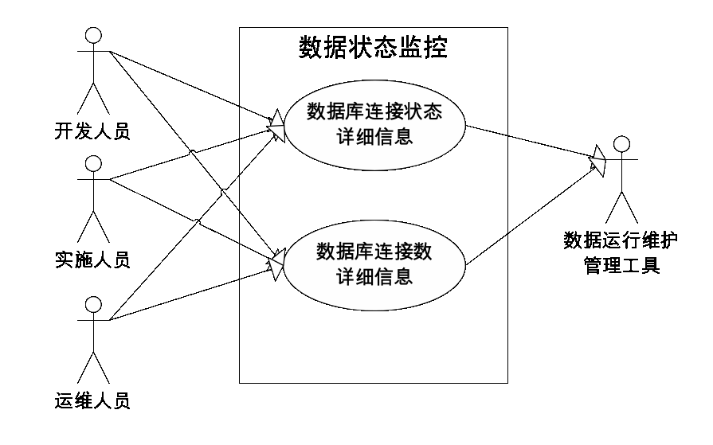
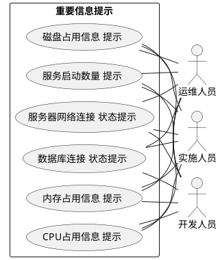

# 1_036 数据对档案

| 字段 | 值 |
|---|---|
| doc | 06运行支撑服务软件需求规格说明-终稿 |
| section | 3.2.1.1 |
| image_caption | 图6 重要信息提示用例图 |
| table_caption | 表4 重要信息提示所有能力能力标识 |

## 原始图片

*图6 重要信息提示用例图*

## 结构图

*来源: born-digital导出(usecase, 10节点/18边)*
*类型经几何启发式精化(Master类型识别失败的图, 投影层推断, canonical锚点不变)*

*用例图以PlantUML渲染(UML母语): 小人=参与者 | 椭圆=用例 | 矩形框=系统边界 | 实线=关联 | 虚线=include/extend*

Mermaid兼容投影(通用md渲染器可显示)

DOT源码(完整语义, graphviz可渲染)

### 锚点节点结构

| # | 文本 | 类型 |
|---|---|---|
| 1 | 实施人员 | actor |
| 2 | 内存占用信息
提示 | usecase |
| 3 | CPU占用信息
提示 | usecase |
| 4 | 重要信息提示 | boundary |
| 5 | 磁盘占用信息
提示 | usecase |
| 6 | 服务启动数量
提示 | usecase |
| 7 | 服务器网络连接
状态提示 | usecase |
| 8 | 数据库连接
状态提示 | usecase |
| 9 | 开发人员 | actor |
| 10 | 运维人员 | actor |

## 表格内容

| 序号 | Use case名称 | 项目唯一标识符 | 需求描述 | 需求重用 | 方式 名称 | 运行 状态 | 对应的任务书功能/性能 |
|---|---|---|---|---|---|---|---|
| 1 | CPU占用信息提示 | PZXQ-YXZCFW-GN-XTYXZ | 能够显示计算机CPU占用状态信息 | 新增 | 桌面、平板、手持 | 开发阶段、集成阶段、运行阶段 | 4.1.1 a) |
| 2 | 内存占用信息提示 | PZXQ-YXZCFW-GN-XTYXZ | 能够显示计算机内存占用状态信息 | 新增 | 桌面、平板、手持 | 开发阶段、集成阶段、运行阶段 | 4.1.1 a) |
| 3 | 磁盘占用信息提示 | PZXQ-YXZCFW-GN-XTYXZ | 能够显示计算机磁盘占用状态信息 | 新增 | 桌面、平板、手持 | 开发阶段、集成阶段、运行阶段 | 4.1.1 a) |
| 4 | 服务启动数量提示 | PZXQ-YXZCFW-GN-XTYXZ | 能够显示计算机服务启动数量 | 新增 | 桌面、平板、手持 | 开发阶段、集成阶段、运行阶段 | 4.1.1 a) |
| 5 | 数据库连接状态提示 | PZXQ-YXZCFW-GN-XTYXZ | 能够显示计算机数据库连接状态 | 新增 | 桌面、平板、手持 | 开发阶段、集成阶段、运行阶段 | 4.1.1 a) |
| 6 | 服务器网络连接状态提示 | PZXQ-YXZCFW-GN-XTYXZ | 能够显示计算机与服务器网络连接状态 | 新增 | 桌面、平板、手持 | 开发阶段、集成阶段、运行阶段 | 4.1.1 a) |

## 正文

重要信息提示能够对系统运行过程中的重要信息包括计算机CPU占用信息、内存占用信息、磁盘占用信息、服务启动数量、数据库连接状态、本机与服务器网络连通状态进行显示。功能用例图如图6所示。
