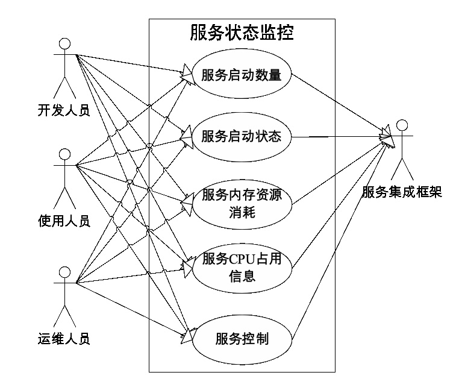
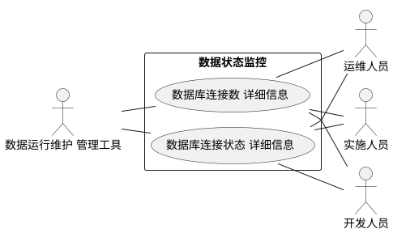
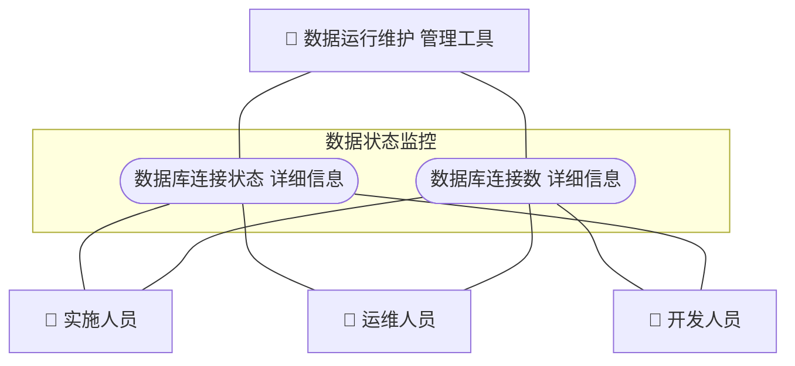
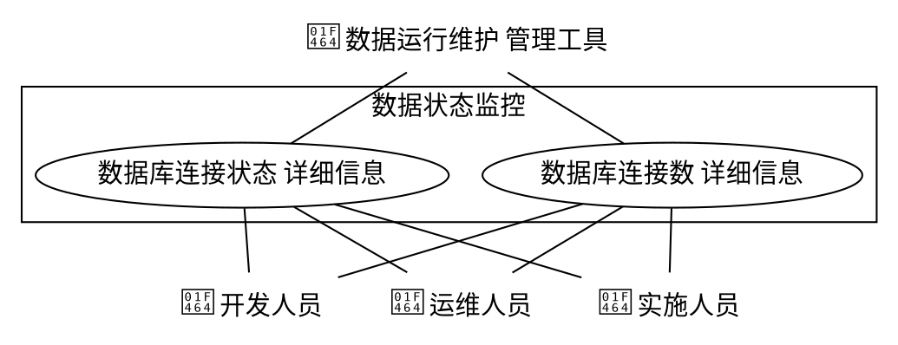

# 1_038 数据对档案

| 字段 | 值 |
|---|---|
| doc | 06运行支撑服务软件需求规格说明-终稿 |
| section | 3.2.1.3 |
| image_caption | 图8 数据状态监控用例图 |
| table_caption | 表16 数据状态监控所有能力标识 |

## 原始图片

*图8 数据状态监控用例图*

## 结构图

*来源: born-digital导出(usecase, 7节点/8边)*
*类型经几何启发式精化(Master类型识别失败的图, 投影层推断, canonical锚点不变)*

*用例图以PlantUML渲染(UML母语): 小人=参与者 | 椭圆=用例 | 矩形框=系统边界 | 实线=关联 | 虚线=include/extend*

Mermaid兼容投影(通用md渲染器可显示)

DOT源码(完整语义, graphviz可渲染)

### 锚点节点结构

| # | 文本 | 类型 |
|---|---|---|
| 1 | 实施人员 | actor |
| 2 | 数据库连接数
详细信息 | usecase |
| 3 | 数据库连接状态
详细信息 | usecase |
| 4 | 数据状态监控 | boundary |
| 5 | 数据运行维护
管理工具 | actor |
| 6 | 开发人员 | actor |
| 7 | 运维人员 | actor |
| 8 |   | other |

## 表格内容

| 序号 | Use case名称 | 项目唯一标识符 | 需求描述 | 需求重用 | 方式 名称 | 运行 状态 | 对应的任务书功能/性能 |
|---|---|---|---|---|---|---|---|
| 1 | 数据库连接状态详细信息 | PZXQ-YXZCFW-GN-XTYXZ | 能够读取计算机的数据库连接状态详细信息， | 新增 | 桌面、平板、手持 | 开发阶段、集成阶段、运行阶段 | 4.1.1 c) |
| 2 | 数据库连接数详细信息 | PZXQ-YXZCFW-GN-XTYXZ | 能够读取计算机的数据库连接数详细信息，对 | 新增 | 桌面、平板、手持 | 开发阶段、集成阶段、运行阶段 | 4.1.1 c) |

## 正文

能够读取计算机的数据库连接状态、数据库最大连接数、数据库当前连接数信息，对以上数据进行汇总并进行显示。用例图如图8所示。
