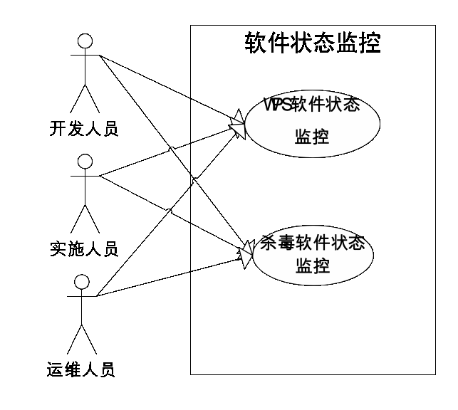
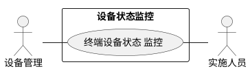
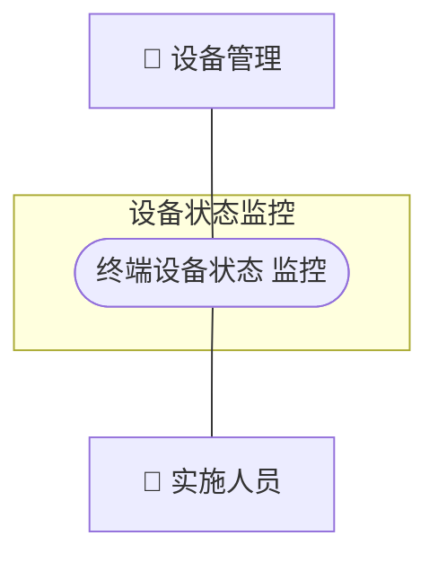
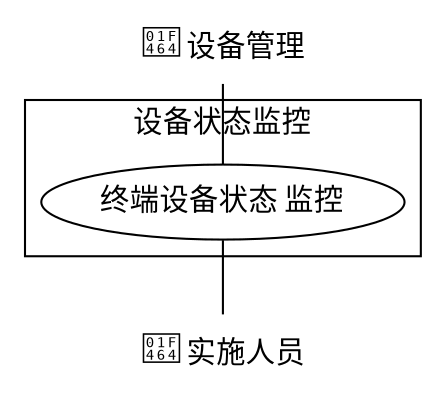

# 1_039 数据对档案

| 字段 | 值 |
|---|---|
| doc | 06运行支撑服务软件需求规格说明-终稿 |
| section | 3.2.1.4 |
| image_caption | 图9 设备状态监控用例图 |
| table_caption | 表19 设备状态监控所有能力标识 |

## 原始图片

*图9 设备状态监控用例图*

## 结构图

*⚠ 结构经census重对齐: 旧锚点(oleObject4.bin:page1.xml)与图片不符, 已切换到与image.png内容一致的锚点(oleObject9.bin:page1.xml, align_score=1.0)*

*来源: born-digital导出(usecase, 4节点/2边)*
*类型经几何启发式精化(Master类型识别失败的图, 投影层推断, canonical锚点不变)*

*用例图以PlantUML渲染(UML母语): 小人=参与者 | 椭圆=用例 | 矩形框=系统边界 | 实线=关联 | 虚线=include/extend*

Mermaid兼容投影(通用md渲染器可显示)

DOT源码(完整语义, graphviz可渲染)

### 锚点节点结构

| # | 文本 | 类型 |
|---|---|---|
| 1 | 实施人员 | actor |
| 2 | 设备状态监控 | boundary |
| 3 | 终端设备状态
监控 | usecase |
| 4 | 设备管理 | actor |

## 表格内容

| 序号 | Use case名称 | 项目唯一标识符 | 需求描述 | 需求重用 | 方式 名称 | 运行状态 | 对应的任务书功能/性能 |
|---|---|---|---|---|---|---|---|
| 1 | 终端设备状态监控 | PZXQ-YXZCFW-GN-XTYXZ | 能够显示车内终端的在线信息、终端用户登陆 | 新增 | 桌面、平板、手持 | 运行阶段 | 4.1.1 f) |

## 正文

能够显示车内终端的在线信息、终端用户登陆信息。用例图如图9所示。
