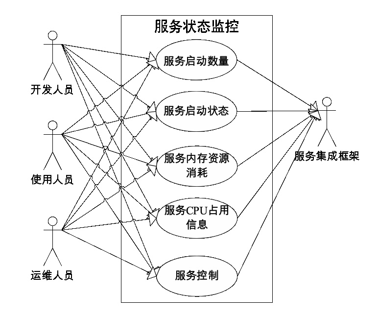
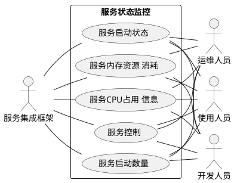
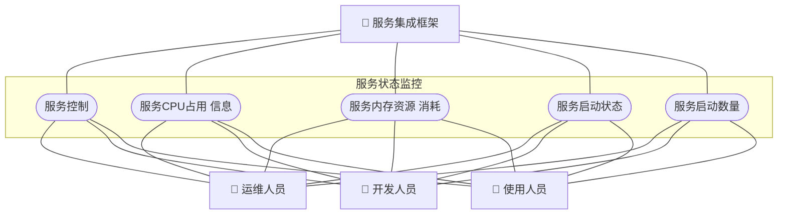
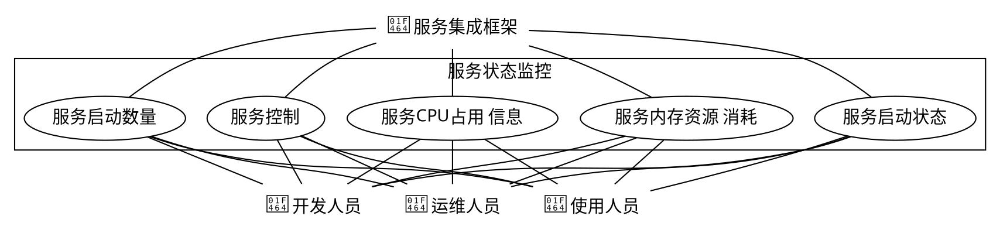

# 1_040 数据对档案

| 字段 | 值 |
|---|---|
| doc | 06运行支撑服务软件需求规格说明-终稿 |
| section | 3.2.1.5 |
| image_caption | 图10 服务状态监控用例图 |
| table_caption | 表21 服务状态监控所有能力标识 |

## 原始图片

*图10 服务状态监控用例图*

## 结构图

*来源: born-digital导出(usecase, 10节点/20边)*
*类型经几何启发式精化(Master类型识别失败的图, 投影层推断, canonical锚点不变)*

*用例图以PlantUML渲染(UML母语): 小人=参与者 | 椭圆=用例 | 矩形框=系统边界 | 实线=关联 | 虚线=include/extend*

Mermaid兼容投影(通用md渲染器可显示)

DOT源码(完整语义, graphviz可渲染)

### 锚点节点结构

| # | 文本 | 类型 |
|---|---|---|
| 1 | 使用人员 | actor |
| 2 | 服务启动数量 | usecase |
| 3 | 服务状态监控 | boundary |
| 4 | 服务启动状态 | usecase |
| 5 | 服务集成框架 | actor |
| 6 | 服务内存资源
消耗 | usecase |
| 7 | 服务CPU占用
信息 | usecase |
| 8 | 服务控制 | usecase |
| 9 | 开发人员 | actor |
| 10 | 运维人员 | actor |

## 表格内容

| 序号 | Use case名称 | 项目唯一标识符 | 需求描述 | 需求 重用 | 方式 名称 | 运行 状态 | 对应的任务书功能/性能 |
|---|---|---|---|---|---|---|---|
| 1 | 服务启动数量 | PZXQ-YXZCFW-GN-XTYXZ | 能够接收服务支撑框架提供的服务启动数量信 | 改进 | 桌面、平板、手持 | 开发阶段、集成阶段、运行阶段 | 4.1.1 d) |
| 2 | 服务启动状态 | PZXQ-YXZCFW-GN-XTYXZ | 能够接收服务支撑框架提供的服务启动状态， | 改进 | 桌面、平板、手持 | 开发阶段、集成阶段、运行阶段 | 4.1.1 d) |
| 3 | 服务内存资源消耗 | PZXQ-YXZCFW-GN-XTYXZ | 能够接收服务支撑框架提供的服务内存资源消 | 新增 | 桌面、平板、手持 | 开发阶段、集成阶段、运行阶段 | 4.1.1 d) |
| 4 | 服务CPU占用信息 | PZXQ-YXZCFW-GN-XTYXZ | 能够接收服务CPU占用信息，以表格方式进 | 新增 | 桌面、平板、手持 | 开发阶段、集成阶段、运行阶段 | 4.1.1 d) |
| 5 | 服务控制 | PZXQ-YXZCFW-GN-XTYXZ | 支持对服务的启停控制 | 改进 | 桌面、平板、手持 | 开发阶段、集成阶段、运行阶段 | 4.1.1 d) |

## 正文

能够接收服务支撑框架提供的服务启动数量、服务启动状态、服务内存资源消耗和CPU占用信息，以表格方式进行显示，支持对服务的启停控制。用例图如图10所示。
