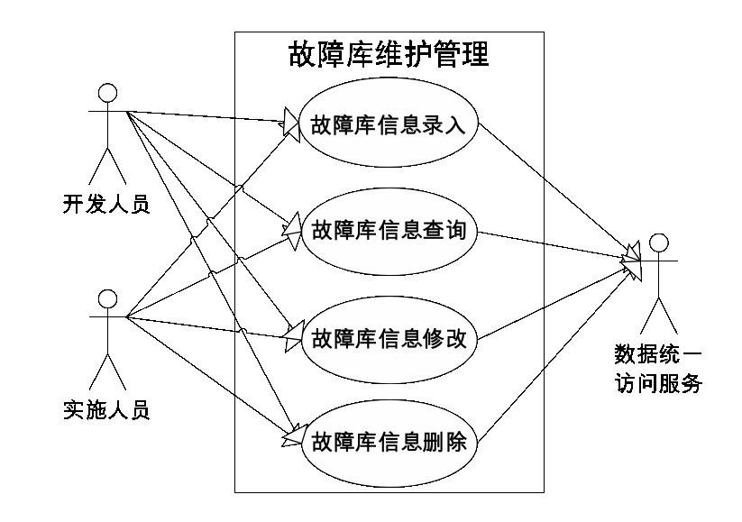
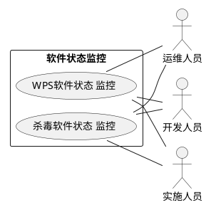
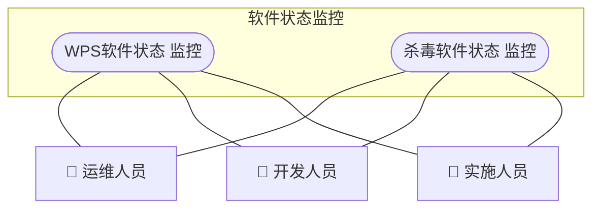
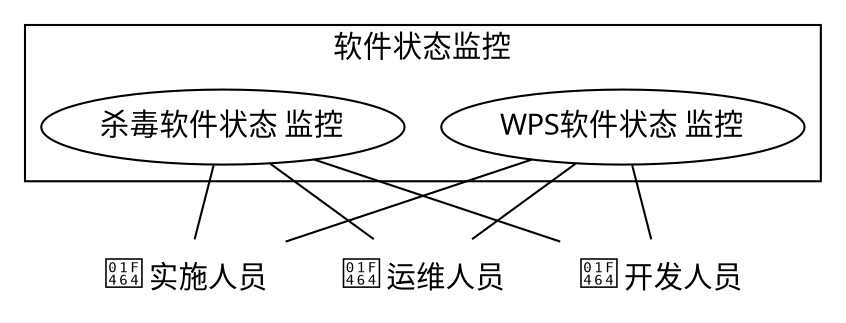

# 1_041 数据对档案

| 字段 | 值 |
|---|---|
| doc | 06运行支撑服务软件需求规格说明-终稿 |
| section | 3.2.1.6 |
| image_caption | 图11 软件状态监控用例图 |
| table_caption | 表27 软件状态监控所有能力标识 |

## 原始图片

*图11 软件状态监控用例图*

## 结构图

*来源: born-digital导出(usecase, 6节点/6边)*
*类型经几何启发式精化(Master类型识别失败的图, 投影层推断, canonical锚点不变)*

*用例图以PlantUML渲染(UML母语): 小人=参与者 | 椭圆=用例 | 矩形框=系统边界 | 实线=关联 | 虚线=include/extend*

Mermaid兼容投影(通用md渲染器可显示)

DOT源码(完整语义, graphviz可渲染)

### 锚点节点结构

| # | 文本 | 类型 |
|---|---|---|
| 1 | 开发人员 | actor |
| 2 | WPS软件状态
监控 | usecase |
| 3 | 软件状态监控 | boundary |
| 4 | 杀毒软件状态
监控 | usecase |
| 5 | 实施人员 | actor |
| 6 | 运维人员 | actor |

## 表格内容

| 序号 | Use case名称 | 项目唯一标识符 | 需求描述 | 需求重用 | 方式名称 | 运行 状态 | 对应的任务书功能/性能 |
|---|---|---|---|---|---|---|---|
| 1 | WPS软件状态监控 | PZXQ-YXZCFW-GN-XTYXZ | 能够获取计算机安装的WPS软件的版本号、 | 新增 | 桌面 | 开发阶段、集成阶段、运行阶段 | 4.1.1 e) |
| 2 | 杀毒软件状态监控 | PZXQ-YXZCFW-GN-XTYXZ | 能够获取计算机安装的杀毒软件的版本号、安 | 新增 | 桌面 | 开发阶段、集成阶段、运行阶段 | 4.1.1 e) |

## 正文

能够获取计算机安装的WPS和杀毒软件的版本号、安装位置和启动状态并进行显示。用例图如图11所示。
