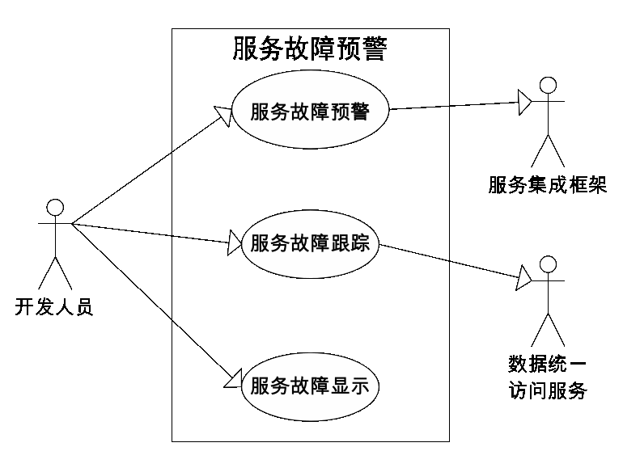
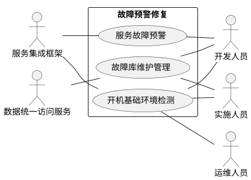
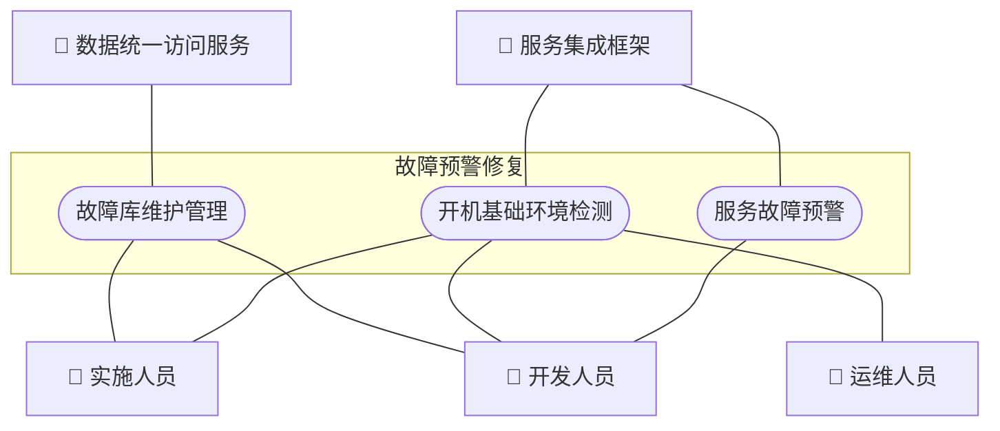
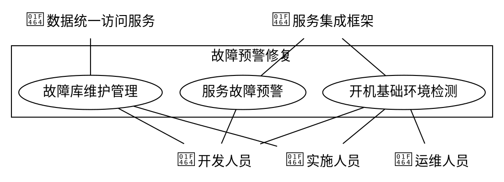

# 1_042 数据对档案

| 字段 | 值 |
|---|---|
| doc | 06运行支撑服务软件需求规格说明-终稿 |
| section | 3.2.2 |
| image_caption | 图12 故障预警修复用例图 |
| table_caption | 表30 故障预警修复所有能力标识 |

## 原始图片

*图12 故障预警修复用例图*

## 结构图

*⚠ 结构经census重对齐: 旧锚点(oleObject15.bin:page1.xml)与图片不符, 已切换到与image.png内容一致的锚点(oleObject12.bin:page1.xml, align_score=1.0)*

*来源: born-digital导出(usecase, 9节点/9边)*
*类型经几何启发式精化(Master类型识别失败的图, 投影层推断, canonical锚点不变)*

*用例图以PlantUML渲染(UML母语): 小人=参与者 | 椭圆=用例 | 矩形框=系统边界 | 实线=关联 | 虚线=include/extend*

Mermaid兼容投影(通用md渲染器可显示)

DOT源码(完整语义, graphviz可渲染)

### 锚点节点结构

| # | 文本 | 类型 |
|---|---|---|
| 1 | 开发人员 | actor |
| 2 | 数据统一访问服务 | actor |
| 3 | 服务集成框架 | actor |
| 4 | 开机基础环境检测 | usecase |
| 5 | 故障预警修复 | boundary |
| 6 | 服务故障预警 | usecase |
| 7 | 故障库维护管理 | usecase |
| 8 | 实施人员 | actor |
| 9 | 运维人员 | actor |

## 表格内容

| 序号 | Use case名称 | 项目唯一标识符 | 需求描述 | 需求重用 | 方式 名称 | 运行 状态 | 对应的任务书功能/性能 |
|---|---|---|---|---|---|---|---|
| 1 | 故障库维护管理 | PZXQ-YXZCFW-GN-GZYJX | 提供故障策略库管理功能，支持用户录入故障 | 新增 | 桌面 | 开发阶段、运行阶段 | 4.1.2 a） |
| 2 | 服务故障预警 | PZXQ-YXZCFW-GN-GZYJX | 能够对系统运行过程中的服务崩溃信息进行代 | 新增 | 桌面 | 开发 阶段 | 4.1.2 b） |
| 3 | 开机基础环境检测 | PZXQ-YXZCFW-GN-GZYJX | 提供开机进行环境自检功能，检测网卡的启动 | 新增 | 桌面 | 开发阶段、集成阶段、运行阶段 | 4.1.2 c） |

## 正文

故障预警修复功能包括：故障库维护管理、服务故障预警、开机基础环境检测，其功能用例如图12所示。
