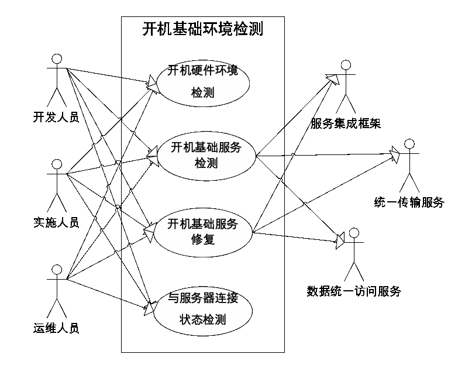
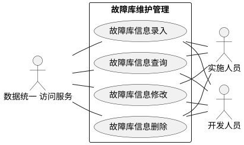
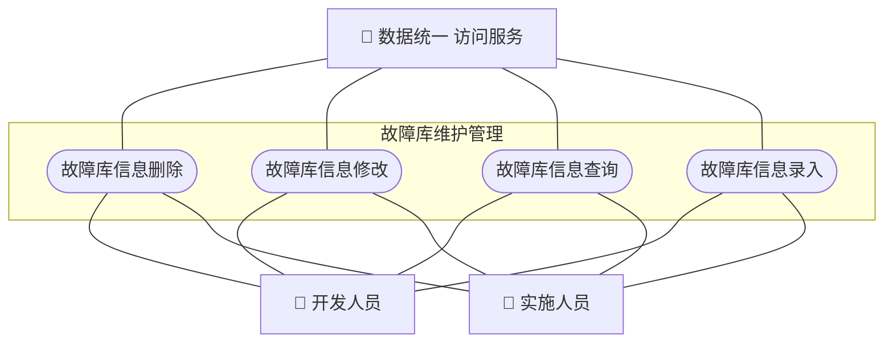
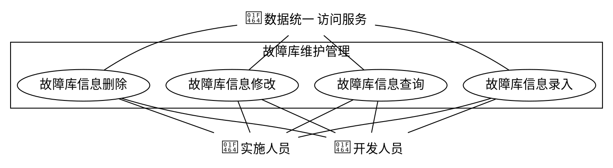

# 1_043 数据对档案

| 字段 | 值 |
|---|---|
| doc | 06运行支撑服务软件需求规格说明-终稿 |
| section | 3.2.2.1 |
| image_caption | 图14 故障库维护管理用例图 |
| table_caption | 表31 故障库维护管理所有能力标识 |

## 原始图片

*图14 故障库维护管理用例图*

## 结构图

*来源: born-digital导出(usecase, 8节点/12边)*
*类型经几何启发式精化(Master类型识别失败的图, 投影层推断, canonical锚点不变)*

*用例图以PlantUML渲染(UML母语): 小人=参与者 | 椭圆=用例 | 矩形框=系统边界 | 实线=关联 | 虚线=include/extend*

Mermaid兼容投影(通用md渲染器可显示)

DOT源码(完整语义, graphviz可渲染)

### 锚点节点结构

| # | 文本 | 类型 |
|---|---|---|
| 1 | 实施人员 | actor |
| 2 | 故障库信息录入 | usecase |
| 3 | 故障库维护管理 | boundary |
| 4 | 故障库信息查询 | usecase |
| 5 | 数据统一
访问服务 | actor |
| 6 | 故障库信息修改 | usecase |
| 7 | 故障库信息删除 | usecase |
| 8 | 开发人员 | actor |

## 表格内容

| 序号 | Use case名称 | 项目唯一标识符 | 需求描述 | 需求重用 | 方式名称 | 运行状态 | 对应的任务书功能/性能 |
|---|---|---|---|---|---|---|---|
| 1 | 故障库信息录入 | PZXQ-YXZCFW-GN-GZYJX | 支持用户向故障库录入故障信息 | 新增 | 桌面 | 开发阶段、运行阶段 | 4.1.2 a) |
| 2 | 故障库信息查询 | PZXQ-YXZCFW-GN-GZYJX | 支持用户查询故障库的故障信息 | 新增 | 桌面 | 开发阶段、运行阶段 | 4.1.2 a) |
| 3 | 故障库信息修改 | PZXQ-YXZCFW-GN-GZYJX | 支持用户修改故障库的故障信息 | 新增 | 桌面 | 开发阶段、运行阶段 | 4.1.2 a) |
| 4 | 故障库信息删除 | PZXQ-YXZCFW-GN-GZYJX | 支持用户删除故障库的故障信息 | 新增 | 桌面 | 开发阶段、运行阶段 | 4.1.2 a) |

## 正文

故障库维护管理提供故障策略库管理功能，支持用户录入故障信息、故障原因和故障修复策略信息，支持故障修复策略信息的查询、增加、删除和修改等。用例图如图14所示。
