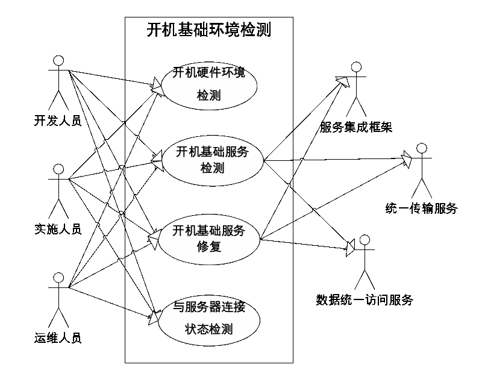
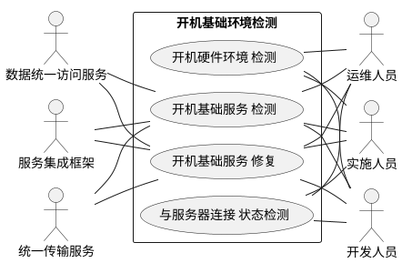
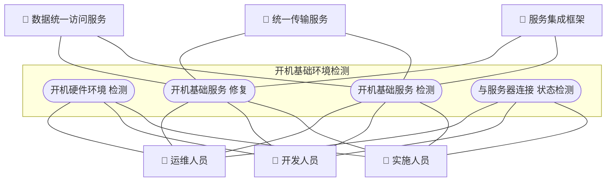
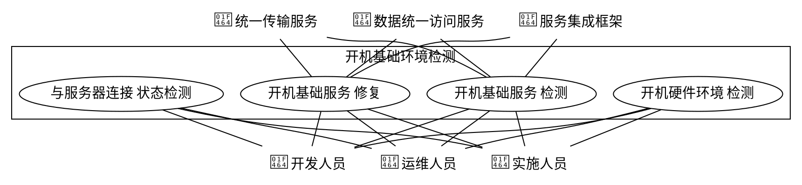

# 1_045 数据对档案

| 字段 | 值 |
|---|---|
| doc | 06运行支撑服务软件需求规格说明-终稿 |
| section | 3.2.2.3 |
| image_caption | 图16 开机基础环境检测用例图 |
| table_caption | 表40 开机基础环境检测所有能力标识 |

## 原始图片

*图16 开机基础环境检测用例图*

## 结构图

*来源: born-digital导出(usecase, 11节点/18边)*
*类型经几何启发式精化(Master类型识别失败的图, 投影层推断, canonical锚点不变)*

*用例图以PlantUML渲染(UML母语): 小人=参与者 | 椭圆=用例 | 矩形框=系统边界 | 实线=关联 | 虚线=include/extend*

Mermaid兼容投影(通用md渲染器可显示)

DOT源码(完整语义, graphviz可渲染)

### 锚点节点结构

| # | 文本 | 类型 |
|---|---|---|
| 1 | 实施人员 | actor |
| 2 | 开机硬件环境
检测 | usecase |
| 3 | 开机基础环境检测 | boundary |
| 4 | 开机基础服务
检测 | usecase |
| 5 | 开机基础服务
修复 | usecase |
| 6 | 与服务器连接
状态检测 | usecase |
| 7 | 服务集成框架 | actor |
| 8 | 统一传输服务 | actor |
| 9 | 数据统一访问服务 | actor |
| 10 | 开发人员 | actor |
| 11 | 运维人员 | actor |

## 表格内容

| 序号 | Use case名称 | 项目唯一标识符 | 需求描述 | 需求重用 | 方式 名称 | 运行 状态 | 对应的任务书功能/性能 |
|---|---|---|---|---|---|---|---|
| 1 | 开机硬件环境检测 | PZXQ-YXZCFW-GN-GZYJX | 检测网卡的启动情况，检测内存、硬盘资源是 | 新增 | 桌面 | 开发阶段、集成阶段、运行阶段 | 4.1.2 c) |
| 2 | 开机基础服务检测 | PZXQ-YXZCFW-GN-GZYJX | 检测系统基础服务包括服务集成框架、数据统 | 新增 | 桌面 | 开发阶段、集成阶段、运行阶段 | 4.1.2 c) |
| 3 | 开机基础服务修复 | PZXQ-YXZCFW-GN-GZYJX | 若系统基础服务启动存在异常，则引导用户进 | 新增 | 桌面 | 开发阶段、集成阶段、运行阶段 | 4.1.2 c) |
| 4 | 与服务器连接状态检测 | PZXQ-YXZCFW-GN-GZYJX | 检测与服务器网络连接状态，将上述信息的检 | 新增 | 桌面 | 开发阶段、集成阶段、运行阶段 | 4.1.2 c) |

## 正文

提供开机进行环境自检功能，检测网卡的启动情况，检测内存、硬盘资源是否满足系统的正常运行，检测系统基础服务包括服务集成框架、数据统一访问服务、统一传输服务的启动状态，检测与服务器网络连接状态，将上述信息的检测结果提示用户，若系统基础服务启动存在异常，则引导用户进行修复。用例图如图16所示。
