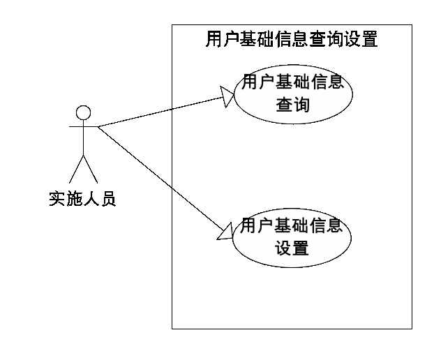
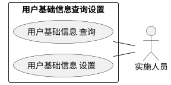
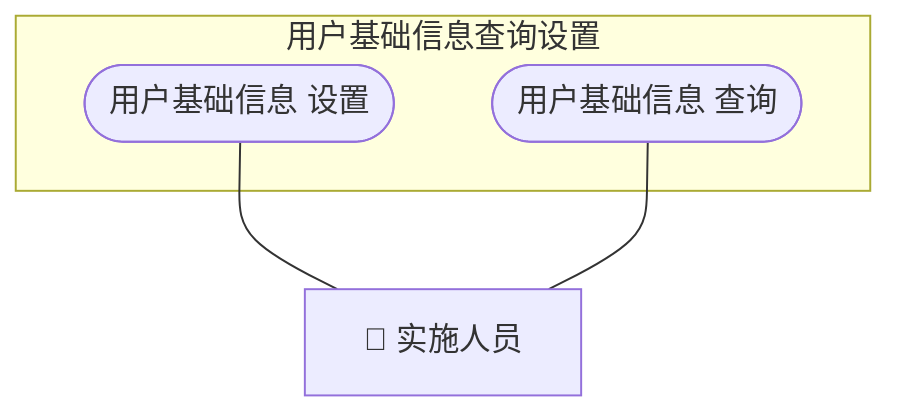
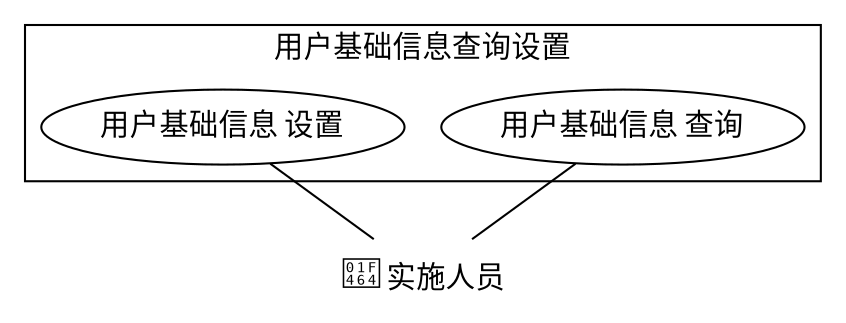

# 1_046 数据对档案

| 字段 | 值 |
|---|---|
| doc | 06运行支撑服务软件需求规格说明-终稿 |
| section | 3.2.3.1 |
| image_caption | 图20 用户基础信息查询设置用例图 |
| table_caption | 表46 用户基础信息查询设置所有能力能力标识 |

## 原始图片

*图20 用户基础信息查询设置用例图*

## 结构图

*来源: born-digital导出(usecase, 4节点/2边)*
*类型经几何启发式精化(Master类型识别失败的图, 投影层推断, canonical锚点不变)*

*用例图以PlantUML渲染(UML母语): 小人=参与者 | 椭圆=用例 | 矩形框=系统边界 | 实线=关联 | 虚线=include/extend*

Mermaid兼容投影(通用md渲染器可显示)

DOT源码(完整语义, graphviz可渲染)

### 锚点节点结构

| # | 文本 | 类型 |
|---|---|---|
| 1 | 实施人员 | actor |
| 2 | 用户基础信息
查询 | usecase |
| 3 | 用户基础信息查询设置 | boundary |
| 4 | 用户基础信息
设置 | usecase |

## 表格内容

| 序号 | Use case名称 | 项目唯一标识符 | 需求描述 | 需求重用 | 方式 名称 | 运行状态 | 对应的任务书功能/性能 |
|---|---|---|---|---|---|---|---|
| 1 | 用户基础信息设置 | PZXQ-YXZCFW-GN-XTJCX | 提供接口支持对当前登录的用户名、用户ID | 新增 | 桌面、平板、手持 | 运行阶段 | 4.1.3 a) |
| 2 | 用户基础信息查询 | PZXQ-YXZCFW-GN-XTJCX | 提供接口支持对当前登录的用户名、用户ID | 新增 | 桌面、平板、手持 | 运行阶段 | 4.1.3 a) |

## 正文

提供接口支持对当前登录的用户名、用户ID、所属编组、部署车辆等信息进行设置和查询，用例图如图20所示。
