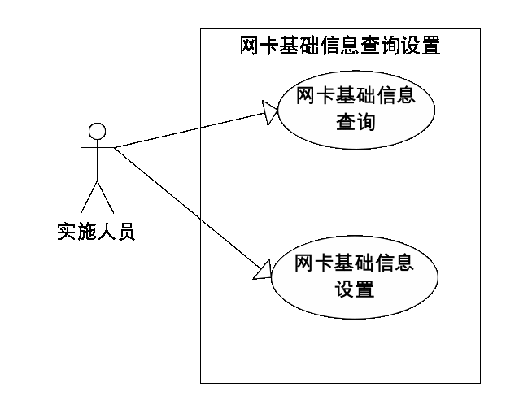
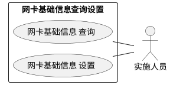
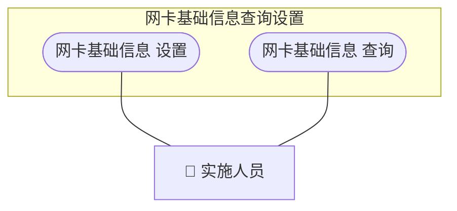

# 1_049 数据对档案

| 字段 | 值 |
|---|---|
| doc | 06运行支撑服务软件需求规格说明-终稿 |
| section | 3.2.3.4 |
| image_caption | 图23 网卡基础信息查询设置用例图 |
| table_caption | 表55 网卡基础信息查询设置所有能力标识 |

## 原始图片

*图23 网卡基础信息查询设置用例图*

## 结构图

*⚠ 结构经census重对齐: 旧锚点(oleObject21.bin:page1.xml)与图片不符, 已切换到与image.png内容一致的锚点(oleObject23.bin:page1.xml, align_score=1.0)*

*来源: born-digital导出(usecase, 4节点/2边)*
*类型经几何启发式精化(Master类型识别失败的图, 投影层推断, canonical锚点不变)*

*用例图以PlantUML渲染(UML母语): 小人=参与者 | 椭圆=用例 | 矩形框=系统边界 | 实线=关联 | 虚线=include/extend*

Mermaid兼容投影(通用md渲染器可显示)

DOT源码(完整语义, graphviz可渲染)

### 锚点节点结构

| # | 文本 | 类型 |
|---|---|---|
| 1 | 实施人员 | actor |
| 2 | 网卡基础信息
查询 | usecase |
| 3 | 网卡基础信息查询设置 | boundary |
| 4 | 网卡基础信息
设置 | usecase |

## 表格内容

| 序号 | Use case名称 | 项目唯一标识符 | 需求描述 | 需求重用 | 方式/名称 | 对应的任务书功能/性能 |
|---|---|---|---|---|---|---|
| 1 | 网卡基础信息设置 | PZXQ-YXZCFW-GN-XTJCX | 提供对当前计算机网卡信息的设置 | 无 | 桌面、平板、手持 | 4.1.3 d) |
| 2 | 网卡基础信息查询 | PZXQ-YXZCFW-GN-XTJCX | 提供对当前计算机网卡信息的查询 | 无 | 桌面、平板、手持 | 4.1.3 d) |

## 正文

提供对当前计算机网卡信息的查询和设置，用例图如图23所示。
