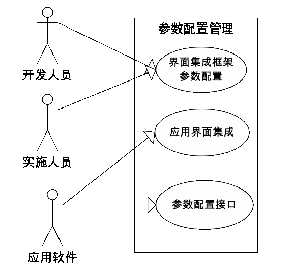
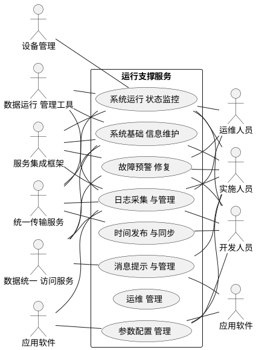
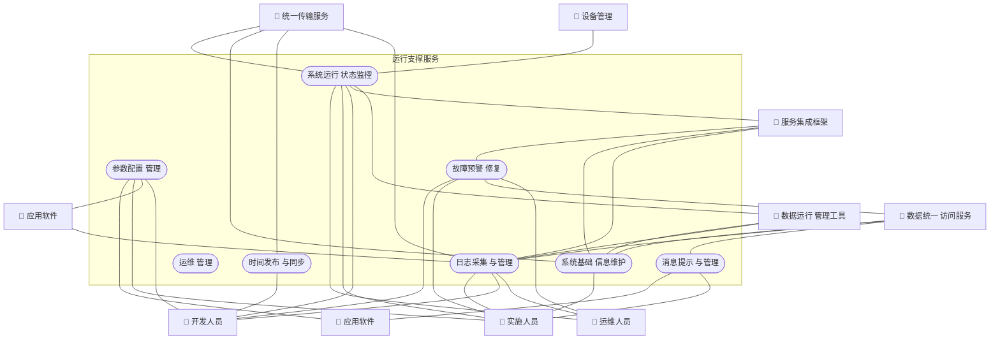

```dot
digraph G {
  rankdir=TB;
  node [fontname="Microsoft YaHei"];
  N1 [shape=plaintext, label="👤 实施人员"];
  N2 [shape=plaintext, label="👤 数据运行 管理工具"];
  N3 [shape=plaintext, label="👤 服务集成框架"];
  N19 [shape=plaintext, label="👤 数据统一 访问服务"];
  N20 [shape=plaintext, label="👤 统一传输服务"];
  N21 [shape=plaintext, label="👤 设备管理"];
  N22 [shape=plaintext, label="👤 应用软件"];
  N26 [shape=plaintext, label="👤 应用软件"];
  N78 [shape=plaintext, label="👤 运维人员"];
  N79 [shape=plaintext, label="👤 开发人员"];
  subgraph cluster_11 {
    label="运行支撑服务";
    N9 [shape=ellipse, label="系统基础 信息维护"];
    N10 [shape=ellipse, label="系统运行 状态监控"];
    N12 [shape=ellipse, label="参数配置 管理"];
    N13 [shape=ellipse, label="故障预警 修复"];
    N14 [shape=ellipse, label="时间发布 与同步"];
    N15 [shape=ellipse, label="日志采集 与管理"];
    N16 [shape=ellipse, label="运维 管理"];
    N17 [shape=ellipse, label="消息提示 与管理"];
  }
  N10 -> N2 [dir=none];
  N10 -> N3 [dir=none];
  N15 -> N78 [dir=none];
  N12 -> N79 [dir=none];
  N13 -> N78 [dir=none];
  N10 -> N79 [dir=none];
  N12 -> N22 [dir=none];
  N13 -> N19 [dir=none];
  N10 -> N1 [dir=none];
  N13 -> N1 [dir=none];
  N9 -> N1 [dir=none];
  N12 -> N1 [dir=none];
  N14 -> N79 [dir=none];
  N15 -> N79 [dir=none];
  N17 -> N1 [dir=none];
  N12 -> N26 [dir=none];
  N17 -> N26 [dir=none];
  N19 -> N17 [dir=none];
  N19 -> N15 [dir=none];
  N21 -> N10 [dir=none];
  N22 -> N15 [dir=none];
  N20 -> N15 [dir=none];
  N2 -> N15 [dir=none];
  N3 -> N15 [dir=none];
  N20 -> N14 [dir=none];
  N19 -> N9 [dir=none];
  N20 -> N9 [dir=none];
  N3 -> N9 [dir=none];
  N2 -> N9 [dir=none];
  N3 -> N13 [dir=none];
  N20 -> N10 [dir=none];
  N15 -> N1 [dir=none];
  N13 -> N79 [dir=none];
  N10 -> N78 [dir=none];
}
```

# 1_050 数据对档案

| 字段 | 值 |
|---|---|
| doc | 06运行支撑服务软件需求规格说明-终稿 |
| section | 3.2.4 |
| image_caption | 图24 参数配置管理维护用例图 |
| table_caption | 表58 参数配置管理所有能力标识 |

## 原始图片

*图24 参数配置管理维护用例图*

## 结构图

*该图为复合图: image.png由2个Visio结构组成(贪心集覆盖并集召回100%, VLM文本匹配判定)*

### 组成部分 1/2 (oleObject3.bin:page1.xml)

*来源: born-digital导出(usecase, 19节点/34边)*
*类型经几何启发式精化(Master类型识别失败的图, 投影层推断, canonical锚点不变)*

*用例图以PlantUML渲染(UML母语): 小人=参与者 | 椭圆=用例 | 矩形框=系统边界 | 实线=关联 | 虚线=include/extend*

Mermaid兼容投影(通用md渲染器可显示)

DOT源码(完整语义, graphviz可渲染)

*⚠ 锚点Connect重建存在3个悬空连线端点(线端粘在无文本形状上被语义过滤跳过), 图示边数可能少于原图——渲染只呈现锚点事实, 不编造边; 独立证据可对照VLM通道提取(scene_vlm_extractions.json)*

### 组成部分 2/2 (oleObject32.bin:page1.xml)

*来源: born-digital导出(flowchart, 23节点/0边)*
*类型经几何启发式精化(Master类型识别失败的图, 投影层推断, canonical锚点不变)*

*状态图以PlantUML渲染(UML母语): [*]=起止 | 圆角框=状态 | 箭头标签=迁移事件*

Mermaid兼容投影(通用md渲染器可显示)

DOT源码(完整语义, graphviz可渲染)

*⚠ 锚点Connect重建存在3个悬空连线端点(线端粘在无文本形状上被语义过滤跳过), 图示边数可能少于原图——渲染只呈现锚点事实, 不编造边; 独立证据可对照VLM通道提取(scene_vlm_extractions.json)*

### 锚点节点结构

| # | 文本 | 类型 |
|---|---|---|
| 1 | 实施人员 | actor |
| 2 | 数据运行
管理工具 | actor |
| 3 | 服务集成框架 | actor |
| 4 | 系统基础
信息维护 | usecase |
| 5 | 系统运行
状态监控 | usecase |
| 6 | 运行支撑服务 | boundary |
| 7 | 参数配置
管理 | usecase |
| 8 | 故障预警
修复 | usecase |
| 9 | 时间发布
与同步 | usecase |
| 10 | 日志采集
与管理 | usecase |
| 11 | 运维
管理 | usecase |
| 12 | 消息提示
与管理 | usecase |
| 13 | 数据统一
访问服务 | actor |
| 14 | 统一传输服务 | actor |
| 15 | 设备管理 | actor |
| … | 共19个节点 | |

## 表格内容

| 序号 | Use case名称 | 项目唯一标识符 | 需求描述 | 需求重用 | 方式 名称 | 运行 状态 | 对应的任务书功能/性能 |
|---|---|---|---|---|---|---|---|
| 1 | 界面集成框架参数配置 | PZXQ-YXZCFW-GN-XTJCX | 能够对界面集成框架的分屏、字体大小、背景 | 改进 | 桌面、平板、手持 | 开发阶段、运行阶段 | 4.1.4 a) |
| 2 | 应用界面集成 | PZXQ-YXZCFW-GN-XTJCX | 提供参数配置界面二次开发接口，依据《界面 | 改进 | 桌面、平板、手持 | 开发阶段、运行阶段 | 4.1.4 b) |
| 3 | 参数配置接口 | PZXQ-YXZCFW-GN-XTJCX | 支持应用软件配置信息的写入、查询、删除、 | 新增 | 桌面、平板、手持 | 开发阶段、运行阶段 | 4.1.4 c) |

## 正文

参数配置管理功能包括：界面集成框架参数配置、应用界面集成、参数配置接口，其功能用例如图24所示。
