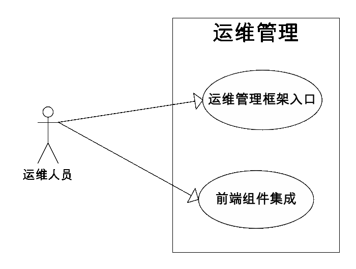
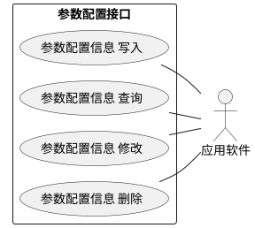
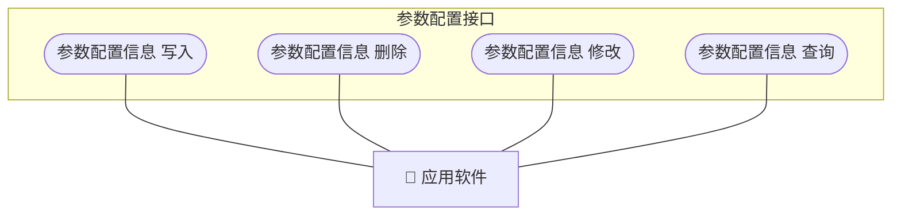
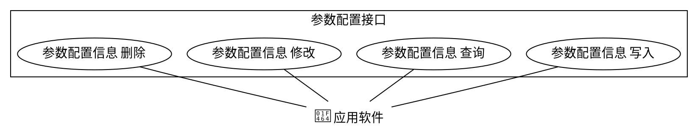

# 1_051 数据对档案

| 字段 | 值 |
|---|---|
| doc | 06运行支撑服务软件需求规格说明-终稿 |
| section | 3.2.4.3 |
| image_caption | 图26 参数配置接口用例图 |
| table_caption | 表61 参数配置接口所有能力标识 |

## 原始图片

*图26 参数配置接口用例图*

## 结构图

*来源: born-digital导出(usecase, 6节点/4边)*
*类型经几何启发式精化(Master类型识别失败的图, 投影层推断, canonical锚点不变)*

*用例图以PlantUML渲染(UML母语): 小人=参与者 | 椭圆=用例 | 矩形框=系统边界 | 实线=关联 | 虚线=include/extend*

Mermaid兼容投影(通用md渲染器可显示)

DOT源码(完整语义, graphviz可渲染)

### 锚点节点结构

| # | 文本 | 类型 |
|---|---|---|
| 1 | 应用软件 | actor |
| 2 | 参数配置信息
写入 | usecase |
| 3 | 参数配置接口 | boundary |
| 4 | 参数配置信息
查询 | usecase |
| 5 | 参数配置信息
修改 | usecase |
| 6 | 参数配置信息
删除 | usecase |

## 表格内容

| 序号 | Use case名称 | 项目唯一标识符 | 需求描述 | 需求重用 | 方式 名称 | 运行 状态 | 对应的任务书功能/性能 |
|---|---|---|---|---|---|---|---|
| 1 | 参数配置信息写入 | PZXQ-YXZCFW-GN-CSPZG | 支持应用软件配置信息的写入 | 新增 | 桌面、平板、手持 | 开发阶段、集成阶段、运行阶段 | 4.1.4 b) |
| 2 | 参数配置信息查询 | PZXQ-YXZCFW-GN-CSPZG | 支持应用软件配置信息的查询 | 新增 | 桌面、平板、手持 | 开发阶段、集成阶段、运行阶段 | 4.1.4 b) |
| 3 | 参数配置信息修改 | PZXQ-YXZCFW-GN-CSPZG | 支持应用软件配置信息的修改 | 新增 | 桌面、平板、手持 | 开发阶段、集成阶段、运行阶段 | 4.1.4 b) |
| 4 | 参数配置信息删除 | PZXQ-YXZCFW-GN-CSPZG | 支持应用软件配置信息的删除 | 新增 | 桌面、平板、手持 | 开发阶段、集成阶段、运行阶段 | 4.1.4 b) |

## 正文

支持应用软件配置信息的写入、查询、删除、修改，用例图如图26所示。
