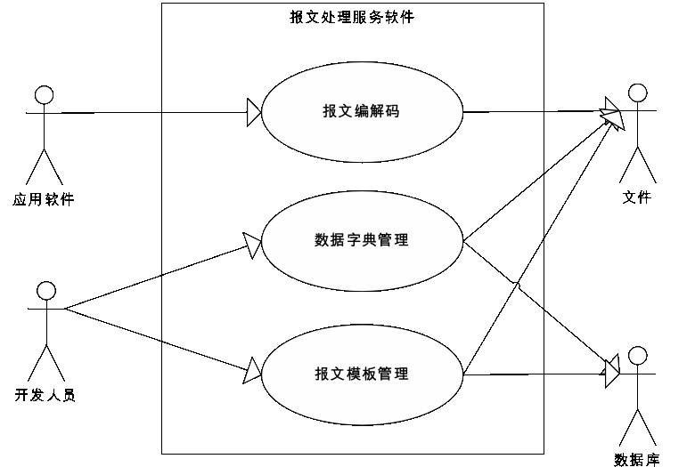
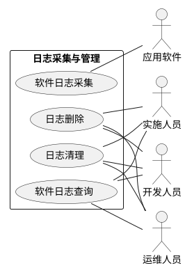
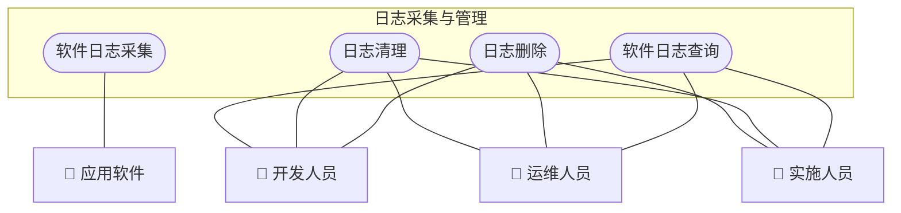
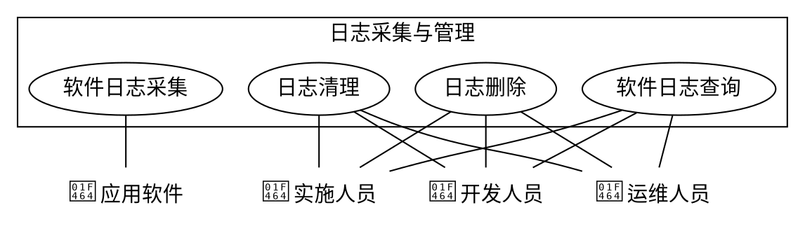

# 1_052 数据对档案

| 字段 | 值 |
|---|---|
| doc | 06运行支撑服务软件需求规格说明-终稿 |
| section | 3.2.5 |
| image_caption | 图27日志采集与管理用例图 |
| table_caption | 表66 日志采集与管理所有能力标识 |

## 原始图片

*图27日志采集与管理用例图*

## 结构图

*来源: born-digital导出(usecase, 9节点/10边)*
*类型经几何启发式精化(Master类型识别失败的图, 投影层推断, canonical锚点不变)*

*用例图以PlantUML渲染(UML母语): 小人=参与者 | 椭圆=用例 | 矩形框=系统边界 | 实线=关联 | 虚线=include/extend*

Mermaid兼容投影(通用md渲染器可显示)

DOT源码(完整语义, graphviz可渲染)

### 锚点节点结构

| # | 文本 | 类型 |
|---|---|---|
| 1 | 实施人员 | actor |
| 2 | 软件日志采集 | usecase |
| 3 | 日志采集与管理 | boundary |
| 4 | 软件日志查询 | usecase |
| 5 | 日志删除 | usecase |
| 6 | 日志清理 | usecase |
| 7 | 应用软件 | actor |
| 8 | 开发人员 | actor |
| 9 | 运维人员 | actor |

## 表格内容

| 序号 | Use case名称 | 项目唯一标识符 | 需求描述 | 需求重用 | 方式 名称 | 运行 状态 | 对应的任务书功能/性能 |
|---|---|---|---|---|---|---|---|
| 1 | 软件日志采集 | PZXQ-YXZCFW-GN-RZCJY | 提供软件日志记录接口，支持应用软件记录日 | 新增 | 桌面、平板、手持 | 开发阶段、集成阶段、运行阶段 | 4.1.6 a) |
| 2 | 软件日志查询 | PZXQ-YXZCFW-GN-RZCJY | 提供对软件日志文件的查询接口，支持对软件 | 新增 | 桌面、平板 | 开发阶段、集成阶段、运行阶段 | 4.1.6 b) |
| 3 | 日志删除 | PZXQ-YXZCFW-GN-RZCJY | 提供对软件日志文件的删除功能 | 新增 | 桌面、平板 | 开发阶段、集成阶段、运行阶段 | 4.1.6 c) |
| 4 | 日志清理 | PZXQ-YXZCFW-GN-RZCJY | 支持按照日志记录时间对日志文件进行自动清 | 新增 | 桌面、平板 | 开发阶段、集成阶段、运行阶段 | 4.1.6 d) |

## 正文

日志采集与管理功能包括：软件日志采集、软件日志查询、日志删除、日志清理，其功能用例如图27所示。
