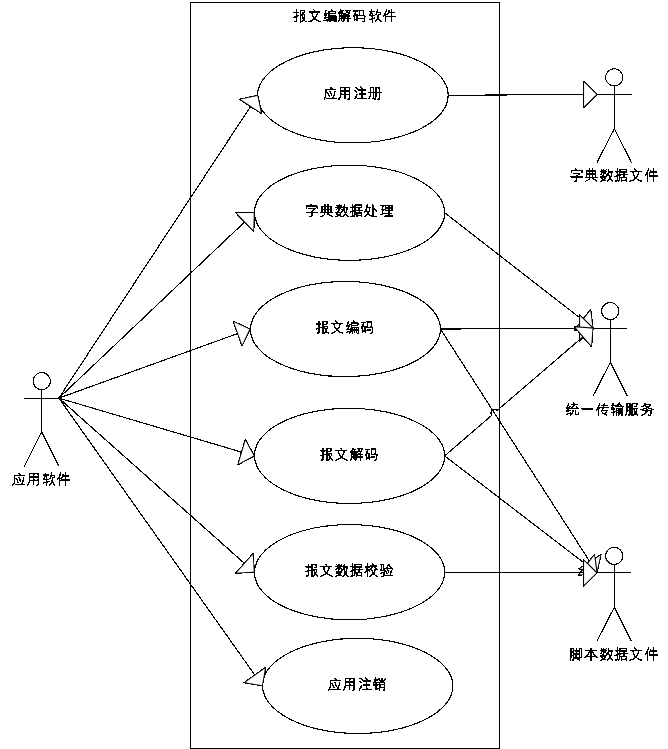
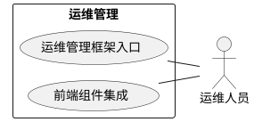
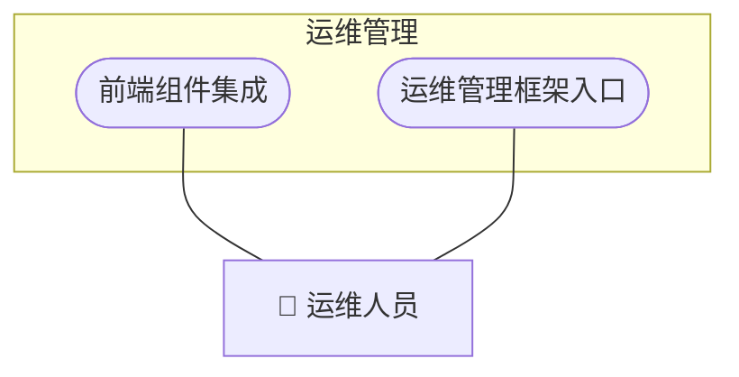
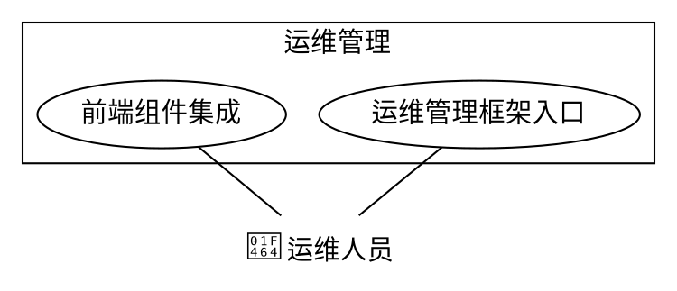

# 1_053 数据对档案

| 字段 | 值 |
|---|---|
| doc | 06运行支撑服务软件需求规格说明-终稿 |
| section | 3.2.6 |
| image_caption | 图29 运维管理用例图 |
| table_caption | 表71 运维管理所有能力标识 |

## 原始图片

*图29 运维管理用例图*

## 结构图

*来源: born-digital导出(usecase, 4节点/2边)*
*类型经几何启发式精化(Master类型识别失败的图, 投影层推断, canonical锚点不变)*

*用例图以PlantUML渲染(UML母语): 小人=参与者 | 椭圆=用例 | 矩形框=系统边界 | 实线=关联 | 虚线=include/extend*

Mermaid兼容投影(通用md渲染器可显示)

DOT源码(完整语义, graphviz可渲染)

### 锚点节点结构

| # | 文本 | 类型 |
|---|---|---|
| 1 | 运维人员 | actor |
| 2 | 运维管理框架入口 | usecase |
| 3 | 前端组件集成 | usecase |
| 4 | 运维管理 | boundary |

## 表格内容

| 序号 | Use case名称 | 项目唯一标识符 | 需求描述 | 需求 重用 | 方式 名称 | 运行 状态 | 对应的任务书功能/性能 |
|---|---|---|---|---|---|---|---|
| 1 | 运维管理框架入口功能 | PZXQ-YXZCFW-GN-YWGL- | 提供运维管理统一集成框架 | 新增 | 桌面 | 运行 阶段 | 4.1.7 a) |
| 2 | 前端组件集成功能 | PZXQ-YXZCFW-GN-YWGL- | 能够对用户管理、基础数据维护、地图数据维 | 新增 | 桌面 | 运行 阶段 | 4.1.7 b) |

## 正文

运维管理功能包括：运维管理框架入口功能、前端组件集成功能，其功能用例如图29所示。
