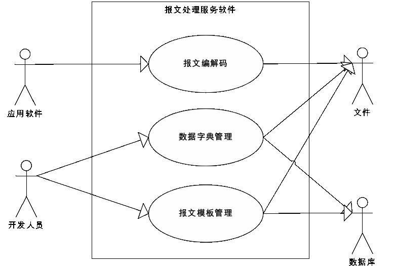
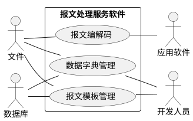
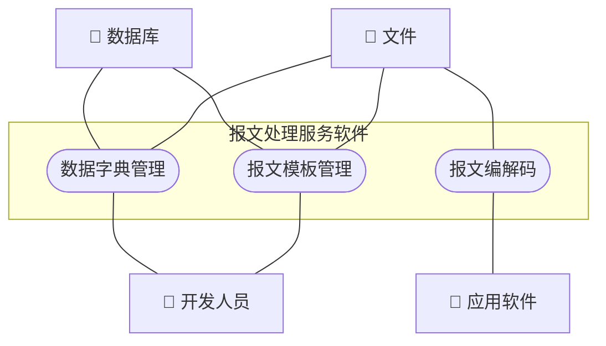
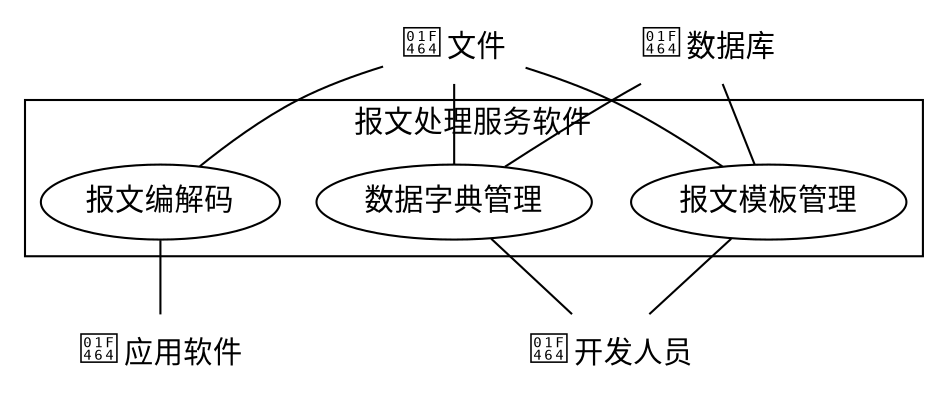

# 1_054 数据对档案

| 字段 | 值 |
|---|---|
| doc | 07报文处理服务软件需求规格说明-终稿 |
| section | 3.2 |
| image_caption | 图3 报文处理服务软件用例图 |
| table_caption | 表2 报文处理服务软件所有能力标识 |

## 原始图片

*图3 报文处理服务软件用例图*

## 结构图

*⚠ 结构经census重对齐: 旧锚点(oleObject2.bin:page1.xml)与图片不符, 已切换到与image.png内容一致的锚点(oleObject3.bin:page1.xml, align_score=1.0)*

*来源: born-digital导出(usecase, 8节点/8边)*
*类型经几何启发式精化(Master类型识别失败的图, 投影层推断, canonical锚点不变)*

*用例图以PlantUML渲染(UML母语): 小人=参与者 | 椭圆=用例 | 矩形框=系统边界 | 实线=关联 | 虚线=include/extend*

Mermaid兼容投影(通用md渲染器可显示)

DOT源码(完整语义, graphviz可渲染)

### 锚点节点结构

| # | 文本 | 类型 |
|---|---|---|
| 1 | 应用软件 | actor |
| 2 | 数据字典管理 | usecase |
| 3 | 报文编解码 | usecase |
| 4 | 报文处理服务软件 | boundary |
| 5 | 报文模板管理 | usecase |
| 6 | 开发人员 | actor |
| 7 | 文件 | actor |
| 8 | 数据库 | actor |

## 表格内容

| 序号 | Use case名称 | 项目唯一标识符 | 需求描述 | 需求 重用 | 方式 | 运行 状态 | 对应的任务书功能/性能 |
|---|---|---|---|---|---|---|---|
| 1 | 报文编解码服务 | PZXQ-GN-BWBJ | 提供应用程序接口； 提供日志记录功能 | 沿用 | 桌面、 平板、手持 | 开发、 运行 | 4.1.1 4.2 |
| 2 | 数据字典管理 | PZXQ-GN-SJZD | 支持数据字典中数据项的增加、删除、修改和 | 沿用 | 桌面 | 开发 | 4.1.2 |
| 3 | 报文模板管理 | PZXQ-GN-BWMB | 支持报文模板的编辑功能，能够对报文模板进 | 沿用 | 桌面 | 开发 | 4.1.3 |

## 正文

报文处理服务软件按照其功能需求，包含报文编解码服务、数据字典管理功能和报文模板管理功能。
