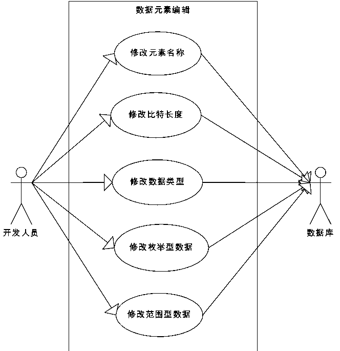
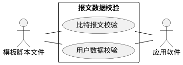
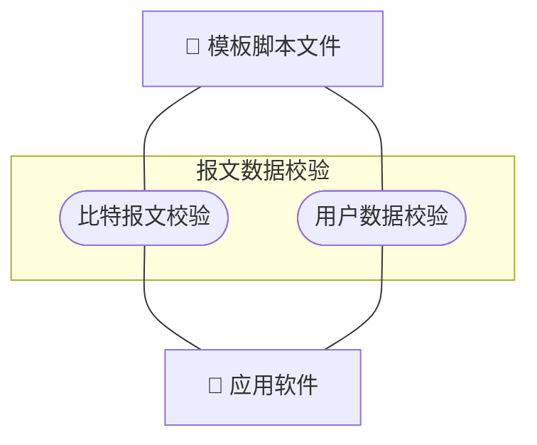
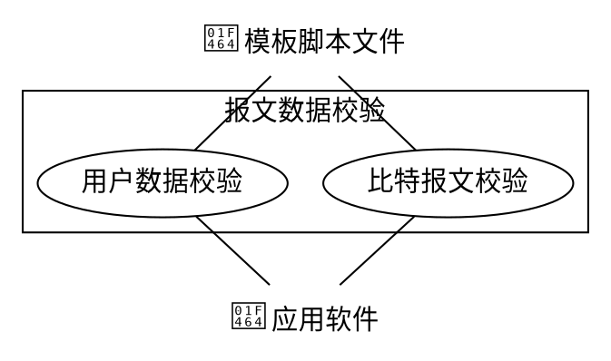

# 1_056 数据对档案

| 字段 | 值 |
|---|---|
| doc | 07报文处理服务软件需求规格说明-终稿 |
| section | 3.2.1.4 |
| image_caption | 图7 报文数据校验功能用例图 |
| table_caption | 表5 报文数据校验所有能力标识 |

## 原始图片

*图7 报文数据校验功能用例图*

## 结构图

*⚠ 结构经census重对齐: 旧锚点(oleObject8.bin:page1.xml)与图片不符, 已切换到与image.png内容一致的锚点(oleObject7.bin:page1.xml, align_score=1.0)*

*来源: born-digital导出(usecase, 5节点/4边)*
*类型经几何启发式精化(Master类型识别失败的图, 投影层推断, canonical锚点不变)*

*用例图以PlantUML渲染(UML母语): 小人=参与者 | 椭圆=用例 | 矩形框=系统边界 | 实线=关联 | 虚线=include/extend*

Mermaid兼容投影(通用md渲染器可显示)

DOT源码(完整语义, graphviz可渲染)

### 锚点节点结构

| # | 文本 | 类型 |
|---|---|---|
| 1 | 应用软件 | actor |
| 2 | 比特报文校验 | usecase |
| 3 | 报文数据校验 | boundary |
| 4 | 用户数据校验 | usecase |
| 5 | 模板脚本文件 | actor |

## 表格内容

| 序号 | Use case名称 | 项目唯一标识符 | 需求描述 | 需求重用 | 方式名称 | 运行方式 | 对应的任务书功能/性能 |
|---|---|---|---|---|---|---|---|
| 1 | 用户数据校验 | PZXQ-GN-BWBJ-BWJY-YH | 校验用户数据是否符合模板规则 | 沿用 | 桌面、平板、手持 | 开发、 运行 | 4.1.1 |
| 2 | 比特报文校验 | PZXQ-GN-BWBJ-BWJY-BT | 校验比特数据是否符合对应数据协议 | 沿用 | 桌面、平板、手持 | 开发、 运行 | 4.1.1 |

## 正文

报文数据校验提供用户数据结构和比特报文的校验接口，能够检验输入的用户数据或比特数据，是否符合与之对应的模板规则或者协议标准，满足不同业务数据协议标准要求的数据处理规则。
