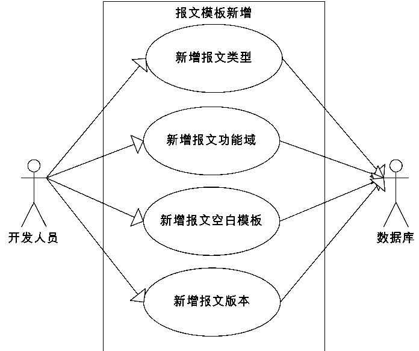
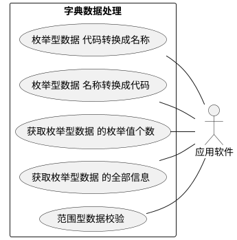
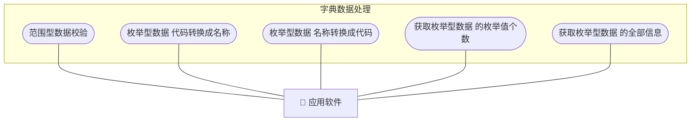
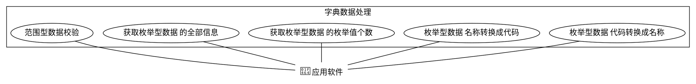

# 1_057 数据对档案

| 字段 | 值 |
|---|---|
| doc | 07报文处理服务软件需求规格说明-终稿 |
| section | 3.2.1.5 |
| image_caption | 图9 字典数据处理功能用例图 |
| table_caption | 表8 字典数据处理所有能力标识 |

## 原始图片

*图9 字典数据处理功能用例图*

## 结构图

*来源: born-digital导出(usecase, 7节点/5边)*
*类型经几何启发式精化(Master类型识别失败的图, 投影层推断, canonical锚点不变)*

*用例图以PlantUML渲染(UML母语): 小人=参与者 | 椭圆=用例 | 矩形框=系统边界 | 实线=关联 | 虚线=include/extend*

Mermaid兼容投影(通用md渲染器可显示)

DOT源码(完整语义, graphviz可渲染)

### 锚点节点结构

| # | 文本 | 类型 |
|---|---|---|
| 1 | 应用软件 | actor |
| 2 | 字典数据处理 | boundary |
| 3 | 枚举型数据
代码转换成名称 | usecase |
| 4 | 枚举型数据
名称转换成代码 | usecase |
| 5 | 获取枚举型数据
的枚举值个数 | usecase |
| 6 | 获取枚举型数据
的全部信息 | usecase |
| 7 | 范围型数据校验 | usecase |

## 表格内容

| 序号 | Use case 名称 | 项目唯一标识符 | 需求描述 | 需求重用 | 方式名称 | 运行状态 | 对应的任务书功能/性能 |
|---|---|---|---|---|---|---|---|
|   | 枚举型数据代码转换成名称 | PZXQ-GN-BWBJ-ZDCL- M | 根据字典数据，将枚举型数据的代码转换为对 | 沿用 | 桌面、平板、手持 | 开发、运行 | 4.1.1 |
|   | 枚举型数据名称转换成代码 | PZXQ-GN-BWBJ-ZDCL- M | 根据字典数据，将枚举型数据的名称转换为对 | 沿用 | 桌面、平板、手持 | 开发、运行 | 4.1.1 |
|   | 获取枚举型数据的枚举值个数 | PZXQ-GN-BWBJ-ZDCL- M | 根据字典数据，获取枚举型数据枚举值数量 | 沿用 | 桌面、平板、手持 | 开发、运行 | 4.1.1 |
|   | 获取枚举型数据的全部信息 | PZXQ-GN-BWBJ-ZDCL- M | 根据字典数据，获取枚举型数据的全部数据 | 沿用 | 桌面、平板、手持 | 开发、运行 | 4.1.1 |
|   | 范围型数据校验 | PZXQ-GN-BWBJ-ZDCL- F | 根据字典数据，校验范围型数据是否符合协议 | 沿用 | 桌面、平板、手持 | 开发、运行 | 4.1.1 |

## 正文

字典数据处理基于数据字典提供用户数据处理功能，为应用软件提供接口，能够将枚举型数据的代码转换成名称，能够将枚举型数据的名称转换成代码，能够获得枚举型字段的枚举值个数，能够获得枚举型字段的所有枚举值和相应VMF编码数组，能够检查范围型字段的用户数据是否正确，功能用例如图9所示。
