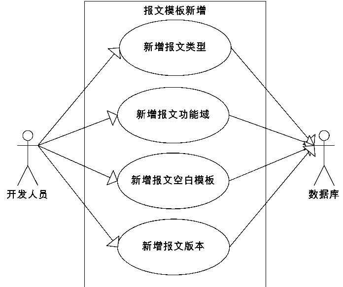
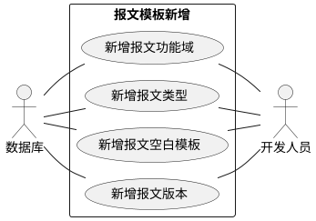
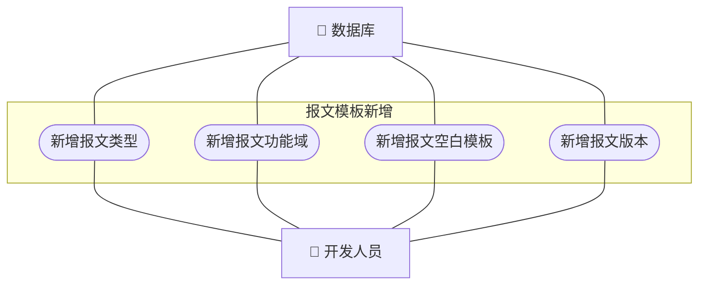
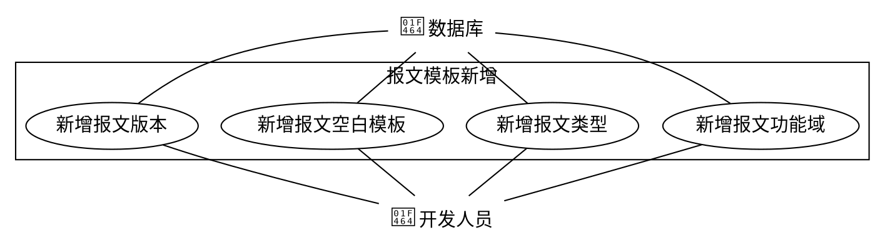

# 1_059 数据对档案

| 字段 | 值 |
|---|---|
| doc | 07报文处理服务软件需求规格说明-终稿 |
| section | 3.2.3.4 |
| image_caption | 图27 报文模板新增功能用例图 |
| table_caption | 表35 报文模板新增所有能力标识 |

## 原始图片

*图27 报文模板新增功能用例图*

## 结构图

*来源: born-digital导出(usecase, 7节点/8边)*
*类型经几何启发式精化(Master类型识别失败的图, 投影层推断, canonical锚点不变)*

*用例图以PlantUML渲染(UML母语): 小人=参与者 | 椭圆=用例 | 矩形框=系统边界 | 实线=关联 | 虚线=include/extend*

Mermaid兼容投影(通用md渲染器可显示)

DOT源码(完整语义, graphviz可渲染)

### 锚点节点结构

| # | 文本 | 类型 |
|---|---|---|
| 1 | 开发人员 | actor |
| 2 | 新增报文功能域 | usecase |
| 3 | 报文模板新增 | boundary |
| 4 | 新增报文类型 | usecase |
| 5 | 数据库 | actor |
| 6 | 新增报文空白模板 | usecase |
| 7 | 新增报文版本 | usecase |

## 表格内容

| 序号 | Use case名称 | 项目唯一标识符 | 需求描述 | 需求重用 | 方式名称 | 运行状态 | 对应的任务书功能/性能 |
|---|---|---|---|---|---|---|---|
| 1 | 新增报文类型 | PZXQ-GN-BWMB-MBXZ-BW | 根据用户需求在本地新增报文类型，如：KT | 沿用 | 桌面 | 开发 | 4.1.3 |
| 2 | 新增报文功能域 | PZXQ-GN-BWMB-MBXZ-GN | 在指定报文类型下增加报文功能域 | 沿用 | 桌面 | 开发 | 4.1.3 |
| 3 | 新增报文空白模板 | PZXQ-GN-BWMB-MBXZ-KB | 在指定报文类型、指定报文功能域下新增报文 | 沿用 | 桌面 | 开发 | 4.1.3 |
| 4 | 新增报文版本 | PZXQ-GN-BWMB-MBXZ-BW | 新增报文版本 | 沿用 | 桌面 | 开发 | 4.1.3 |

## 正文

报文模板新增支持用户使用报文模板管理工具创建新的报文模板，报文模板是用户结构文件和模板脚本文件的依据，是比特数据和用户数据的连接，报文模板编辑功能的用例图见图27。
