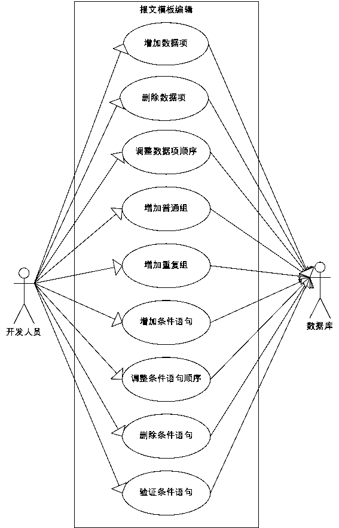
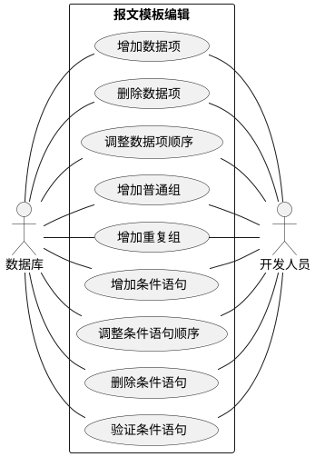
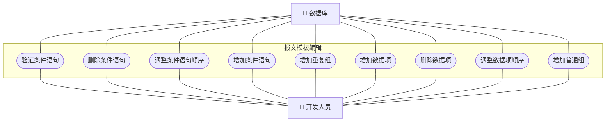
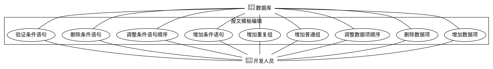

# 1_060 数据对档案

| 字段 | 值 |
|---|---|
| doc | 07报文处理服务软件需求规格说明-终稿 |
| section | 3.2.3.5 |
| image_caption | 图32 报文模板编辑用例图 |
| table_caption | 表40 报文模板编辑所有能力标识 |

## 原始图片

*图32 报文模板编辑用例图*

## 结构图

*来源: born-digital导出(usecase, 12节点/18边)*
*类型经几何启发式精化(Master类型识别失败的图, 投影层推断, canonical锚点不变)*

*用例图以PlantUML渲染(UML母语): 小人=参与者 | 椭圆=用例 | 矩形框=系统边界 | 实线=关联 | 虚线=include/extend*

Mermaid兼容投影(通用md渲染器可显示)

DOT源码(完整语义, graphviz可渲染)

### 锚点节点结构

| # | 文本 | 类型 |
|---|---|---|
| 1 | 开发人员 | actor |
| 2 | 报文模板编辑 | boundary |
| 3 | 增加数据项 | usecase |
| 4 | 删除数据项 | usecase |
| 5 | 调整数据项顺序 | usecase |
| 6 | 数据库 | actor |
| 7 | 增加普通组 | usecase |
| 8 | 增加重复组 | usecase |
| 9 | 增加条件语句 | usecase |
| 10 | 调整条件语句顺序 | usecase |
| 11 | 删除条件语句 | usecase |
| 12 | 验证条件语句 | usecase |

## 表格内容

| 序号 | Use case 名称 | 项目唯一标识符 | 需求描述 | 需求重用 | 方式名称 | 运行状态 | 对应的任务书功能/性能 |
|---|---|---|---|---|---|---|---|
|   | 增加数据项 | PZXQ-GN-SJZD-MBBJ- Z | 在报文模板中增加数据项 | 沿用 | 桌面 | 开发 | 4.1.3 |
|   | 删除数据项 | PZXQ-GN-SJZD-MBBJ- S | 从报文模板中删除已存在的数据项 | 沿用 | 桌面 | 开发 | 4.1.3 |
|   | 调整数据项顺序 | PZXQ-GN-SJZD-MBBJ- T | 调整已存在数据项的顺序 | 沿用 | 桌面 | 开发 | 4.1.3 |
|   | 增加普通组 | PZXQ-GN-SJZD-MBBJ- P | 在报文模板中增加普通组 | 沿用 | 桌面 | 开发 | 4.1.3 |
|   | 增加重复组 | PZXQ-GN-SJZD-MBBJ- C | 在报文模板中增加重复组 | 沿用 | 桌面 | 开发 | 4.1.3 |
|   | 增加条件语句 | PZXQ-GN-SJZD-MBBJ- Z | 为报文增加条件语句 | 沿用 | 桌面 | 开发 | 4.1.3 |
|   | 调整条件语句顺序 | PZXQ-GN-SJZD-MBBJ- T | 调整条件语句中字段的顺序 | 沿用 | 桌面 | 开发 | 4.1.3 |
|   | 删除条件语句 | PZXQ-GN-SJZD-MBBJ- S | 删除已存在的条件语句 | 沿用 | 桌面 | 开发 | 4.1.3 |
|   | 验证条件语句 | PZXQ-GN-SJZD-MBBJ- Y | 验证条件语句是否合法 | 沿用 | 桌面 | 开发 | 4.1.3 |

## 正文

报文模板编辑支持增加数据项、删除已有数据项和针对已有数据项进行顺序调整等操作，功能用例见图32。
