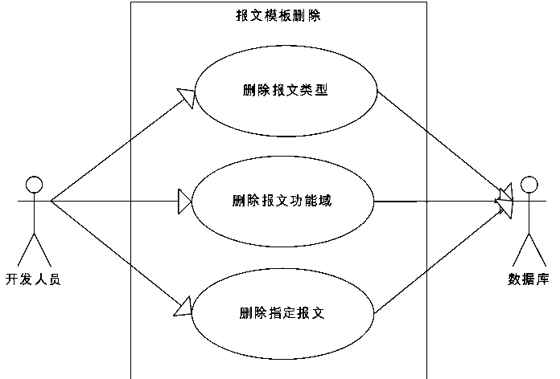
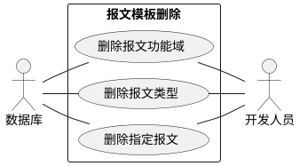
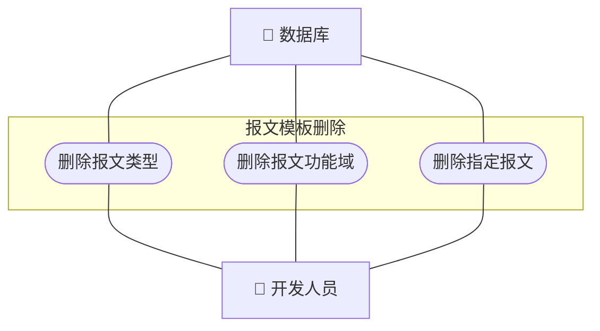
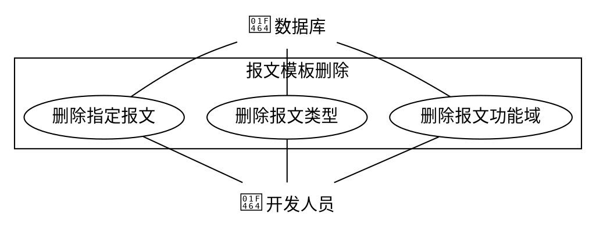

# 1_061 数据对档案

| 字段 | 值 |
|---|---|
| doc | 07报文处理服务软件需求规格说明-终稿 |
| section | 3.2.3.6 |
| image_caption | 图40 报文模板删除功能用例图 |
| table_caption | 表48 报文模板删除所有能力标识 |

## 原始图片

*图40 报文模板删除功能用例图*

## 结构图

*来源: born-digital导出(usecase, 6节点/6边)*
*类型经几何启发式精化(Master类型识别失败的图, 投影层推断, canonical锚点不变)*

*用例图以PlantUML渲染(UML母语): 小人=参与者 | 椭圆=用例 | 矩形框=系统边界 | 实线=关联 | 虚线=include/extend*

Mermaid兼容投影(通用md渲染器可显示)

DOT源码(完整语义, graphviz可渲染)

### 锚点节点结构

| # | 文本 | 类型 |
|---|---|---|
| 1 | 开发人员 | actor |
| 2 | 删除报文功能域 | usecase |
| 3 | 报文模板删除 | boundary |
| 4 | 删除报文类型 | usecase |
| 5 | 数据库 | actor |
| 6 | 删除指定报文 | usecase |

## 表格内容

| 序号 | Use case名称 | 项目唯一标识符 | 需求描述 | 需求重用 | 方式名称 | 运行状态 | 对应的任务书功能/性能 |
|---|---|---|---|---|---|---|---|
| 1 | 删除报文类型 | PZXQ-GN-BWMB-MBSC-BW | 根据用户需求删除报文类型。 | 沿用 | 桌面 | 开发 | 4.1.3 |
| 2 | 删除报文功能域 | PZXQ-GN-BWMB-MBSC-GN | 在指定报文类型下删除指定报文功能域。 | 沿用 | 桌面 | 开发 | 4.1.3 |
| 3 | 删除指定报文 | PZXQ-GN-BWMB-MBSC-BW | 在指定报文类型、指定报文功能域下删除指定 | 沿用 | 桌面 | 开发 | 4.1.3 |

## 正文

报文模板删除支持用户使用报文模板管理工具删除旧的报文模板、报文种类、报文功能域等，报文模板删除功能的用例图见图40。
