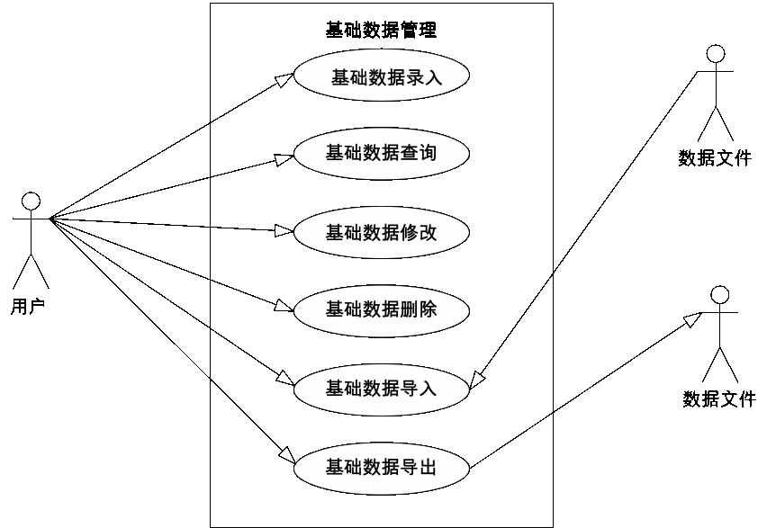
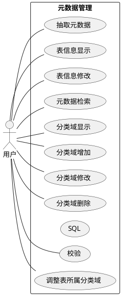
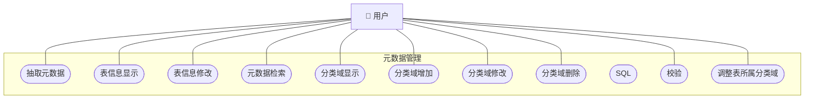
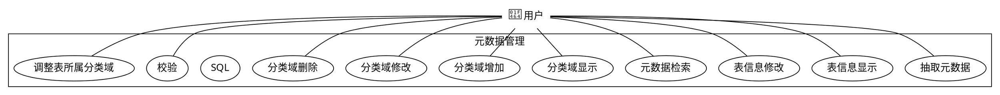

# 1_063 数据对档案

| 字段 | 值 |
|---|---|
| doc | 08数据运行维护管理工具软件需求规格说明-终稿 |
| section | 3.2.1 |
| image_caption | 图 3元数据管理用例图 |
| table_caption | 表 3元数据管理能力能力标识 |

## 原始图片

*图 3元数据管理用例图*

## 结构图

*来源: born-digital导出(usecase, 13节点/10边)*
*类型经几何启发式精化(Master类型识别失败的图, 投影层推断, canonical锚点不变)*

*用例图以PlantUML渲染(UML母语): 小人=参与者 | 椭圆=用例 | 矩形框=系统边界 | 实线=关联 | 虚线=include/extend*

Mermaid兼容投影(通用md渲染器可显示)

DOT源码(完整语义, graphviz可渲染)

### 锚点节点结构

| # | 文本 | 类型 |
|---|---|---|
| 1 |   | other |
| 2 |   | other |
| 3 |   | other |
| 4 |   | other |
| 5 | 抽取元数据 | other |
| 6 |   | other |
| 7 |   | other |
| 8 | 表信息显示 | other |
| 9 |   | other |
| 10 |   | other |
| 11 | 表信息修改 | other |
| 12 |   | other |
| 13 |   | other |
| 14 | 元数据检索 | other |
| 15 |   | other |
| … | 共36个节点 | |

## 表格内容

| 序号 | Use case名称 | 项目唯一标识符 | 需求描述 | 需求重用 | 方式名称 | 运行状态 | 对应的任务书功能/性能 |
|---|---|---|---|---|---|---|---|
| 1 | 抽取元数据 | PZXQ-GN-YSJGL-CQYSJ | 抽取目标数据库形成元数据库 | 新研 | 桌面 | 开发阶段 | 4.1.1 a) |
| 2 | 表信息显示 | PZXQ-GN-YSJGL-BXXXS | 查看数据库指定表信息 | 新研 | 桌面 | 开发阶段 | 4.1.1 b) |
| 3 | 表信息修改 | PZXQ-GN-YSJGL-BXXXG | 修改数据库指定表信息 | 新研 | 桌面 | 开发阶段 | 4.1.1 b) |
| 4 | 元数据检索 | PZXQ-GN-YSJGL-YSJJS | 对元数据信息的检索 | 新研 | 桌面 | 开发阶段 | 4.1.1 c) |
| 5 | 分类域显示 | PZXQ-GN-YSJGL-FLYXS | 对表分类域的查看显示功能 | 新研 | 桌面 | 开发阶段 | 4.1.1 d) |
| 6 | 分类域增加 | PZXQ-GN-YSJGL-FLYZJ | 增加表分类域功能 | 新研 | 桌面 | 开发阶段 | 4.1.1 d) |
| 7 | 分类域修改 | PZXQ-GN-YSJGL-FLYXG | 修改表分类域功能 | 新研 | 桌面 | 开发阶段 | 4.1.1 d) |
| 8 | 分类域删除 | PZXQ-GN-YSJGL-FLYSC | 删除表分类域功能 | 新研 | 桌面 | 开发阶段 | 4.1.1 d) |
| 9 | 调整表所属分类域 | PZXQ-GN-YSJGL-TZBSSF | 调整表所属分类域 | 新研 | 桌面 | 开发阶段 | 4.1.1 d) |
| 10 | SQL校验 | PZXQ-GN-YSJGL-SQLJY | 提供对建表SQL语句是否满足约束的SQL | 新研 | 桌面 | 开发阶段 | 4.1.1 e) |

## 正文

元数据管理功能包括：抽取元数据、表信息显示、表信息修改、元数据检索、分类域显示、分类域增加、分类域修改、分类域删除、调整表所属分类域、SQL校验，其功能用例如图 3所示。
