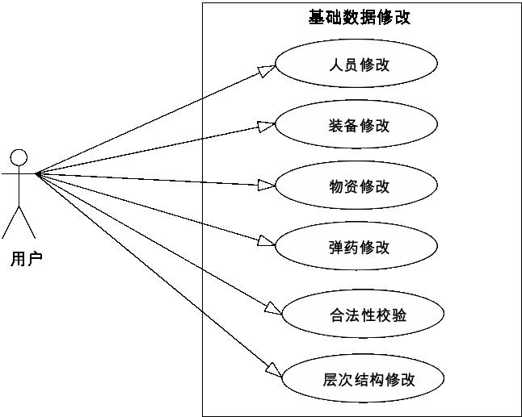
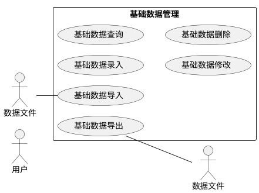
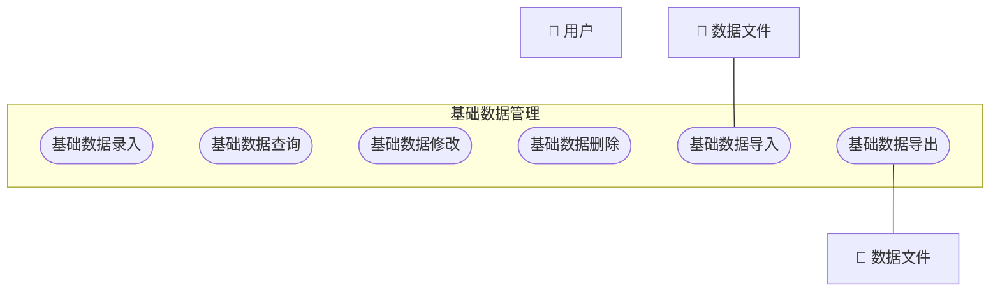
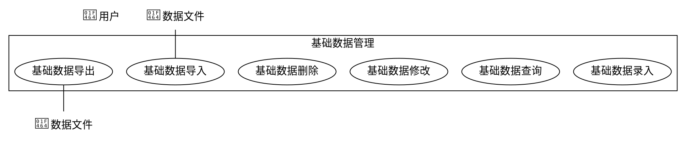

# 1_066 数据对档案

| 字段 | 值 |
|---|---|
| doc | 08数据运行维护管理工具软件需求规格说明-终稿 |
| section | 3.2.3.1 |
| image_caption | 图 6基础数据管理用例图 |
| table_caption | 表20基础数据维护能力能力标识 |

## 原始图片

*图 6基础数据管理用例图*

## 结构图

*⚠ 结构经census重对齐: 旧锚点(oleObject11.bin:page1.xml)与图片不符, 已切换到与image.png内容一致的锚点(oleObject6.bin:page1.xml, align_score=1.0)*

*来源: born-digital导出(usecase, 10节点/2边)*
*类型经几何启发式精化(Master类型识别失败的图, 投影层推断, canonical锚点不变)*

*用例图以PlantUML渲染(UML母语): 小人=参与者 | 椭圆=用例 | 矩形框=系统边界 | 实线=关联 | 虚线=include/extend*

Mermaid兼容投影(通用md渲染器可显示)

DOT源码(完整语义, graphviz可渲染)

### 锚点节点结构

| # | 文本 | 类型 |
|---|---|---|
| 1 |   | other |
| 2 |   | other |
| 3 |   | other |
| 4 |   | other |
| 5 | 基础数据录入 | other |
| 6 |   | other |
| 7 |   | other |
| 8 | 基础数据查询 | other |
| 9 |   | other |
| 10 |   | other |
| 11 | 基础数据修改 | other |
| 12 |   | other |
| 13 |   | other |
| 14 | 基础数据删除 | other |
| 15 |   | other |
| … | 共39个节点 | |

## 表格内容

| 序号 | Use case名称 | 项目唯一标识符 | 需求描述 | 需求重用 | 方式名称 | 运行状态 | 对应的任务书功能/性能 |
|---|---|---|---|---|---|---|---|
| 1 | 基础数据录入 | PZXQ-GN-JCSJWHGL-JCS | 提供对数据库的数据插入功能 | 沿用 | 桌面、平板 | 集成阶段 | 4.1.3 b、c、d、e、f、i、j） |
| 2 | 基础数据查询 | PZXQ-GN-JCSJWHGL-JCS | 提供对数据库的数据查询功能 | 沿用 | 桌面、平板 | 集成阶段 | 4.1.3 b、c、d、e、f、i、j） |
| 3 | 基础数据修改 | PZXQ-GN-JCSJWHGL-JCS | 提供对数据库的数据修改功能 | 沿用 | 桌面、平板 | 集成阶段 | 4.1.3 b、c、d、e、f、i、j） |
| 4 | 基础数据删除 | PZXQ-GN-JCSJWHGL-JCS | 提供对数据库的数据删除功能 | 沿用 | 桌面、平板 | 集成阶段 | 4.1.3 b、c、d、e、f、i、j） |
| 5 | 基础数据导入 | PZXQ-GN-JCSJWHGL-JCS | 提供批量数据导入功能，提供SQL数据导入 | 沿用 | 桌面、平板 | 集成阶段 | 4.1.3 b、c、d、e、f、i、j） |
| 6 | 基础数据导出 | PZXQ-GN-JCSJWHGL-JCS | 提供批量数据导出功能，提供SQL文件导出 | 沿用 | 桌面、平板 | 集成阶段 | 4.1.3 b、c、d、e、f、i、j） |

## 正文

基础数据维护能力包括：基础数据录入、基础数据查询、基础数据修改、基础数据删除、基础数据导入、基础数据导出，其功能用例如图 6所示。
