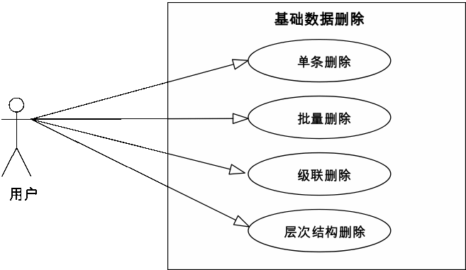
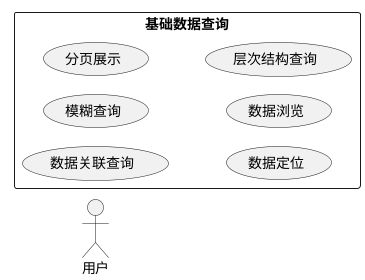
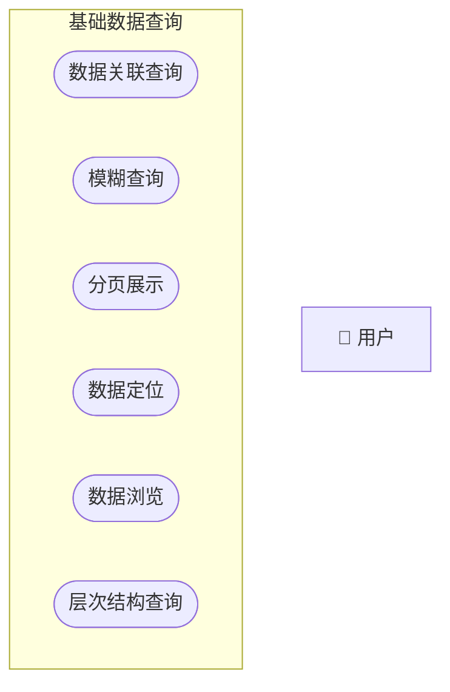
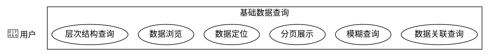

# 1_067 数据对档案

| 字段 | 值 |
|---|---|
| doc | 08数据运行维护管理工具软件需求规格说明-终稿 |
| section | 3.2.3.1.2 |
| image_caption | 图 8 基础数据管理用例图 |
| table_caption | 表 31基础数据维护查询能力标识 |

## 原始图片

*图 8 基础数据管理用例图*

## 结构图

*来源: born-digital导出(usecase, 8节点/0边)*
*类型经几何启发式精化(Master类型识别失败的图, 投影层推断, canonical锚点不变)*

*用例图以PlantUML渲染(UML母语): 小人=参与者 | 椭圆=用例 | 矩形框=系统边界 | 实线=关联 | 虚线=include/extend*

Mermaid兼容投影(通用md渲染器可显示)

DOT源码(完整语义, graphviz可渲染)

### 锚点节点结构

| # | 文本 | 类型 |
|---|---|---|
| 1 |   | other |
| 2 |   | other |
| 3 |   | other |
| 4 |   | other |
| 5 | 数据关联查询 | other |
| 6 |   | other |
| 7 |   | other |
| 8 | 模糊查询 | other |
| 9 |   | other |
| 10 |   | other |
| 11 | 分页展示 | other |
| 12 |   | other |
| 13 |   | other |
| 14 | 数据定位 | other |
| 15 |   | other |
| … | 共33个节点 | |

## 表格内容

| 序号 | Use case名称 | 项目唯一标识符 | 需求描述 | 需求重用 | 方式名称 | 运行状态 | 对应的任务书功能/性能 |
|---|---|---|---|---|---|---|---|
| 1 | 数据关联查询 | PZXQ-GN-JCSJWHGL-JCS | 提供数据关联查询功能 | 沿用 | 桌面 平板 | 集成阶段 | 4.1.3 a） |
| 2 | 模糊查询 | PZXQ-GN-JCSJWHGL-JCS | 提供数据模糊查询功能 | 沿用 | 桌面 平板 | 集成阶段 | 4.1.3 a） |
| 3 | 层次结构查询 | PZXQ-GN-JCSJWHGL-JCS | 提供对层次结构数据的综合查询功能 | 沿用 | 桌面 平板 | 集成阶段 | 4.1.3 a） |
| 4 | 分页展示 | PZXQ-GN-JCSJWHGL-JCS | 数据分页显示功能 | 沿用 | 桌面 平板 | 集成阶段 | 4.1.3 a） |
| 5 | 数据定位 | PZXQ-GN-JCSJWHGL-JCS | 提供数据定位功能 | 沿用 | 桌面 平板 | 集成阶段 | 4.1.3 a） |
| 6 | 数据浏览 | PZXQ-GN-JCSJWHGL-JCS | 提供详细浏览数据功能 | 沿用 | 桌面 平板 | 集成阶段 | 4.1.3 a） |

## 正文

基础数据检索能力包括：数据关联查询、模糊查询、层次结构查询、分页展示、数据定位、数据浏览，其功能用例如图 8所示。
