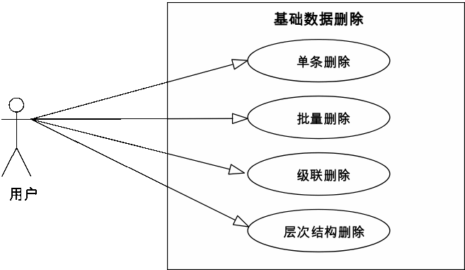

# 1_069 数据对档案

| 字段 | 值 |
|---|---|
| doc | 08数据运行维护管理工具软件需求规格说明-终稿 |
| section | 3.2.3.1.4 |
| image_caption | 图 10基础数据删除用例图 |
| table_caption | 表 45基础数据维护能力标识 |

## 原始图片

*图 10基础数据删除用例图*

## 结构图

*该对无Visio锚点(非Visio图, 无born-digital导出)*

## 表格内容

| 序号 | Use case名称 | 项目唯一标识符 | 需求描述 | 需求重用 | 方式名称 | 运行状态 | 对应的任务书功能/性能 |
|---|---|---|---|---|---|---|---|
| 1 | 单条删除 | PZXQ-GN-JCSJWHGL-JCS | 提供对录入的基础数据单条删除功能 | 沿用 | 桌面、 平板 | 集成阶段 | 4.1.3 d） |
| 2 | 批量删除 | PZXQ-GN-JCSJWHGL-JCS | 提供对录入的基础数据批量删除功能 | 沿用 | 桌面、 平板 | 集成阶段 | 4.1.3 d） |
| 3 | 级联删除 | PZXQ-GN-JCSJWHGL-JCS | 提供级联删除数据功能 | 沿用 | 桌面、 平板 | 集成阶段 | 4.1.3 d） |
| 4 | 层次结构删除 | PZXQ-GN-JCSJWHGL-JCS | 提供删除层次结构数据功能 | 沿用 | 桌面、 平板 | 集成阶段 | 4.1.3 d） |

## 正文

基础数据删除能力包括：单条删除、批量删除、级联删除、层次结构删除，其功能用例如图 10所示。
