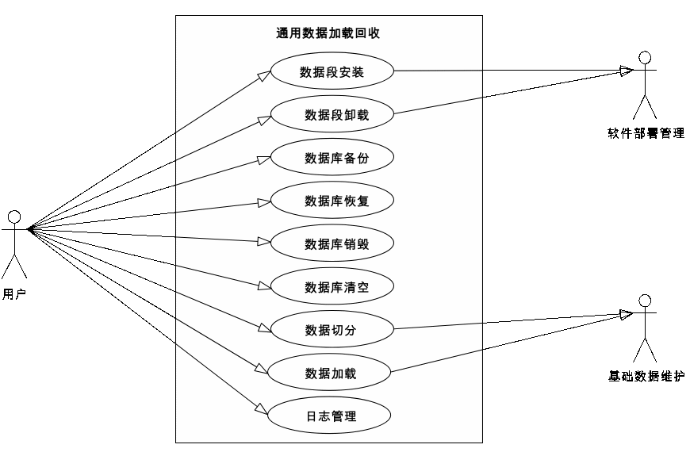
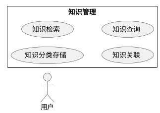
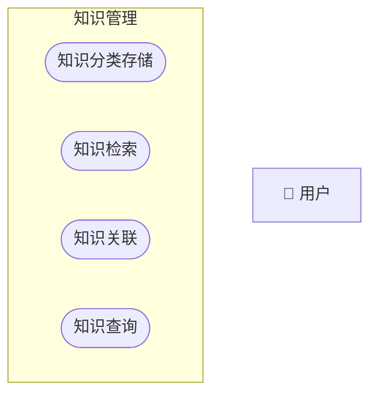
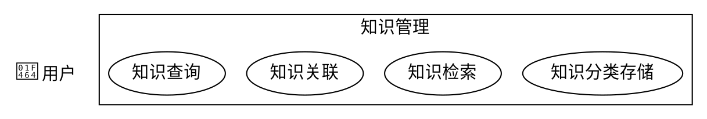

# 1_072 数据对档案

| 字段 | 值 |
|---|---|
| doc | 08数据运行维护管理工具软件需求规格说明-终稿 |
| section | 3.2.3.2 |
| image_caption | 图14知识库管理用例图 |
| table_caption | 表 54知识库管理能力标识 |

## 原始图片

*图14知识库管理用例图*

## 结构图

*来源: born-digital导出(usecase, 6节点/0边)*
*类型经几何启发式精化(Master类型识别失败的图, 投影层推断, canonical锚点不变)*

*用例图以PlantUML渲染(UML母语): 小人=参与者 | 椭圆=用例 | 矩形框=系统边界 | 实线=关联 | 虚线=include/extend*

Mermaid兼容投影(通用md渲染器可显示)

DOT源码(完整语义, graphviz可渲染)

### 锚点节点结构

| # | 文本 | 类型 |
|---|---|---|
| 1 |   | other |
| 2 |   | other |
| 3 |   | other |
| 4 |   | other |
| 5 | 知识分类存储 | other |
| 6 |   | other |
| 7 |   | other |
| 8 | 知识检索 | other |
| 9 |   | other |
| 10 |   | other |
| 11 | 知识关联 | other |
| 12 |   | other |
| 13 |   | other |
| 14 | 知识查询 | other |
| 15 |   | other |
| … | 共24个节点 | |

## 表格内容

| 序号 | Use case名称 | 项目唯一标识符 | 需求描述 | 需求重用 | 方式名称 | 运行状态 | 对应的任务书功能/性能 |
|---|---|---|---|---|---|---|---|
| 1 | 知识分类存储 | PZXQ-GN-JCSJWH-ZSKGL | 提供对知识的分类存储功能 | 新研 | 桌面、 平板 | 集成阶段 | 4.1.3 l） |
| 2 | 知识检索 | PZXQ-GN-JCSJWH-ZSKGL | 提供对知识的检索功能 | 新研 | 桌面、 平板 | 集成阶段 | 4.1.3 l） |
| 3 | 知识关联 | PZXQ-GN-JCSJWH-ZSKGL | 提供知识的关联查询功能 | 新研 | 桌面、 平板 | 集成阶段 | 4.1.3 l） |
| 4 | 知识查询 | PZXQ-GN-JCSJWH-ZSKGL | 提供对知识内容的综合查询功能 | 新研 | 桌面、 平板 | 集成阶段 | 4.1.3 l） |

## 正文

知识库管理能力包括：知识分类存储、知识检索、知识关联、知识查询，其功能用例如图14所示。
