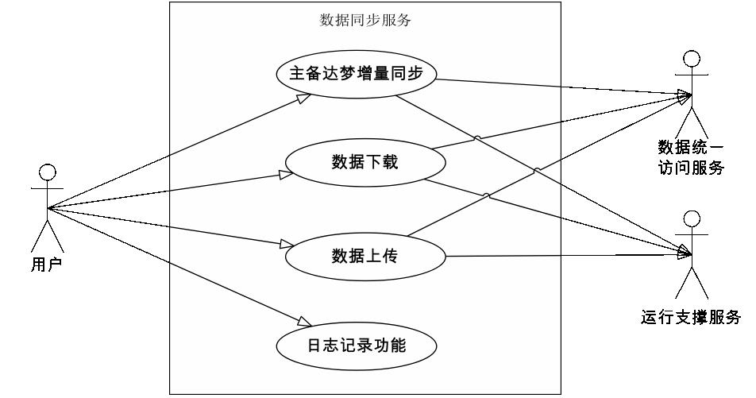
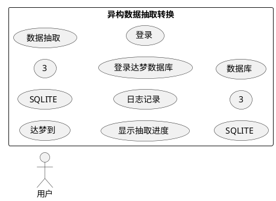
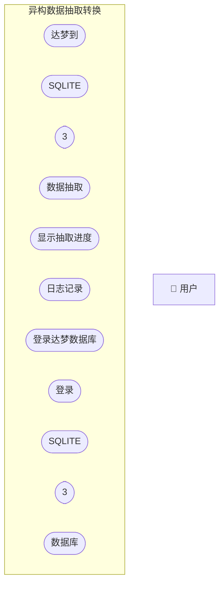
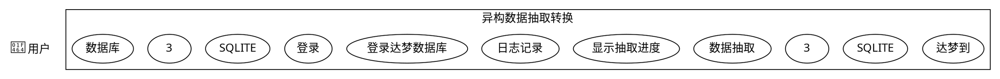

# 1_075 数据对档案

| 字段 | 值 |
|---|---|
| doc | 08数据运行维护管理工具软件需求规格说明-终稿 |
| section | 3.2.5 |
| image_caption | 图17异构数据抽取转换用例图 |
| table_caption | 表 74数据抽取转换能力标识 |

## 原始图片

*图17异构数据抽取转换用例图*

## 结构图

*来源: born-digital导出(usecase, 13节点/0边)*
*类型经几何启发式精化(Master类型识别失败的图, 投影层推断, canonical锚点不变)*

*用例图以PlantUML渲染(UML母语): 小人=参与者 | 椭圆=用例 | 矩形框=系统边界 | 实线=关联 | 虚线=include/extend*

Mermaid兼容投影(通用md渲染器可显示)

DOT源码(完整语义, graphviz可渲染)

### 锚点节点结构

| # | 文本 | 类型 |
|---|---|---|
| 1 |   | other |
| 2 |   | other |
| 3 |   | other |
| 4 |   | other |
| 5 | 达梦到 | other |
| 6 | SQLITE | other |
| 7 | 3 | other |
| 8 | 数据抽取 | other |
| 9 |   | other |
| 10 |   | other |
| 11 | 显示抽取进度 | other |
| 12 |   | other |
| 13 |   | other |
| 14 | 日志记录 | other |
| 15 |   | other |
| … | 共36个节点 | |

## 表格内容

| 序号 | Use case名称 | 项目唯一标识符 | 需求描述 | 需求重用 | 方式名称 | 运行状态 | 对应的任务书功能/性能 |
|---|---|---|---|---|---|---|---|
| 1 | 登录达梦数据库 | PZXQ-GN-SJCQZH-DLDMS | 提供界面异步抽取装换的达梦数据库登录功能 | 沿用 | 桌面、 平板 | 集成阶段 | 4.1.6 a) |
| 2 | 登录SQLITE3数据库 | PZXQ-GN-SJCQZH-DLSQL | 提供界面异步抽取装换的SQLITE3数据 | 沿用 | 桌面、 平板 | 集成阶段 | 4.1.6 a) |
| 3 | 达梦到SQLITE3数据抽取 | PZXQ-GN-SJCQZH-DMDSQ | 提供达梦数据库到SQLITE3数据库之间 | 沿用 | 桌面、 平板 | 集成阶段 | 4.1.6 c) |
| 4 | 显示抽取进度 | PZXQ-GN-SJCQZH-XSCQJ | 界面显示抽取进度 | 沿用 | 桌面、 平板 | 集成阶段 | 4.1.6 c) |
| 5 | 日志记录 | PZXQ-GN-SJCQZH-RZJL | 提供抽取日志记录功能 | 沿用 | 桌面、 平板 | 集成阶段 | 4.1.6 b) |

## 正文

数据抽取转换能力包括：登陆达梦数据库、登陆SQLITE3数据库、达梦到SQLITE3数据抽取、显示抽取进度、日志记录，其功能用例如图17所示。
