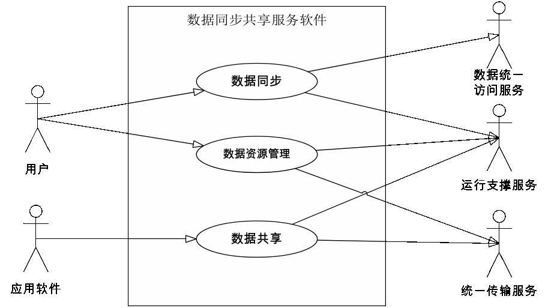
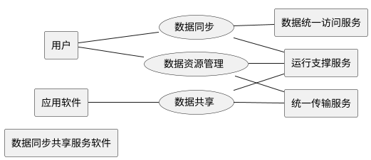
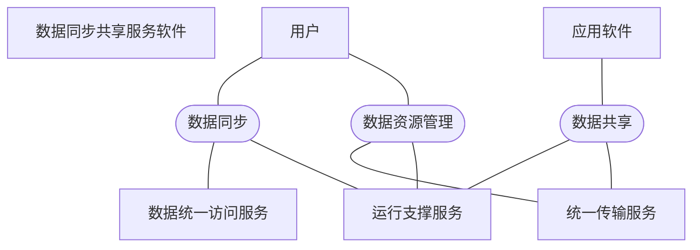
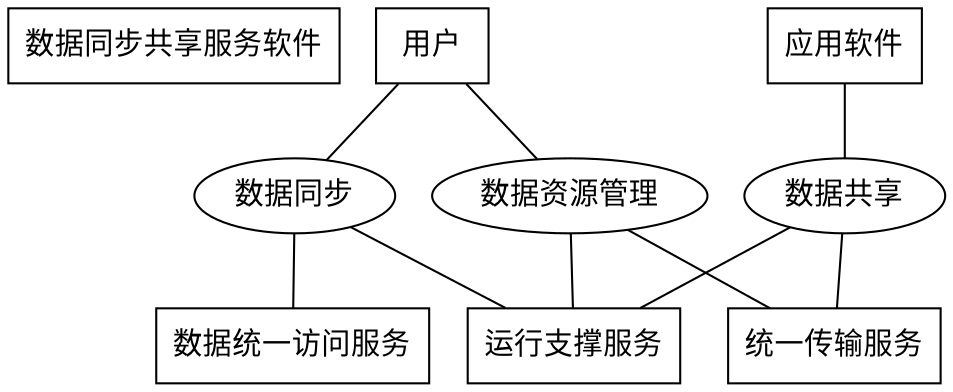

# 1_076 数据对档案

| 字段 | 值 |
|---|---|
| doc | 09数据同步共享服务软件需求规格说明-终稿 |
| section | 3.2 |
| image_caption | 图 9 数据同步共享服务用例图 |
| table_caption | 表 2数据同步共享服务所有能力标识 |

## 原始图片

*图 9 数据同步共享服务用例图*

## 结构图

*⚠ 结构经census重对齐: 旧锚点(oleObject27.bin:page1.xml)与图片不符, 已切换到与image.png内容一致的锚点(oleObject9.bin:page1.xml, align_score=1.0)*

*来源: born-digital导出(usecase, 9节点/9边)*
*类型经几何启发式精化(Master类型识别失败的图, 投影层推断, canonical锚点不变)*

*用例图以PlantUML渲染(UML母语): 小人=参与者 | 椭圆=用例 | 矩形框=系统边界 | 实线=关联 | 虚线=include/extend*

Mermaid兼容投影(通用md渲染器可显示)

DOT源码(完整语义, graphviz可渲染)

### 锚点节点结构

| # | 文本 | 类型 |
|---|---|---|
| 1 | 数据同步共享服务软件 | process |
| 2 | 数据同步 | usecase |
| 3 | 数据共享 | usecase |
| 4 | 数据资源管理 | usecase |
| 5 |   | other |
| 6 | 用户 | other |
| 7 |   | other |
| 8 | 数据统一访问服务 | other |
| 9 |   | other |
| 10 | 运行支撑服务 | other |
| 11 |   | other |
| 12 | 统一传输服务 | other |
| 13 |   | other |
| 14 | 应用软件 | other |

## 表格内容

| 序号 | Use case名称 | 项目唯一标识符 | 需求描述 | 需求重用 | 方式名称 | 运行状态 | 对应的任务书功能 |
|---|---|---|---|---|---|---|---|
| 1 | 数据同步 | PZXQ-GN-SJTB | 车上状态下，同步主备达梦数据库间数据、上 | 沿用 | 桌面、平板 | 运行阶段 | 4.1.2 |
| 2 | 数据资源管理 | PZXQ-GN-SJZYGL | 数据资源目录的展现功能和模糊查找；提供数 | 新研 | 桌面 | 运行阶段 | 4.1.3 |
| 3 | 数据共享 | PZXQ-GN-SJGX | 存储和获取数据 | 新研 | 桌面、平板 | 运行阶段 | 4.1.1 |

## 正文

数据同步共享服务包括数据同步服务、数据共享服务和数据资源管理三个模块。数据同步共享服务功能图，如图 8所示。
