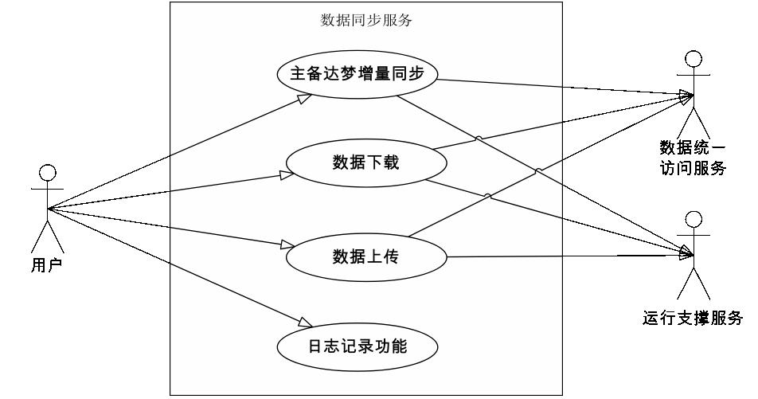
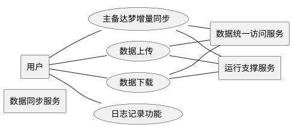
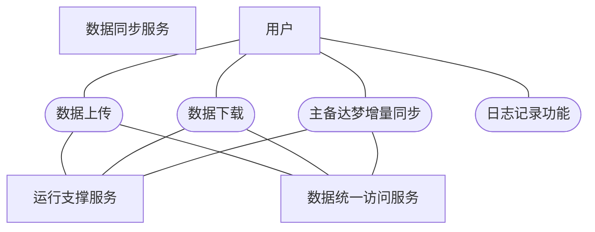
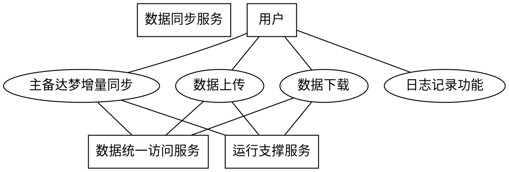

# 1_077 数据对档案

| 字段 | 值 |
|---|---|
| doc | 09数据同步共享服务软件需求规格说明-终稿 |
| section | 3.2.1 |
| image_caption | 图 10 数据同步任务用例图 |
| table_caption | 表 3数据同步服务软件所有能力标识 |

## 原始图片

*图 10 数据同步任务用例图*

## 结构图

*来源: born-digital导出(usecase, 8节点/10边)*
*类型经几何启发式精化(Master类型识别失败的图, 投影层推断, canonical锚点不变)*

*用例图以PlantUML渲染(UML母语): 小人=参与者 | 椭圆=用例 | 矩形框=系统边界 | 实线=关联 | 虚线=include/extend*

Mermaid兼容投影(通用md渲染器可显示)

DOT源码(完整语义, graphviz可渲染)

### 锚点节点结构

| # | 文本 | 类型 |
|---|---|---|
| 1 | 数据同步服务 | process |
| 2 | 主备达梦增量同步 | usecase |
| 3 | 数据上传 | usecase |
| 4 | 数据下载 | usecase |
| 5 |   | other |
| 6 | 用户 | other |
| 7 | 日志记录功能 | usecase |
| 8 |   | other |
| 9 | 数据统一访问服务 | other |
| 10 |   | other |
| 11 | 运行支撑服务 | other |

## 表格内容

| 序号 | Use case名称 | 项目唯一标识符 | 需求描述 | 需求重用 | 方式名称 | 运行 状态 | 对应的任务书功能/性能 |
|---|---|---|---|---|---|---|---|
| 1 | 主备达梦增量同步 | PZXQ-GN-SJTB-ZBZLTB | 主备服务器数据库间增量同步功能 | 沿用 | 桌面 | 运行阶段 | 4.1.2.a、4.2.a |
| 2 | 数据下载 | PZXQ-GN-SJTB-SJXZ | 达梦数据库到席位sqlite3轻量数据库 | 新研 | 桌面、平板 | 运行阶段 | 4.1.2.f、4.2.a |
| 3 | 数据上传 | PZXQ-GN-SJTB-SJSC | 席位sqlite3轻量数据库到达梦数据库 | 新研 | 桌面、平板 | 运行阶段 | 4.1.2.g、4.2.a |
| 4 | 日志记录功能 | PZXQ-GN-SJTB-RZJLGN | 对同步任务日志、数据下载日志和数据上传日 | 沿用 | 桌面、平板 | 运行阶段 | 4.1.2.h |

## 正文

数据同步功能包括主备数据库间增量同步、数据下载和数据上传三大功能。数据同步任务用例图如下图 10所示。
