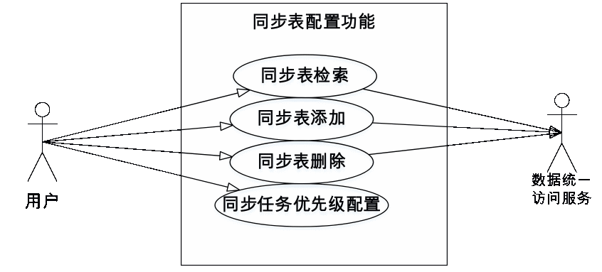
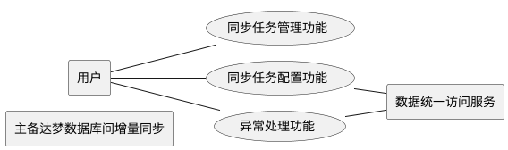
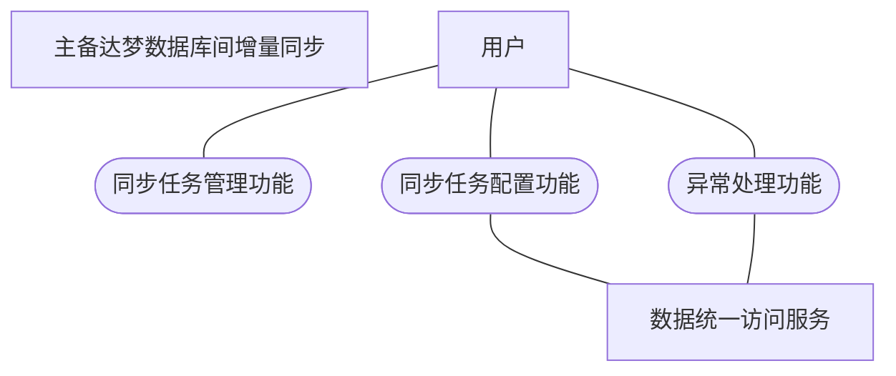
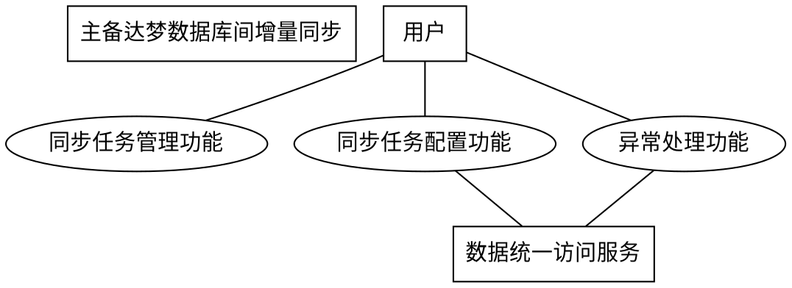

# 1_078 数据对档案

| 字段 | 值 |
|---|---|
| doc | 09数据同步共享服务软件需求规格说明-终稿 |
| section | 3.2.1.1 |
| image_caption | 图 11数据同步任务用例图 |
| table_caption | 表 4主备达梦数据库增量同步能力标识 |

## 原始图片

*图 11数据同步任务用例图*

## 结构图

*⚠ 结构经census重对齐: 旧锚点(oleObject12.bin:page1.xml)与图片不符, 已切换到与image.png内容一致的锚点(oleObject11.bin:page1.xml, align_score=1.0)*

*来源: born-digital导出(usecase, 6节点/5边)*
*类型经几何启发式精化(Master类型识别失败的图, 投影层推断, canonical锚点不变)*

*用例图以PlantUML渲染(UML母语): 小人=参与者 | 椭圆=用例 | 矩形框=系统边界 | 实线=关联 | 虚线=include/extend*

Mermaid兼容投影(通用md渲染器可显示)

DOT源码(完整语义, graphviz可渲染)

### 锚点节点结构

| # | 文本 | 类型 |
|---|---|---|
| 1 | 主备达梦数据库间增量同步 | process |
| 2 |   | other |
| 3 | 用户 | other |
| 4 | 同步任务管理功能 | usecase |
| 5 | 同步任务配置功能 | usecase |
| 6 | 异常处理功能 | usecase |
| 7 |   | other |
| 8 | 数据统一访问服务 | other |

## 表格内容

| 序号 | Use case名称 | 项目唯一标识符 | 需求描述 | 需求重用 | 方式名称 | 运行状态 | 对应的任务书功能/性能 |
|---|---|---|---|---|---|---|---|
| 1 | 同步任务管理功能 | PZXQ-GN-SJTB-ZBZLTB- | 提供对同步任务的管理功能 | 沿用 | 桌面 | 运行阶段 | 4.1.2.d |
| 2 | 同步任务配置功能 | PZXQ-GN-SJTB-ZBZLTB- | 提供对同步数据表、任务优先级的配置功能 | 沿用 | 桌面 | 运行阶段 | 4.1.2.b |
| 3 | 异常处理功能 | PZXQ-GN-SJTB-ZBZLTB- | 提供异常处理功能 | 沿用 | 桌面 | 运行阶段 | 4.1.2.e |

## 正文

主备达梦数据库间增量同步功能包括同步任务管理功能、同步任务配置功能和异常处理功能。数据同步用例图如图 11所示。
