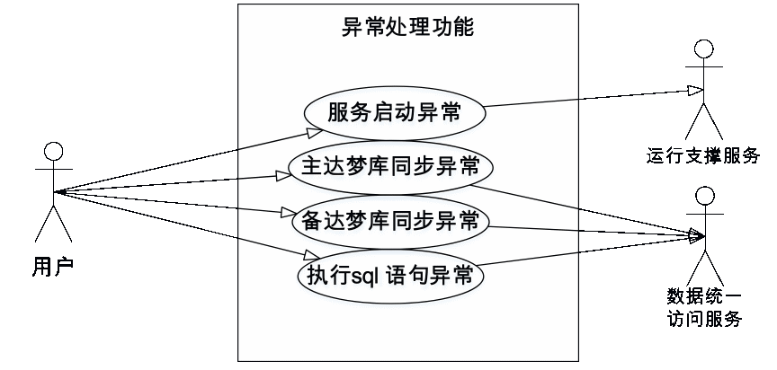
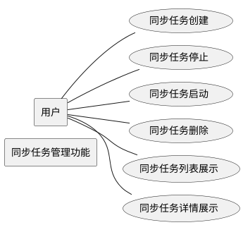
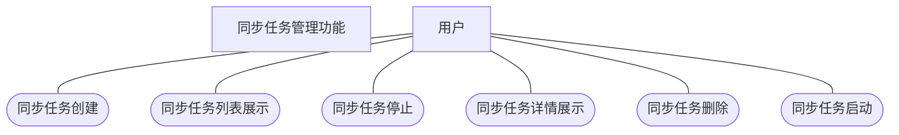

# 1_079 数据对档案

| 字段 | 值 |
|---|---|
| doc | 09数据同步共享服务软件需求规格说明-终稿 |
| section | 3.2.1.1.1 |
| image_caption | 图 12 同步任务功能用例图 |
| table_caption | 表 5同步任务管理功能能力标识 |

## 原始图片

*图 12 同步任务功能用例图*

## 结构图

*⚠ 结构经census重对齐: 旧锚点(oleObject13.bin:page1.xml)与图片不符, 已切换到与image.png内容一致的锚点(oleObject12.bin:page1.xml, align_score=1.0)*

*来源: born-digital导出(usecase, 8节点/6边)*
*类型经几何启发式精化(Master类型识别失败的图, 投影层推断, canonical锚点不变)*

*用例图以PlantUML渲染(UML母语): 小人=参与者 | 椭圆=用例 | 矩形框=系统边界 | 实线=关联 | 虚线=include/extend*

Mermaid兼容投影(通用md渲染器可显示)

DOT源码(完整语义, graphviz可渲染)

### 锚点节点结构

| # | 文本 | 类型 |
|---|---|---|
| 1 | 同步任务管理功能 | process |
| 2 | 同步任务创建 | usecase |
| 3 | 同步任务停止 | usecase |
| 4 | 同步任务启动 | usecase |
| 5 | 同步任务删除 | usecase |
| 6 | 同步任务列表展示 | usecase |
| 7 |   | other |
| 8 | 用户 | other |
| 9 | 同步任务详情展示 | usecase |

## 表格内容

| 序号 | Use case名称 | 项目唯一标识符 | 需求描述 | 需求重用 | 方式名称 | 运行状态 | 对应的任务书功能/性能 |
|---|---|---|---|---|---|---|---|
| 1 | 同步任务创建 | PZXQ-GN-SJTB-ZBZLTB- | 同步任务的创建； | 沿用 | 桌面 | 运行阶段 | 4.1.2.d |
| 2 | 同步任务列表展示 | PZXQ-GN-SJTB-ZBZLTB- | 同步任务列表展示； | 沿用 | 桌面 | 运行阶段 | 4.1.2.d |
| 3 | 同步任务停止 | PZXQ-GN-SJTB-ZBZLTB- | 同步任务提供停止功能； | 沿用 | 桌面 | 运行阶段 | 4.1.2.d |
| 4 | 同步任务启动 | PZXQ-GN-SJTB-ZBZLTB- | 同步任务启动功能； | 沿用 | 桌面 | 运行阶段 | 4.1.2.d |
| 5 | 同步任务删除 | PZXQ-GN-SJTB-ZBZLTB- | 同步任务删除功能 | 沿用 | 桌面 | 运行阶段 | 4.1.2.d |
| 6 | 同步任务详情展示 | PZXQ-GN-SJTB-ZBZLTB- | 同步任务详细信息展示功能 | 沿用 | 桌面 | 运行阶段 | 4.1.2.d |

## 正文

同步任务管理功能能力标识表，见表 5所示。
