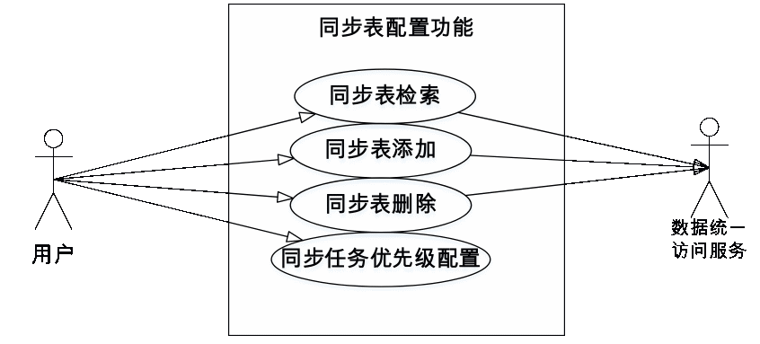
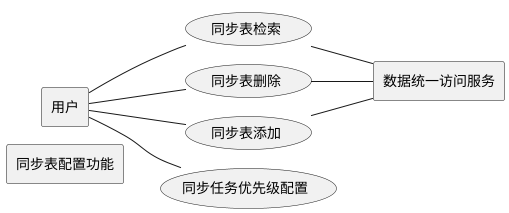
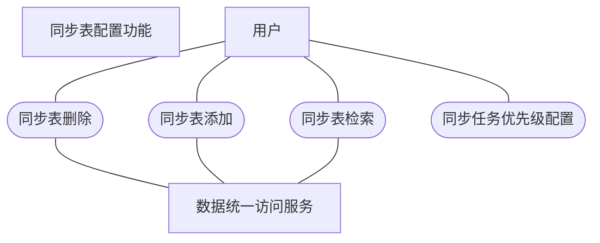
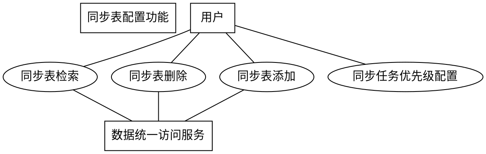

# 1_080 数据对档案

| 字段 | 值 |
|---|---|
| doc | 09数据同步共享服务软件需求规格说明-终稿 |
| section | 3.2.1.1.2 |
| image_caption | 图 14 同步任务配置功能用例图 |
| table_caption | 表 12同步任务配置功能能力标识 |

## 原始图片

*图 14 同步任务配置功能用例图*

## 结构图

*来源: born-digital导出(usecase, 7节点/7边)*
*类型经几何启发式精化(Master类型识别失败的图, 投影层推断, canonical锚点不变)*

*用例图以PlantUML渲染(UML母语): 小人=参与者 | 椭圆=用例 | 矩形框=系统边界 | 实线=关联 | 虚线=include/extend*

Mermaid兼容投影(通用md渲染器可显示)

DOT源码(完整语义, graphviz可渲染)

### 锚点节点结构

| # | 文本 | 类型 |
|---|---|---|
| 1 | 同步表配置功能 | process |
| 2 | 同步表检索 | usecase |
| 3 | 同步表删除 | usecase |
| 4 | 同步表添加 | usecase |
| 5 |   | other |
| 6 | 用户 | other |
| 7 | 同步任务优先级配置 | usecase |
| 8 |   | other |
| 9 | 数据统一访问服务 | other |

## 表格内容

| 序号 | Use case名称 | 项目唯一标识符 | 需求描述 | 需求重用 | 方式名称 | 运行状态 | 对应的任务书功能/性能 |
|---|---|---|---|---|---|---|---|
| 1 | 同步表检索 | PZXQ-GN-SJTB-ZBZLTB- | 主备服务器同步数据表检索功能 | 沿用 | 桌面 | 运行阶段 | 4.1.2.b |
| 2 | 同步表添加 | PZXQ-GN-SJTB-ZBZLTB- | 主备服务器同步数据表添加功能 | 沿用 | 桌面 | 运行阶段 | 4.1.2.b |
| 3 | 同步表删除 | PZXQ-GN-SJTB-ZBZLTB- | 主备服务器同步数据表删除功能 | 沿用 | 桌面 | 运行阶段 | 4.1.2.b |
| 4 | 同步任务优先级配置 | PZXQ-GN-SJTB-ZBZLTB- | 主备服务器同步任务优先级配置功能 | 沿用 | 桌面 | 运行阶段 | 4.1.2.c |

## 正文

同步任务配置功能包括同步表检索、同步表添加、同步表删除和同步任务优先级配置功能。同步任务配置功能用例图如图 14所示。
