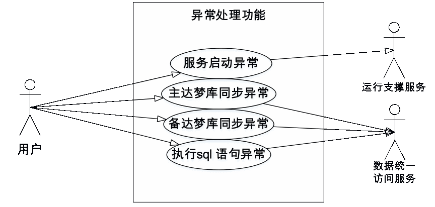
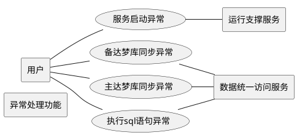
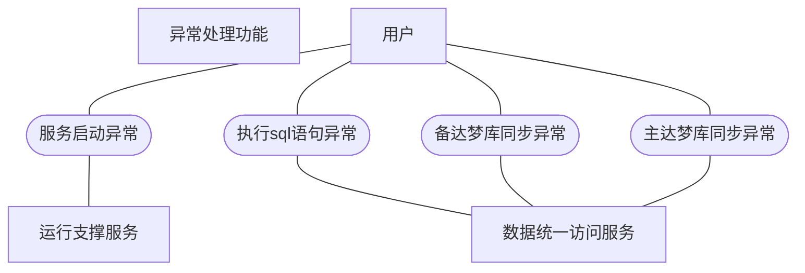
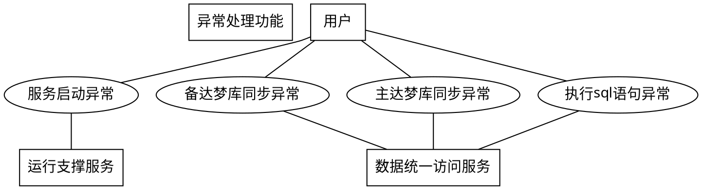

# 1_081 数据对档案

| 字段 | 值 |
|---|---|
| doc | 09数据同步共享服务软件需求规格说明-终稿 |
| section | 3.2.1.1.3 |
| image_caption | 图 16 异常处理功能用例图 |
| table_caption | 表 17异常处理功能能力标识 |

## 原始图片

*图 16 异常处理功能用例图*

## 结构图

*来源: born-digital导出(usecase, 8节点/8边)*
*类型经几何启发式精化(Master类型识别失败的图, 投影层推断, canonical锚点不变)*

*用例图以PlantUML渲染(UML母语): 小人=参与者 | 椭圆=用例 | 矩形框=系统边界 | 实线=关联 | 虚线=include/extend*

Mermaid兼容投影(通用md渲染器可显示)

DOT源码(完整语义, graphviz可渲染)

### 锚点节点结构

| # | 文本 | 类型 |
|---|---|---|
| 1 | 异常处理功能 | process |
| 2 | 服务启动异常 | usecase |
| 3 | 备达梦库同步异常 | usecase |
| 4 | 主达梦库同步异常 | usecase |
| 5 |   | other |
| 6 | 用户 | other |
| 7 | 执行sql语句异常 | usecase |
| 8 |   | other |
| 9 | 数据统一访问服务 | other |
| 10 |   | other |
| 11 | 运行支撑服务 | other |

## 表格内容

| 序号 | Use case名称 | 项目唯一标识符 | 需求描述 | 需求重用 | 方式名称 | 运行状态 | 对应的任务书功能/性能 |
|---|---|---|---|---|---|---|---|
| 1 | 服务启动异常 | PZXQ-GN-SJTB-ZBZLTB- | 记录主备服务器数据同步服务启动异常 | 沿用 | 桌面 | 运行阶段 | 4.1.2.e |
| 2 | 主达梦库同步异常 | PZXQ-GN-SJTB-ZBZLTB- | 记录主备服务器数据同步主服务器数据库异常 | 沿用 | 桌面 | 运行阶段 | 4.1.2.e |
| 3 | 备达梦库同步异常 | PZXQ-GN-SJTB-ZBZLTB- | 记录主备服务器数据同步备服务器数据库异常 | 沿用 | 桌面 | 运行阶段 | 4.1.2.e |
| 4 | 执行sql语句异常 | PZXQ-GN-SJTB-ZBZLTB- | 记录主备服务器数据同步中执行sql语句异 | 沿用 | 桌面 | 运行阶段 | 4.1.2.e |

## 正文

异常处理功能能力标识表，见表 17所示。
