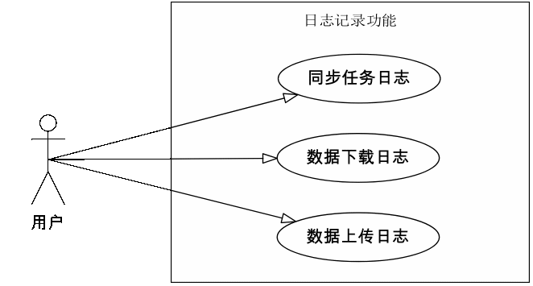
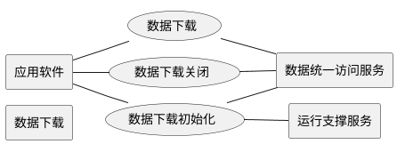
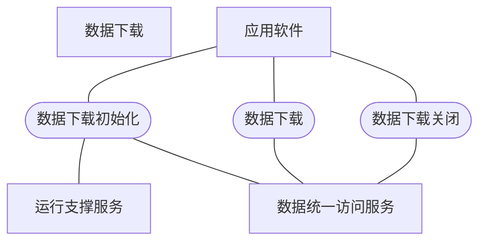
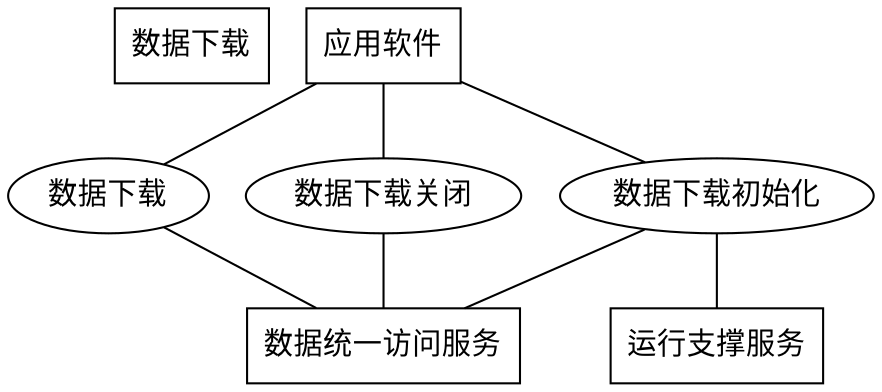

# 1_082 数据对档案

| 字段 | 值 |
|---|---|
| doc | 09数据同步共享服务软件需求规格说明-终稿 |
| section | 3.2.1.2 |
| image_caption | 图 18数据下载用例图 |
| table_caption | 表 22数据下载能力标识表 |

## 原始图片

*图 18数据下载用例图*

## 结构图

*来源: born-digital导出(usecase, 7节点/7边)*
*类型经几何启发式精化(Master类型识别失败的图, 投影层推断, canonical锚点不变)*

*用例图以PlantUML渲染(UML母语): 小人=参与者 | 椭圆=用例 | 矩形框=系统边界 | 实线=关联 | 虚线=include/extend*

Mermaid兼容投影(通用md渲染器可显示)

DOT源码(完整语义, graphviz可渲染)

### 锚点节点结构

| # | 文本 | 类型 |
|---|---|---|
| 1 | 数据下载 | process |
| 2 | 应用软件 | other |
| 3 | 数据下载初始化 | usecase |
| 4 | 数据下载 | usecase |
| 5 | 数据下载关闭 | usecase |
| 6 |   | other |
| 7 |   | other |
| 8 | 数据统一访问服务 | other |
| 9 |   | other |
| 10 | 运行支撑服务 | other |

## 表格内容

| 序号 | Use case名称 | 项目唯一标识符 | 需求描述 | 需求重用 | 状态/方式名称 | 运行状态 | 对应的任务书功能/性能 |
|---|---|---|---|---|---|---|---|
| 1 | 数据下载初始化 | PZXQ-GN-SJTB-SJXZ-CS | 实现主服务器的数据库(达梦数据库)到席位 | 新研 | 桌面、平板 | 运行阶段 | 4.1.2.f |
| 2 | 数据下载 | PZXQ-GN-SJTB-SJXZ-SJ | 实现主服务器的数据库(达梦数据库)到席位 | 新研 | 桌面、平板 | 运行阶段 | 4.1.2.f |
| 3 | 数据下载关闭 | PZXQ-GN-SJTB-SJXZ-SJ | 实现主服务器的数据库(达梦数据库)到席位 | 新研 | 桌面、平板 | 运行阶段 | 4.1.2.f |

## 正文

主服务器数据库到席位sqlite数据库数据下载流程图如图 19所示。
