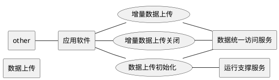
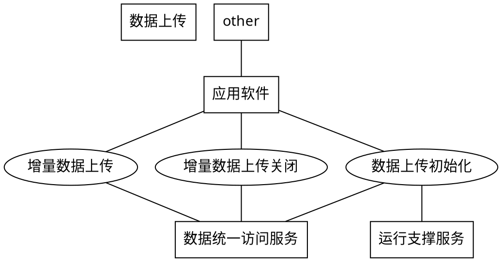

# 1_083 数据对档案

| 字段 | 值 |
|---|---|
| doc | 09数据同步共享服务软件需求规格说明-终稿 |
| section | 3.2.1.3 |
| image_caption | 图 20 数据上传用例图 |
| table_caption | 表 26数据上传能力标识表 |

## 原始图片


*图 20 数据上传用例图*

## 结构图

*来源: born-digital导出(usecase, 7节点/8边)*
*类型经几何启发式精化(Master类型识别失败的图, 投影层推断, canonical锚点不变)*

*用例图以PlantUML渲染(UML母语): 小人=参与者 | 椭圆=用例 | 矩形框=系统边界 | 实线=关联 | 虚线=include/extend*



<details><summary>Mermaid兼容投影(通用md渲染器可显示)</summary>

```mermaid
flowchart TD
    N45["数据上传"]
    N51["应用软件"]
    N52(["数据上传初始化"])
    N56(["增量数据上传"])
    N58(["增量数据上传关闭"])
    N73["数据统一访问服务"]
    N75["运行支撑服务"]
    N58 --- N73
    N56 --- N73
    N52 --- N73
    N52 --- N75
    N51 --- N52
    N50[""]
    N50 --- N51
    N51 --- N56
    N51 --- N58
```

</details>

<details><summary>DOT源码(完整语义, graphviz可渲染)</summary>



</details>

### 锚点节点结构

| # | 文本 | 类型 |
|---|---|---|
| 1 | 数据上传 | process |
| 2 |   | other |
| 3 | 应用软件 | other |
| 4 | 数据上传初始化 | usecase |
| 5 | 增量数据上传 | usecase |
| 6 | 增量数据上传关闭 | usecase |
| 7 |   | other |
| 8 | 数据统一访问服务 | other |
| 9 |   | other |
| 10 | 运行支撑服务 | other |

## 表格内容

| 序号 | Use case名称 | 项目唯一标识符 | 需求描述 | 需求重用 | 状态/方式名称 | 运行状态 | 对应的任务书功能/性能 |
|---|---|---|---|---|---|---|---|
| 1 | 数据上传初始化 | PZXQ-GN-SJTB-SJSC-CS | 席位数据库（sqlite数据库）到主服务 | 新研 | 桌面、平板 | 运行阶段 | 4.1.2.g |
| 2 | 增量数据上传 | PZXQ-GN-SJTB-SJSC-ZL | 席位数据库（sqlite数据库）到主服务 | 新研 | 桌面、平板 | 运行阶段 | 4.1.2.g |
| 3 | 增量数据上传关闭 | PZXQ-GN-SJTB-SJSC-ZL | 席位数据库（sqlite数据库）到主服务 | 新研 | 桌面、平板 | 运行阶段 | 4.1.2.g |

## 正文

数据上传能力标识表，见表 26所示。
