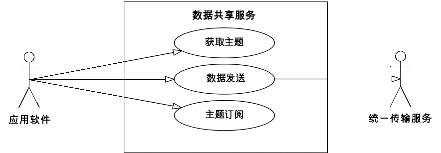

# 1_085 数据对档案

| 字段 | 值 |
|---|---|
| doc | 09数据同步共享服务软件需求规格说明-终稿 |
| section | 3.2.2 |
| image_caption | 图 23数据共享任务用例图 |
| table_caption | 表 34数据共享服务软件所有能力标识 |

## 原始图片

*图 23数据共享任务用例图*

## 结构图

*该对无Visio锚点(非Visio图, 无born-digital导出)*

## 表格内容

| 序号 | Use case名称 | 项目唯一标识符 | 需求描述 | 需求重用 | 方式名称 | 运行状态 | 对应的任务书功能/性能 |
|---|---|---|---|---|---|---|---|
| 1 | 获取主题 | PZXQ-GN-SJGX-HQZT | 获取资源池中所有资源主题 | 沿用 | 桌面、平板 | 运行阶段 | 4.1.1.c |
| 2 | 数据发布 | PZXQ-GN-SJGX-SJFB | 以指定主题发送消息 | 沿用 | 桌面、平板 | 运行阶段 | 4.1.1.a |
| 3 | 主题订阅 | PZXQ-GN-SJGX-ZTDY | 接收特定主题的消息 | 沿用 | 桌面、平板 | 运行阶段 | 4.1.1.b |

## 正文

数据共享功能主要分为3个功能，数据共享任务用例图如下图 23所示。
