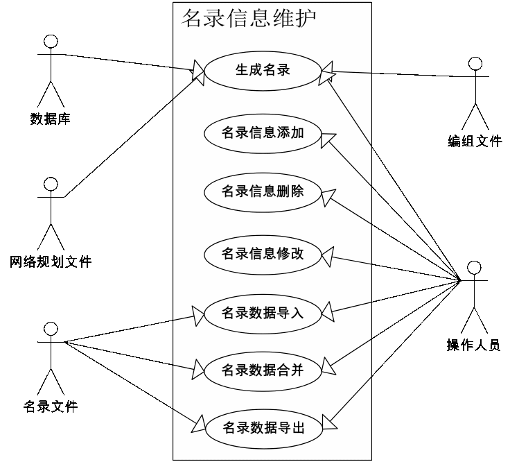
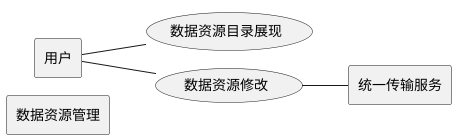
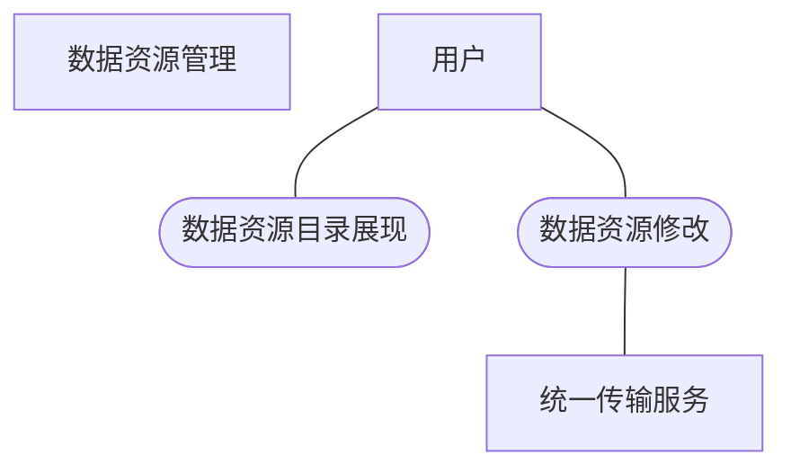
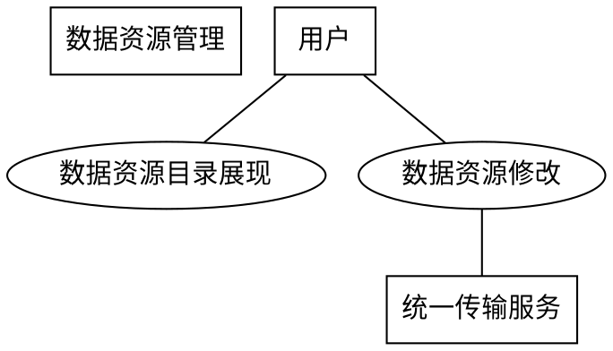

# 1_086 数据对档案

| 字段 | 值 |
|---|---|
| doc | 09数据同步共享服务软件需求规格说明-终稿 |
| section | 3.2.3 |
| image_caption | 图 27 数据资源管理任务用例图 |
| table_caption | 表 38数据资源管理软件所有能力标识 |

## 原始图片

*图 27 数据资源管理任务用例图*

## 结构图

*⚠ 结构经census重对齐: 旧锚点(oleObject8.bin:page1.xml)与图片不符, 已切换到与image.png内容一致的锚点(oleObject27.bin:page1.xml, align_score=1.0)*

*来源: born-digital导出(usecase, 5节点/3边)*
*类型经几何启发式精化(Master类型识别失败的图, 投影层推断, canonical锚点不变)*

*用例图以PlantUML渲染(UML母语): 小人=参与者 | 椭圆=用例 | 矩形框=系统边界 | 实线=关联 | 虚线=include/extend*

Mermaid兼容投影(通用md渲染器可显示)

DOT源码(完整语义, graphviz可渲染)

### 锚点节点结构

| # | 文本 | 类型 |
|---|---|---|
| 1 | 数据资源管理 | process |
| 2 | 数据资源目录展现 | usecase |
| 3 |   | other |
| 4 | 用户 | other |
| 5 | 数据资源修改 | usecase |
| 6 |   | other |
| 7 | 统一传输服务 | other |

## 表格内容

| 序号 | Use case名称 | 项目唯一标识符 | 需求描述 | 需求重用 | 方式名称 | 运行状态 | 对应的任务书功能/性能 |
|---|---|---|---|---|---|---|---|
| 1 | 数据资源目录的展现功能 | PZXQ-GN-SJZYGL-SJZYM | 用页面目录形式展示出所有的数据资源 | 沿用 | 桌面、平板 | 运行阶段 | 4.1.3.a |
| 2 | 数据资源的修改功能 | PZXQ-GN-SJZYGL-SJZYX | 对数据资源进行修改 | 沿用 | 桌面、平板 | 运行阶段 | 4.1.3.b |

## 正文

数据资源管理主要提供数据资源目录的展现功能和数据资源的修改功能。数据资源管理任务用例图如下图 27所示。
