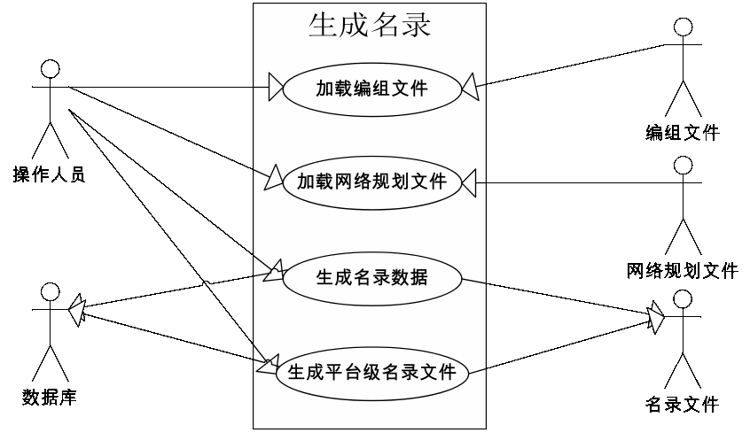
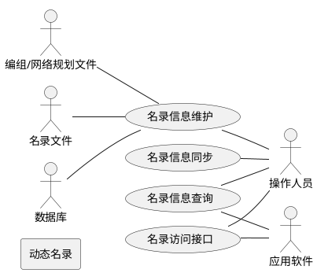
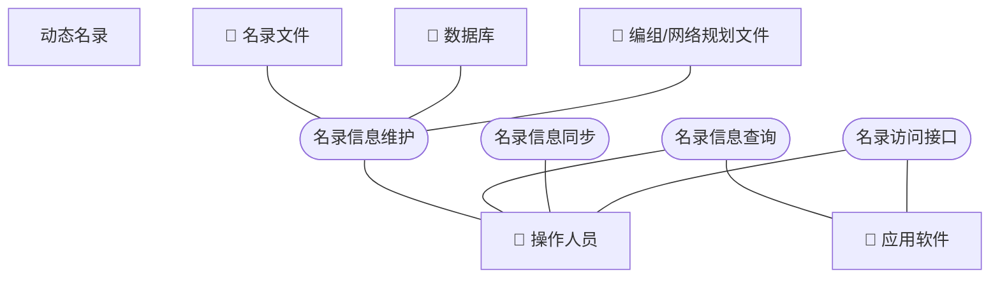
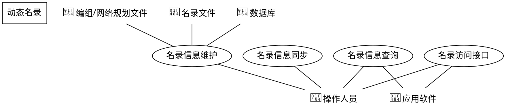

# 1_087 数据对档案

| 字段 | 值 |
|---|---|
| doc | 10动态名录软件需求规格说明-终稿 |
| section | 3.2 |
| image_caption | 图4 动态名录软件用例图 |
| table_caption | 表3 动态名录软件所有能力标识 |

## 原始图片

*图4 动态名录软件用例图*

## 结构图

*⚠ 结构经census重对齐: 旧锚点(oleObject3.bin:page1.xml)与图片不符, 已切换到与image.png内容一致的锚点(oleObject4.bin:page1.xml, align_score=1.0)*

*来源: born-digital导出(usecase, 10节点/9边)*
*类型经几何启发式精化(Master类型识别失败的图, 投影层推断, canonical锚点不变)*

*用例图以PlantUML渲染(UML母语): 小人=参与者 | 椭圆=用例 | 矩形框=系统边界 | 实线=关联 | 虚线=include/extend*

Mermaid兼容投影(通用md渲染器可显示)

DOT源码(完整语义, graphviz可渲染)

*⚠ 锚点Connect重建存在1个悬空连线端点(线端粘在无文本形状上被语义过滤跳过), 图示边数可能少于原图——渲染只呈现锚点事实, 不编造边; 独立证据可对照VLM通道提取(scene_vlm_extractions.json)*

### 锚点节点结构

| # | 文本 | 类型 |
|---|---|---|
| 1 | 动态名录 | process |
| 2 | 名录信息维护 | usecase |
| 3 | 名录信息查询 | usecase |
| 4 | 名录信息同步 | usecase |
| 5 | 名录访问接口 | usecase |
| 6 | 应用软件 | actor |
| 7 | 编组/网络规划文件 | actor |
| 8 | 名录文件 | actor |
| 9 | 数据库 | actor |
| 10 | 操作人员 | actor |

## 表格内容

| 序号 | Use case名称 | 项目唯一标识符 | 需求描述 | 需求重用 | 方式名称 | 运行状态 | 对应的任务书功能/性能 |
|---|---|---|---|---|---|---|---|
| 1 | 名录信息维护 | PZXQ-GN-MLXXWH | 完成名录信息的生成、维护功能，并提供可视 | 改进 | 桌面版 平板版 | 集成阶段、运行阶段 | 4.1.1、4.2a、4.2b |
| 2 | 名录信息查询 | PZXQ-GN-MLXXCX | 完成名录节点信息查询能力，包括上级、下级 | 沿用 | 桌面版 平板版 手持版 | 运行阶段 | 4.1.2、4.2a、4.2b |
| 3 | 名录信息同步 | PZXQ-GN-MLXXTB | 完成更新节点信息、用户上下线信息、用户装 | 新研 | 桌面版 平板版 手持版 | 运行阶段 | 4.1.3 |
| 4 | 名录访问接口 | PZXQ-GN-MLFWJK | 提供应用软件访问查询名录信息的接口 | 改进 | 桌面版 平板版 手持版 | 开发阶段 | 4.1.4 |

## 正文

动态名录软件按照其功能需求，包含名录信息维护、名录信息查询、名录信息同步和名录访问接口功能，并提供名录辅助工具，操作人员可通过该工具进行名录相关功能的操作。
