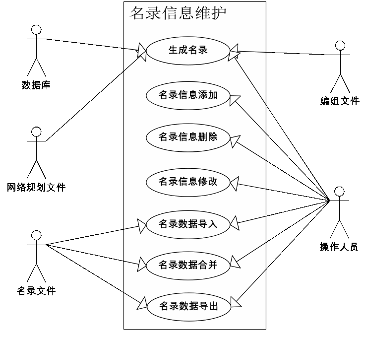
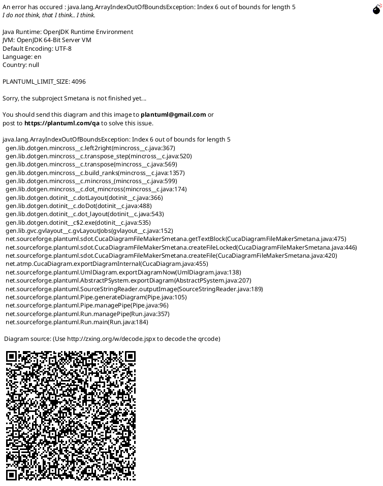
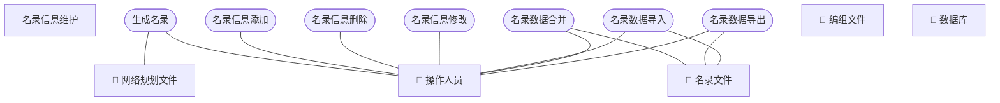

# 1_088 数据对档案

| 字段 | 值 |
|---|---|
| doc | 10动态名录软件需求规格说明-终稿 |
| section | 3.2.1 |
| image_caption | 图5 名录信息维护用例图 |
| table_caption | 表4名录信息维护功能能力标识 |

## 原始图片

*图5 名录信息维护用例图*

## 结构图

*⚠ 结构经census重对齐: 旧锚点(oleObject7.bin:page1.xml)与图片不符, 已切换到与image.png内容一致的锚点(oleObject5.bin:page1.xml, align_score=1.0)*

*来源: born-digital导出(usecase, 13节点/11边)*
*类型经几何启发式精化(Master类型识别失败的图, 投影层推断, canonical锚点不变)*

*用例图以PlantUML渲染(UML母语): 小人=参与者 | 椭圆=用例 | 矩形框=系统边界 | 实线=关联 | 虚线=include/extend*

Mermaid兼容投影(通用md渲染器可显示)

DOT源码(完整语义, graphviz可渲染)

### 锚点节点结构

| # | 文本 | 类型 |
|---|---|---|
| 1 | 名录信息维护 | process |
| 2 | 生成名录 | usecase |
| 3 | 名录信息添加 | usecase |
| 4 | 名录信息删除 | usecase |
| 5 | 名录信息修改 | usecase |
| 6 | 名录数据导出 | usecase |
| 7 | 名录数据导入 | usecase |
| 8 | 名录数据合并 | usecase |
| 9 | 名录文件 | actor |
| 10 | 编组文件 | actor |
| 11 | 网络规划文件 | actor |
| 12 | 数据库 | actor |
| 13 | 操作人员 | actor |

## 表格内容

| 序号 | Use case名称 | 项目唯一标识符 | 需求描述 | 需求重用 | 方式名称 | 运行状态 | 对应的任务书功能/性能 |
|---|---|---|---|---|---|---|---|
| 1 | 生成名录 | PZXQ-GN-MLXXWH-SCML | 能够通过所需编组数据、装备数据、人员数据 | 改进 | 桌面版 平板版 | 集成阶段 | 4.1.1a、4.2a、4.2b |
| 2 | 名录信息添加 | PZXQ-GN-MLXXWH-MLXXT | 能够提供添加名录节点及其属性信息的功能。 | 沿用 | 桌面版 平板版 手持版 | 集成阶段、运行阶段 | 4.1.1b、4.2a、4.2b |
| 3 | 名录信息删除 | PZXQ-GN-MLXXWH-MLXXS | 能够提供删除名录节点及其属性信息的功能。 | 沿用 | 桌面版 平板版 手持版 | 集成阶段、运行阶段 | 4.1.1b |
| 4 | 名录信息修改 | PZXQ-GN-MLXXWH-MLXXX | 能够提供修改名录节点及其属性信息的功能 | 沿用 | 桌面版 平板版 手持版 | 集成阶段、运行阶段 | 4.1.1b |
| 5 | 名录数据导出 | PZXQ-GN-MLXXWH-MLSJD | 能够提供导出名录数据的功能 | 改进 | 桌面版 平板版 手持版 | 集成阶段、运行阶段 | 4.1.1d |
| 6 | 名录数据导入 | PZXQ-GN-MLXXWH-MLSJD | 能够提供导入名录数据的功能 | 改进 | 桌面版 平板版 手持版 | 集成阶段、运行阶段 | 4.1.1c、4.2a、4.2b |
| 7 | 名录数据合并 | PZXQ-GN-MLXXWH-MLSJH | 能够提供合并名录数据的功能 | 改进 | 桌面版 平板版 | 集成阶段、运行阶段 | 4.1.1e、4.2a、4.2b |

## 正文

动态名录软件名录信息维护功能主要完成名录文件的生成和名录信息的添加、删除、修改、导入、导出、合并功能，并提供名录信息的可视化维护功能，名录信息维护用例图如图5所示。
