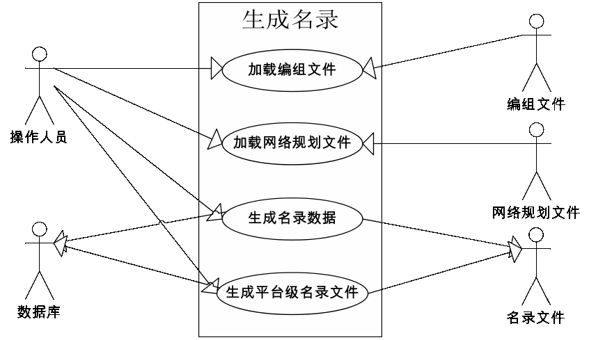
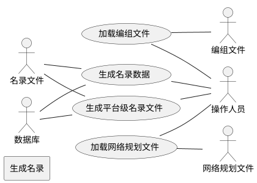
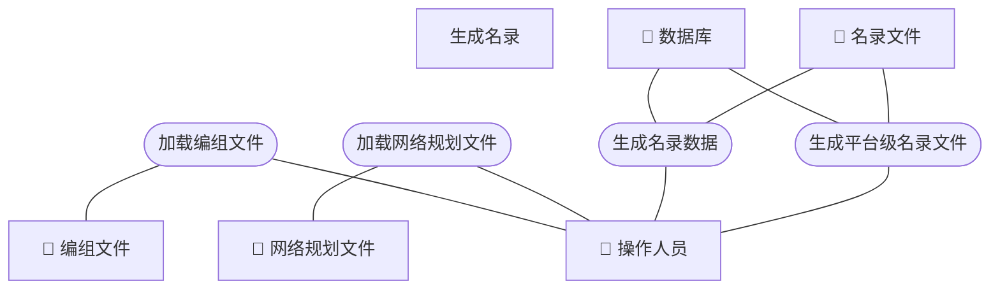
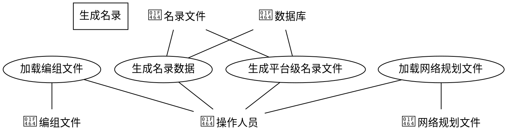

# 1_089 数据对档案

| 字段 | 值 |
|---|---|
| doc | 10动态名录软件需求规格说明-终稿 |
| section | 3.2.1.1 |
| image_caption | 图 6 名录生成用例图 |
| table_caption | 表 5 生成名录功能能力标识 |

## 原始图片

*图 6 名录生成用例图*

## 结构图

*来源: born-digital导出(usecase, 10节点/10边)*
*类型经几何启发式精化(Master类型识别失败的图, 投影层推断, canonical锚点不变)*

*用例图以PlantUML渲染(UML母语): 小人=参与者 | 椭圆=用例 | 矩形框=系统边界 | 实线=关联 | 虚线=include/extend*

Mermaid兼容投影(通用md渲染器可显示)

DOT源码(完整语义, graphviz可渲染)

### 锚点节点结构

| # | 文本 | 类型 |
|---|---|---|
| 1 | 生成名录 | process |
| 2 | 加载编组文件 | usecase |
| 3 | 加载网络规划文件 | usecase |
| 4 | 生成名录数据 | usecase |
| 5 | 生成平台级名录文件 | usecase |
| 6 | 编组文件 | actor |
| 7 | 名录文件 | actor |
| 8 | 操作人员 | actor |
| 9 | 网络规划文件 | actor |
| 10 | 数据库 | actor |

## 表格内容

| 序号 | Use case名称 | 项目唯一标识符 | 需求描述 | 需求重用 | 方式名称 | 运行状态 | 对应的任务书功能/性能 |
|---|---|---|---|---|---|---|---|
|   | 加载编组文件 | PZXQ-GN-MLXXWH-SCML- | 根据编组结果，加载编组文件并解析。 | 改进 | 桌面版 平板版 | 集成阶段 | 4.1.1a、4.2a、4.2b |
|   | 加载网络规划文件 | PZXQ-GN-MLXXWH-SCML- | 根据网络规划结果，加载网络规划文件并解析 | 改进 | 桌面版 平板版 | 集成阶段 | 4.1.1a |
|   | 生成名录数据 | PZXQ-GN-MLXXWH-SCML- | 根据输入的信息生成名录数据，包括节点信息 | 改进 | 桌面版 平板版 | 集成阶段 | 4.1.1a |
|   | 生成平台级名录文件 | PZXQ-GN-MLXXWH-SCML- | 支持生成平台级名录文件 | 改进 | 桌面版 平板版 | 集成阶段 | 4.1.1a |

## 正文

动态名录软件提供名录数据生成的功能，支持根据编组文件、网络规划文件及系统基础数据生成名录文件，包括节点信息及各节点间的编组从属关系，支持生成平台级名录文件。生成名录的用例图如图 6所示。
