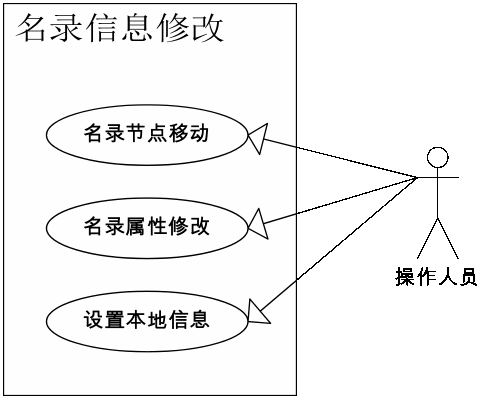
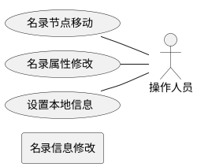

# 1_092 数据对档案

| 字段 | 值 |
|---|---|
| doc | 10动态名录软件需求规格说明-终稿 |
| section | 3.2.1.4 |
| image_caption | 图 9 名录信息修改用例图 |
| table_caption | 表 16 名录信息修改能力标识 |

## 原始图片

*图 9 名录信息修改用例图*

## 结构图

*⚠ 结构经census重对齐: 旧锚点(oleObject18.bin:page1.xml)与图片不符, 已切换到与image.png内容一致的锚点(oleObject9.bin:page1.xml, align_score=1.0)*

*来源: born-digital导出(usecase, 5节点/3边)*
*类型经几何启发式精化(Master类型识别失败的图, 投影层推断, canonical锚点不变)*

*用例图以PlantUML渲染(UML母语): 小人=参与者 | 椭圆=用例 | 矩形框=系统边界 | 实线=关联 | 虚线=include/extend*

Mermaid兼容投影(通用md渲染器可显示)

DOT源码(完整语义, graphviz可渲染)

### 锚点节点结构

| # | 文本 | 类型 |
|---|---|---|
| 1 | 名录信息修改 | process |
| 2 | 名录节点移动 | usecase |
| 3 | 名录属性修改 | usecase |
| 4 | 设置本地信息 | usecase |
| 5 | 操作人员 | actor |

## 表格内容

| 序号 | Use case名称 | 项目唯一标识符 | 需求描述 | 需求重用 | 方式名称 | 运行状态 | 对应的任务书功能/性能 |
|---|---|---|---|---|---|---|---|
|   | 名录节点移动 | PZXQ-GN-MLXXWH-MLXXX | 具备移动名录节点的功能。 | 沿用 | 桌面版 平板版 | 集成阶段、运行阶段 | 4.1.1b |
|   | 名录属性修改 | PZXQ-GN-MLXXWH-MLXXX | 具备修改名录节点属性的功能。 | 沿用 | 桌面版 平板版 | 集成阶段、运行阶段 | 4.1.1b |
|   | 设置本地信息 | PZXQ-GN-MLXXWH-MLXXX | 具备设置本地信息的功能。 | 沿用 | 桌面版 平板版 | 集成阶段 | 4.1.1b |

## 正文

能够提供修改名录节点及其属性信息的功能。名录信息修改用例图如图 9所示。
