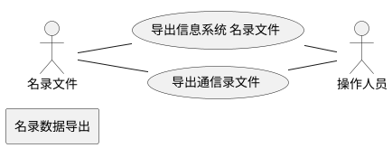
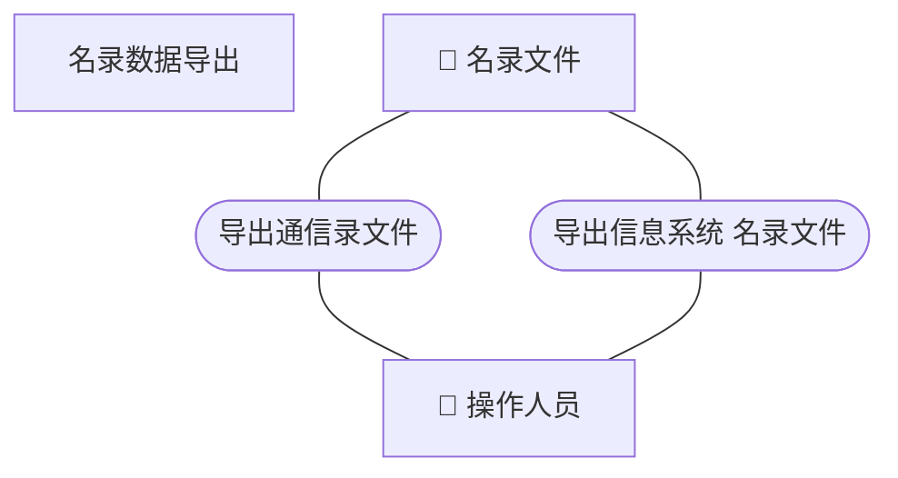
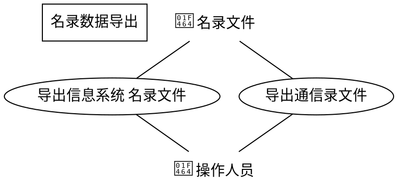

# 1_093 数据对档案

| 字段 | 值 |
|---|---|
| doc | 10动态名录软件需求规格说明-终稿 |
| section | 3.2.1.5 |
| image_caption | 图 10 名录数据导出用例图 |
| table_caption | 表 20 名录数据导出能力标识 |

## 原始图片

*图 10 名录数据导出用例图*

## 结构图

*来源: born-digital导出(usecase, 5节点/4边)*
*类型经几何启发式精化(Master类型识别失败的图, 投影层推断, canonical锚点不变)*

*用例图以PlantUML渲染(UML母语): 小人=参与者 | 椭圆=用例 | 矩形框=系统边界 | 实线=关联 | 虚线=include/extend*

Mermaid兼容投影(通用md渲染器可显示)

DOT源码(完整语义, graphviz可渲染)

### 锚点节点结构

| # | 文本 | 类型 |
|---|---|---|
| 1 | 名录数据导出 | process |
| 2 | 导出信息系统
名录文件 | usecase |
| 3 | 导出通信录文件 | usecase |
| 4 | 操作人员 | actor |
| 5 | 名录文件 | actor |

## 表格内容

| 序号 | Use case名称 | 项目唯一标识符 | 需求描述 | 需求重用 | 方式名称 | 运行状态 | 对应的任务书功能/性能 |
|---|---|---|---|---|---|---|---|
| 1 | 导出名录文件 | PZXQ-GN-MLXXWH-MLSJD | 能够将名录数据导出为信息系统名录文件。 | 改进 | 桌面版 平板版 | 集成阶段、运行阶段 | 4.1.1d |
| 2 | 导出通信录文件 | PZXQ-GN-MLXXWH-MLSJD | 能够将名录数据导出为通信录文件。 | 改进 | 桌面版 平板版 | 集成阶段、运行阶段 | 4.1.1d |

## 正文

动态名录提供名录文件的导出功能，支持导出旅信息系统名录文件、“统一版”通信录文件。名录数据导出用例图如图 10所示。
