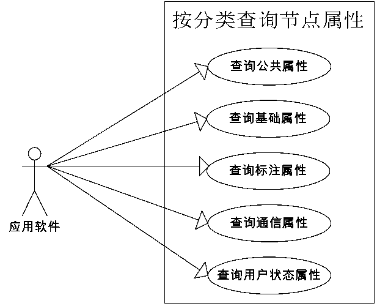
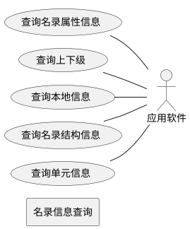

# 1_096 数据对档案

| 字段 | 值 |
|---|---|
| doc | 10动态名录软件需求规格说明-终稿 |
| section | 3.2.2 |
| image_caption | 图 13 名录信息查询用例图 |

## 原始图片

*图 13 名录信息查询用例图*

## 结构图

*⚠ 结构经census重对齐: 旧锚点(oleObject14.bin:page1.xml)与图片不符, 已切换到与image.png内容一致的锚点(oleObject13.bin:page1.xml, align_score=1.0)*

*来源: born-digital导出(usecase, 7节点/5边)*
*类型经几何启发式精化(Master类型识别失败的图, 投影层推断, canonical锚点不变)*

*用例图以PlantUML渲染(UML母语): 小人=参与者 | 椭圆=用例 | 矩形框=系统边界 | 实线=关联 | 虚线=include/extend*

Mermaid兼容投影(通用md渲染器可显示)

DOT源码(完整语义, graphviz可渲染)

### 锚点节点结构

| # | 文本 | 类型 |
|---|---|---|
| 1 | 名录信息查询 | process |
| 2 | 查询名录属性信息 | usecase |
| 3 | 查询上下级 | usecase |
| 4 | 查询本地信息 | usecase |
| 5 | 查询名录结构信息 | usecase |
| 6 | 查询单元信息 | usecase |
| 7 | 应用软件 | actor |

## 表格内容

| 序号 | Use case名称 | 项目唯一标识符 | 需求描述 | 需求重用 | 方式名称 | 运行状态 | 对应的任务书功能/性能 |
|---|---|---|---|---|---|---|---|
| 1 | 查询名录结构信息 | PZXQ-GN-MLXXCX-CXMLJ | 提供完整名录结构信息查询功能，支持按照用 | 沿用 | 桌面版 平板版 手持版 | 运行阶段 | 4.1.2a |
| 2 | 查询名录属性信息 | PZXQ-GN-MLXXCX-CXMLS | 能够根据数据唯一标识查询指定节点的单个或 | 沿用 | 桌面版 平板版 手持版 | 运行阶段 | 4.1.2b |
| 3 | 查询单元信息 | PZXQ-GN-MLXXCX-CXZHD | 能够通过属性名称及属性值查询符合条件的所 | 沿用 | 桌面版 平板版 手持版 | 运行阶段 | 4.1.2c |
| 4 | 查询本地信息 | PZXQ-GN-MLXXCX-CXBDX | 能够查询本地节点信息 | 沿用 | 桌面版 平板版 手持版 | 运行阶段 | 4.1.2d |
| 5 | 查询上下级 | PZXQ-GN-MLXXCX-CXSXJ | 提供编组关系信息查询功能，支持根据数据唯 | 沿用 | 桌面版 平板版 手持版 | 运行阶段 | 4.1.2d |

## 正文

动态名录软件提供完整名录结构信息查询功能，支持按照用户编组关系、从属关系进行查询。查询名录结构信息的用例图如图 14所示。
