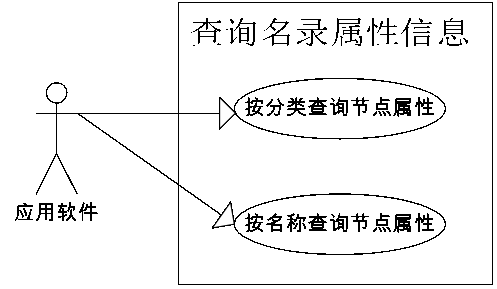
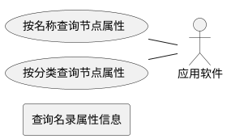
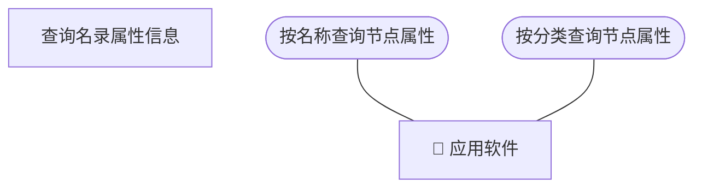

# 1_098 数据对档案

| 字段 | 值 |
|---|---|
| doc | 10动态名录软件需求规格说明-终稿 |
| section | 3.2.2.2 |
| image_caption | 图 15 查询名录属性信息用例图 |
| table_caption | 表 34 查询节点信息功能能力标识 |

## 原始图片

*图 15 查询名录属性信息用例图*

## 结构图

*来源: born-digital导出(usecase, 4节点/2边)*
*类型经几何启发式精化(Master类型识别失败的图, 投影层推断, canonical锚点不变)*

*用例图以PlantUML渲染(UML母语): 小人=参与者 | 椭圆=用例 | 矩形框=系统边界 | 实线=关联 | 虚线=include/extend*

Mermaid兼容投影(通用md渲染器可显示)

DOT源码(完整语义, graphviz可渲染)

### 锚点节点结构

| # | 文本 | 类型 |
|---|---|---|
| 1 | 查询名录属性信息 | process |
| 2 | 按名称查询节点属性 | usecase |
| 3 | 按分类查询节点属性 | usecase |
| 4 | 应用软件 | actor |

## 表格内容

| 序号 | Use case名称 | 项目唯一标识符 | 需求描述 | 需求重用 | 方式名称 | 运行状态 | 对应的任务书功能/性能 |
|---|---|---|---|---|---|---|---|
|   | 按分类查询节点属性 | PZXQ-GN-MLXXCX-CXJDX | 支持按照属性分类进行节点信息的查询。 | 沿用 | 桌面版 平板版 手持版 | 运行阶段 | 4.1.2b |
|   | 按名称查询节点属性 | PZXQ-GN-MLXXCX-CXJDX | 支持按照属性名称行节点信息的查询。 | 沿用 | 桌面版 平板版 手持版 | 运行阶段 | 4.1.2b |

## 正文

支持按照属性分类进行节点信息的查询。按分类查询节点属性用例图如图 16 按分类查询节点属性用例图所示。
