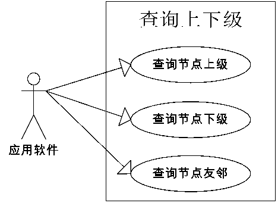
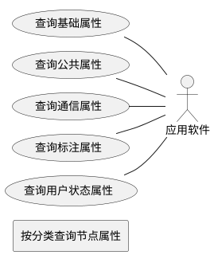

# 1_099 数据对档案

| 字段 | 值 |
|---|---|
| doc | 10动态名录软件需求规格说明-终稿 |
| section | 3.2.2.2.1 |
| image_caption | 图 16 按分类查询节点属性用例图 |
| table_caption | 表 35 按分类查询节点属性能力标识 |

## 原始图片

*图 16 按分类查询节点属性用例图*

## 结构图

*来源: born-digital导出(usecase, 7节点/5边)*
*类型经几何启发式精化(Master类型识别失败的图, 投影层推断, canonical锚点不变)*

*用例图以PlantUML渲染(UML母语): 小人=参与者 | 椭圆=用例 | 矩形框=系统边界 | 实线=关联 | 虚线=include/extend*

Mermaid兼容投影(通用md渲染器可显示)

DOT源码(完整语义, graphviz可渲染)

### 锚点节点结构

| # | 文本 | 类型 |
|---|---|---|
| 1 | 按分类查询节点属性 | process |
| 2 | 查询基础属性 | usecase |
| 3 | 查询公共属性 | usecase |
| 4 | 查询通信属性 | usecase |
| 5 | 查询标注属性 | usecase |
| 6 | 查询用户状态属性 | usecase |
| 7 | 应用软件 | actor |

## 表格内容

| 序号 | Use case名称 | 项目唯一标识符 | 需求描述 | 需求重用 | 方式名称 | 运行状态 | 对应的任务书功能/性能 |
|---|---|---|---|---|---|---|---|
| 1 | 查询公共属性 | PZXQ-GN-MLXXCX-CXJDX | 能够查询节点所有公共属性。 | 沿用 | 桌面版 平板版 手持版 | 运行阶段 | 4.1.1b |
| 2 | 查询基础属性 | PZXQ-GN-MLXXCX-CXJDX | 能够查询节点所有基础属性。 | 沿用 | 桌面版 平板版 手持版 | 运行阶段 | 4.1.1b |
| 3 | 查询标注属性 | PZXQ-GN-MLXXCX-CXJDX | 能够查询节点所有标注属性 | 沿用 | 桌面版 平板版 手持版 | 运行阶段 | 4.1.1b |
| 4 | 查询通信属性 | PZXQ-GN-MLXXCX-CXJDX | 能够查询节点所有通信属性 | 沿用 | 桌面版 平板版 手持版 | 运行阶段 | 4.1.1b |
| 5 | 查询用户状态属性 | PZXQ-GN-MLXXCX-CXJDX | 能够查询节点所有用户状态属性 | 沿用 | 桌面版 平板版 手持版 | 运行阶段 | 4.1.1b |

## 正文

支持按照属性分类进行节点信息的查询。按分类查询节点属性用例图如图 16 按分类查询节点属性用例图所示。
