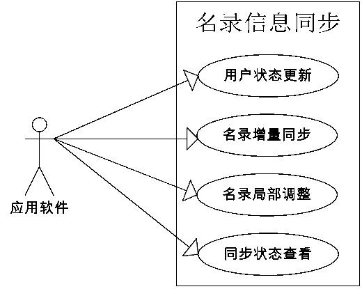
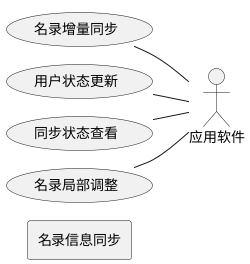

# 1_106 数据对档案

| 字段 | 值 |
|---|---|
| doc | 10动态名录软件需求规格说明-终稿 |
| section | 3.2.3 |
| image_caption | 图 23 名录信息同步用例图 |
| table_caption | 表 60 名录信息同步能力标识 |

## 原始图片

*图 23 名录信息同步用例图*

## 结构图

*来源: born-digital导出(usecase, 6节点/4边)*
*类型经几何启发式精化(Master类型识别失败的图, 投影层推断, canonical锚点不变)*

*用例图以PlantUML渲染(UML母语): 小人=参与者 | 椭圆=用例 | 矩形框=系统边界 | 实线=关联 | 虚线=include/extend*

Mermaid兼容投影(通用md渲染器可显示)

DOT源码(完整语义, graphviz可渲染)

### 锚点节点结构

| # | 文本 | 类型 |
|---|---|---|
| 1 | 名录信息同步 | process |
| 2 | 名录增量同步 | usecase |
| 3 | 用户状态更新 | usecase |
| 4 | 同步状态查看 | usecase |
| 5 | 名录局部调整 | usecase |
| 6 | 应用软件 | actor |

## 表格内容

| 序号 | Use case名称 | 项目唯一标识符 | 需求描述 | 需求重用 | 方式名称 | 运行状态 | 对应的任务书功能/性能 |
|---|---|---|---|---|---|---|---|
| 1 | 用户状态更新 | PZXQ-GN-MLXXTB-YHZTG | 具备用户上下线管理、登录地址维护更新能力 | 新研 | 桌面版 平板版 手持版 | 运行阶段 | 4.1.3a |
| 2 | 名录增量同步 | PZXQ-GN-MLXXTB-MLZLT | 具备将编组节点属性信息有变化的部分、用户 | 新研 | 桌面版 平板版 手持版 | 运行阶段 | 4.1.3b |
| 3 | 名录局部调整 | PZXQ-GN-MLXXTB-MLJBT | 具备将待同步信息同步到相关的上级或下级的 | 新研 | 桌面版 平板版 手持版 | 运行阶段 | 4.1.3b |
| 4 | 同步状态查看 | PZXQ-GN-MLXXTB-TBZTC | 提供名录信息同步状态查看的功能 | 沿用 | 桌面版 平板版 手持版 | 运行阶段 | 4.1.3c |

## 正文

名录信息同步功能将用户在线状态信息按照既定策略在单元间同步。其用例图如图 23所示。
