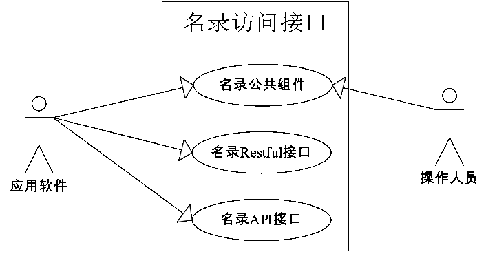
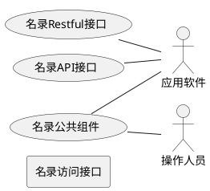

# 1_107 数据对档案

| 字段 | 值 |
|---|---|
| doc | 10动态名录软件需求规格说明-终稿 |
| section | 3.2.4 |
| image_caption | 图 24 名录服务接口用例图 |
| table_caption | 表 65 名录访问接口能力标识 |

## 原始图片

*图 24 名录服务接口用例图*

## 结构图

*来源: born-digital导出(usecase, 6节点/4边)*
*类型经几何启发式精化(Master类型识别失败的图, 投影层推断, canonical锚点不变)*

*用例图以PlantUML渲染(UML母语): 小人=参与者 | 椭圆=用例 | 矩形框=系统边界 | 实线=关联 | 虚线=include/extend*

Mermaid兼容投影(通用md渲染器可显示)

DOT源码(完整语义, graphviz可渲染)

### 锚点节点结构

| # | 文本 | 类型 |
|---|---|---|
| 1 | 名录访问接口 | process |
| 2 | 名录Restful接口 | usecase |
| 3 | 名录公共组件 | usecase |
| 4 | 名录API接口 | usecase |
| 5 | 应用软件 | actor |
| 6 | 操作人员 | actor |

## 表格内容

| 序号 | Use case名称 | 项目唯一标识符 | 需求描述 | 需求重用 | 方式名称 | 运行状态 | 对应的任务书功能/性能 |
|---|---|---|---|---|---|---|---|
| 1 | 名录公共组件 | PZXQ-GN-MLFWJK-MLGGZ | 支持应用软件将WEB名录公共组件嵌入其前 | 新研 | 桌面版 平板版 手持版 | 开发阶段 | 4.1.4a |
| 2 | 名录Restful接口 | PZXQ-GN-MLFWJK-MLRES | 能够为应用软件提供查询全部名录信息、查询 | 新研 | 桌面版 平板版 手持版 | 开发阶段 | 4.1.4b |
| 3 | 名录API接口 | PZXQ-GN-MLFWJK-MLAPI | 能够为应用软件提供查询全部名录信息、查询 | 沿用 | 桌面版 平板版 手持版 | 开发阶段 | 4.1.4c |

## 正文

名录访问接口功能提供应用软件访问查询名录信息的接口。名录访问接口用例图如图 24所示。
