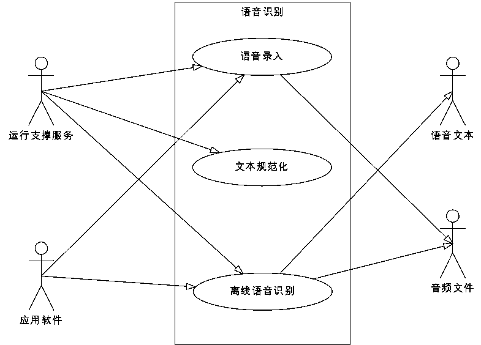
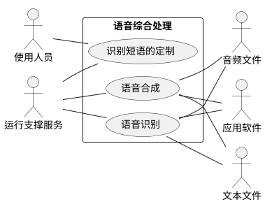
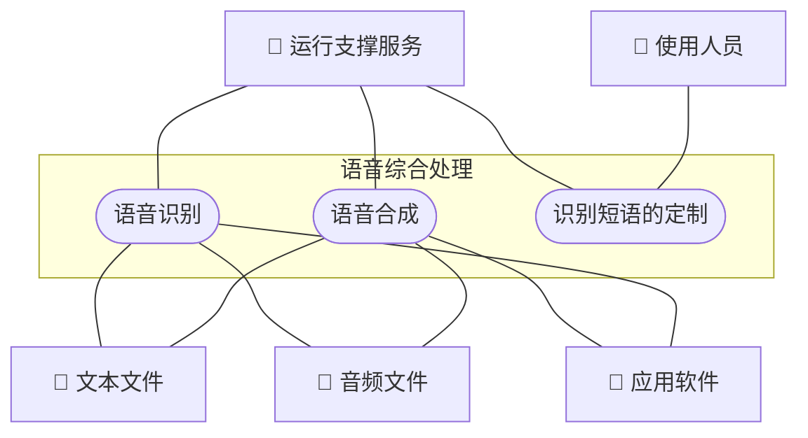
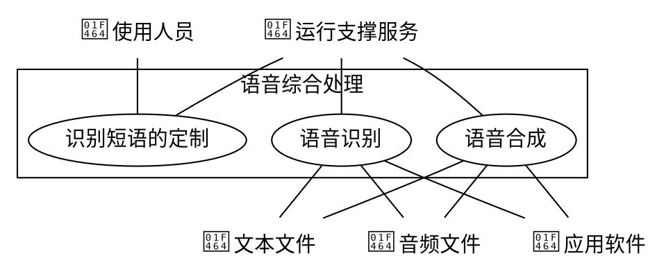

# 1_108 数据对档案

| 字段 | 值 |
|---|---|
| doc | 11语音综合处理软件需求规格说明-终稿 |
| section | 3.2 |
| image_caption | 图3 语音综合处理软件用例图 |
| table_caption | 表2 语音综合处理软件所有能力标识 |

## 原始图片

*图3 语音综合处理软件用例图*

## 结构图

*⚠ 结构经census重对齐: 旧锚点(oleObject15.bin:page1.xml)与图片不符, 已切换到与image.png内容一致的锚点(oleObject3.bin:page1.xml, align_score=1.0)*

*来源: born-digital导出(usecase, 9节点/10边)*
*类型经几何启发式精化(Master类型识别失败的图, 投影层推断, canonical锚点不变)*

*用例图以PlantUML渲染(UML母语): 小人=参与者 | 椭圆=用例 | 矩形框=系统边界 | 实线=关联 | 虚线=include/extend*

Mermaid兼容投影(通用md渲染器可显示)

DOT源码(完整语义, graphviz可渲染)

*⚠ 锚点Connect重建存在1个悬空连线端点(线端粘在无文本形状上被语义过滤跳过), 图示边数可能少于原图——渲染只呈现锚点事实, 不编造边; 独立证据可对照VLM通道提取(scene_vlm_extractions.json)*

### 锚点节点结构

| # | 文本 | 类型 |
|---|---|---|
| 1 | 语音综合处理 | boundary |
| 2 | 语音合成 | usecase |
| 3 | 语音识别 | usecase |
| 4 | 识别短语的定制 | usecase |
| 5 | 使用人员 | actor |
| 6 | 运行支撑服务 | actor |
| 7 | 应用软件 | actor |
| 8 | 文本文件 | actor |
| 9 | 音频文件 | actor |

## 表格内容

| 序号 | Use case名称 | 项目唯一标识符 | 需求描述 | 需求重用 | 方式名称 | 运行状态 | 对应的任务书功能/性能 |
|---|---|---|---|---|---|---|---|
| 1 | 语音合成 | PZXQ-GN-YYZHCL -YYHC | 提供格式化文本信息向语音信息转换的语音合 | 新研 | 手持、桌面、平板 | 运行阶段 | 4.1.1 |
| 2 | 语音识别 | PZXQ-GN-YYZHCL -YYSB | 提供语音录入功能，能够将语音信息转换为w | 无 | 手持、桌面、平板 | 运行阶段 | 4.1.2 4.2 a) |
| 3 | 识别短语定制 | PZXQ-GN-YYZHCL -SBDY | 提供识别短语的管理功能，支持用户按照需求 | 无 | 桌面 | 集成阶段、运行阶段 | 4.1.3 4.2 b） |

## 正文

语音综合处理软件按照其功能需求，包含语音合成、语音识别、识别短语的定制的功能，见图2所示。
