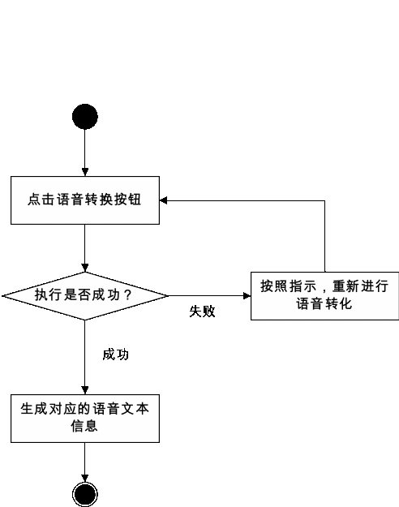
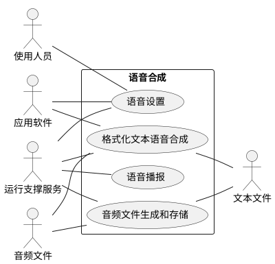
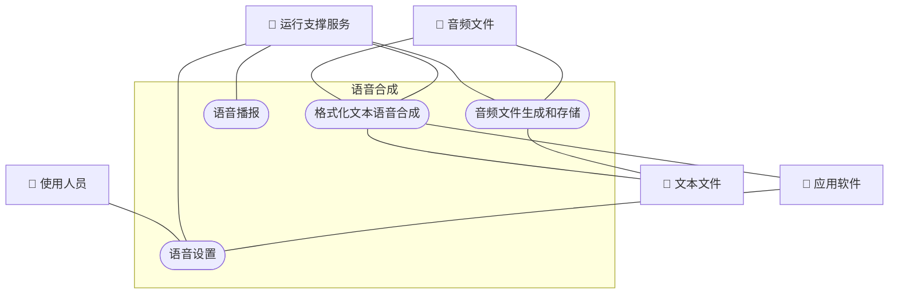
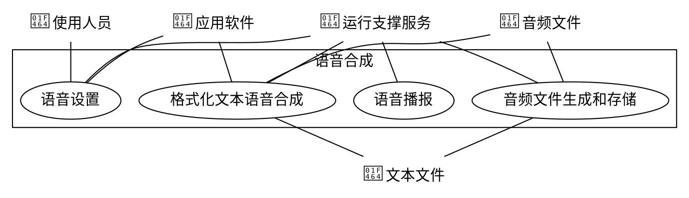

# 1_109 数据对档案

| 字段 | 值 |
|---|---|
| doc | 11语音综合处理软件需求规格说明-终稿 |
| section | 3.2 |
| image_caption | 图4 语音合成用例图 |
| table_caption | 表3 语音合成能力标识 |

## 原始图片

*图4 语音合成用例图*

## 结构图

*来源: born-digital导出(usecase, 10节点/11边)*
*类型经几何启发式精化(Master类型识别失败的图, 投影层推断, canonical锚点不变)*

*用例图以PlantUML渲染(UML母语): 小人=参与者 | 椭圆=用例 | 矩形框=系统边界 | 实线=关联 | 虚线=include/extend*

Mermaid兼容投影(通用md渲染器可显示)

DOT源码(完整语义, graphviz可渲染)

### 锚点节点结构

| # | 文本 | 类型 |
|---|---|---|
| 1 | 语音合成 | boundary |
| 2 | 格式化文本语音合成 | usecase |
| 3 | 语音播报 | usecase |
| 4 | 语音设置 | usecase |
| 5 | 使用人员 | actor |
| 6 | 运行支撑服务 | actor |
| 7 | 应用软件 | actor |
| 8 | 文本文件 | actor |
| 9 | 音频文件 | actor |
| 10 | 音频文件生成和存储 | usecase |

## 表格内容

| 序号 | Use case名称 | 项目唯一标识符 | 需求描述 | 需求重用 | 方式 名称 | 运行 状态 | 对应的任务书功能/性能 |
|---|---|---|---|---|---|---|---|
| 1 | 格式化文本语音合成 | PZXQ-GN-YYZHCL-YYHC- | 提供格式化文本信息向语音信息转换的语音合 | 新研 | 桌面、平板、手持 | 运行阶段 | 4.1.1a) |
| 2 | 音频文件生成和存储 | PZXQ-GN-YYZHCL-YYHC- | 能够将合成的语音转换成wav格式音频文件 | 新研 | 桌面、平板、手持 | 运行阶段 | 4.1.1b) |
| 3 | 语音播报 | PZXQ-GN-YYZHCL-YYHC- | 能够对本地wav音频和合成的wav音频进 | 新研 | 桌面、平板、手持 | 运行阶段 | 4.1.1c) |
| 4 | 语音设置 | PZXQ-GN-YYZHCL-YYHC- | 可进行人声选择（男声、女声），进行语音播 | 新研 | 桌面、平板、手持 | 运行阶段 | 4.1.1d) |

## 正文

语音合成的主要功能包括：格式化文本语音合成、音频文件生成和存储、语音播报、语音设置，功能用例如图4所示。
