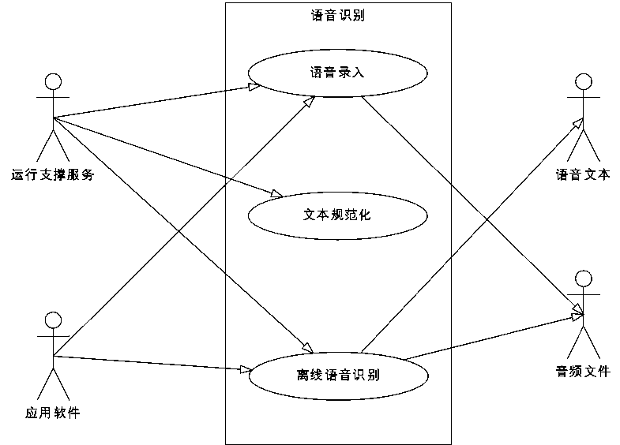
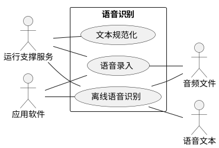
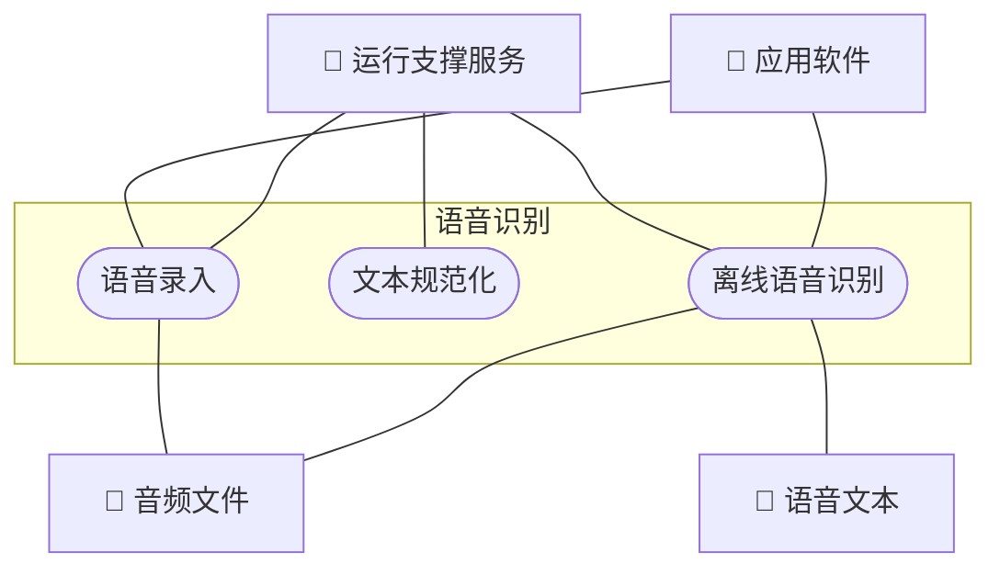
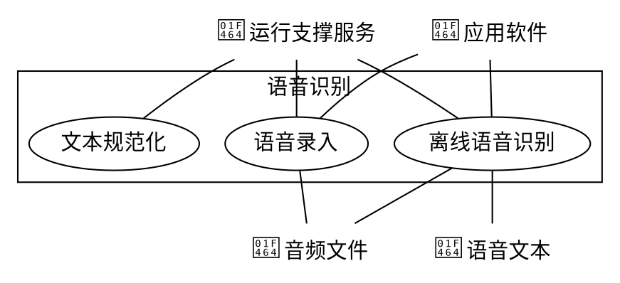

# 1_110 数据对档案

| 字段 | 值 |
|---|---|
| doc | 11语音综合处理软件需求规格说明-终稿 |
| section | 3.2 |
| image_caption | 图 9语音识别用例图 |
| table_caption | 表 8语音识别能力标识 |

## 原始图片

*图 9语音识别用例图*

## 结构图

*⚠ 结构经census重对齐: 旧锚点(oleObject2.bin:page1.xml)与图片不符, 已切换到与image.png内容一致的锚点(oleObject9.bin:page1.xml, align_score=1.0)*

*来源: born-digital导出(usecase, 8节点/8边)*
*类型经几何启发式精化(Master类型识别失败的图, 投影层推断, canonical锚点不变)*

*用例图以PlantUML渲染(UML母语): 小人=参与者 | 椭圆=用例 | 矩形框=系统边界 | 实线=关联 | 虚线=include/extend*

Mermaid兼容投影(通用md渲染器可显示)

DOT源码(完整语义, graphviz可渲染)

### 锚点节点结构

| # | 文本 | 类型 |
|---|---|---|
| 1 | 语音识别 | boundary |
| 2 | 语音录入 | usecase |
| 3 | 文本规范化 | usecase |
| 4 | 离线语音识别 | usecase |
| 5 | 运行支撑服务 | actor |
| 6 | 应用软件 | actor |
| 7 | 语音文本 | actor |
| 8 | 音频文件 | actor |

## 表格内容

| 序号 | Use case名称 | 项目唯一标识符 | 需求描述 | 需求重用 | 方式名称 | 运行 状态 | 对应的任务书功能/性能 |
|---|---|---|---|---|---|---|---|
| 1 | 语音录入 | PZXQ-GN-YYZHCL-YYSB- | 提供语音录入的功能 | 新研 | 桌面、平板、手持 | 运行阶段 | 4.1.2a) |
| 2 | 文本规范化 | PZXQ-GN-YYZHCL-YYSB- | 对语音转换成的文本格式进行规范化定义，实 | 新研 | 桌面、平板、手持 | 运行阶段 | 4.1.2c) |
| 3 | 离线语音识别 | PZXQ-GN-YYZHCL-YYSB- | 支持离线条件下实时语音识别 | 新研 | 桌面、平板、手持 | 运行阶段 | 4.1.2b) |

## 正文

语音识别的主要功能包括：语音录入、文本规范化、离线语音识别，功能用例如图 9所示。
