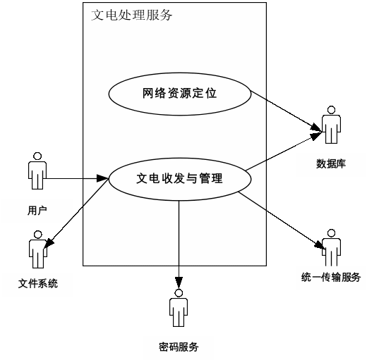
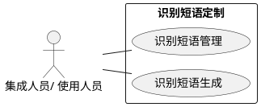
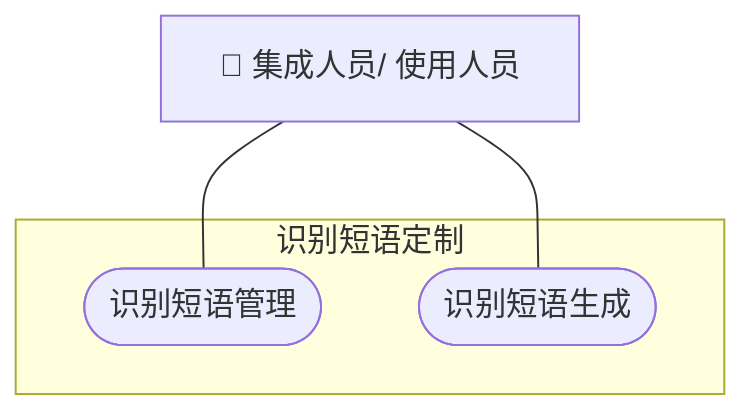
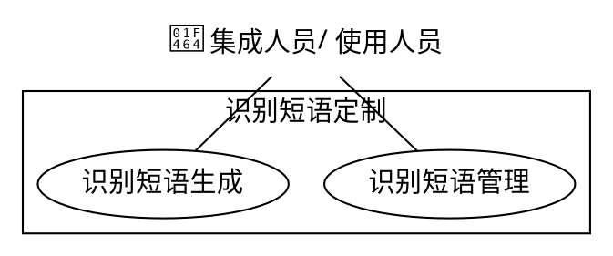

# 1_111 数据对档案

| 字段 | 值 |
|---|---|
| doc | 11语音综合处理软件需求规格说明-终稿 |
| section | 3.2 |
| image_caption | 图14 识别短语定制功能用例图 |
| table_caption | 表12 识别短语定制能力标识 |

## 原始图片

*图14 识别短语定制功能用例图*

## 结构图

*来源: born-digital导出(usecase, 4节点/2边)*
*类型经几何启发式精化(Master类型识别失败的图, 投影层推断, canonical锚点不变)*

*用例图以PlantUML渲染(UML母语): 小人=参与者 | 椭圆=用例 | 矩形框=系统边界 | 实线=关联 | 虚线=include/extend*

Mermaid兼容投影(通用md渲染器可显示)

DOT源码(完整语义, graphviz可渲染)

### 锚点节点结构

| # | 文本 | 类型 |
|---|---|---|
| 1 | 识别短语定制 | boundary |
| 2 | 识别短语管理 | usecase |
| 3 | 识别短语生成 | usecase |
| 4 | 集成人员/
使用人员 | actor |

## 表格内容

| 序号 | Use case名称 | 项目唯一标识符 | 需求描述 | 需求重用 | 方式名称 | 运行状态 | 对应的任务书功能/性能 |
|---|---|---|---|---|---|---|---|
| 1 | 识别短语管理 | PZXQ-GN-YYZHCL-YYSB- | 提供识别短语的管理功能，支持用户按照需求 | 新研 | 桌面 | 集成阶段、运行阶段 | 4.1.3a) |
| 2 | 识别短语生成 | PZXQ-GN-YYZHCL-YYSB- | 依据语法规则构建用于语言解码的BNF文件 | 新研 | 桌面 | 集成阶段、运行阶段 | 4.1.3b) |

## 正文

识别短语定制的主要功能包括：识别短语管理、识别短语生成，功能用例如图14所示。
